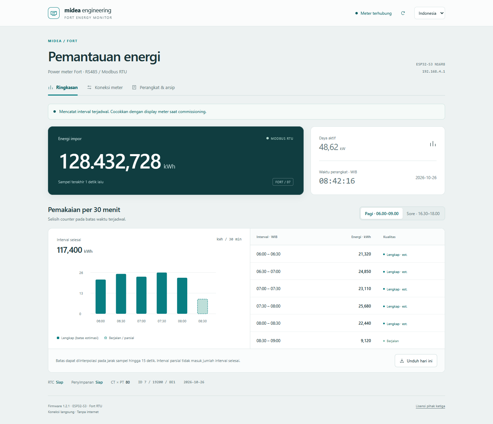
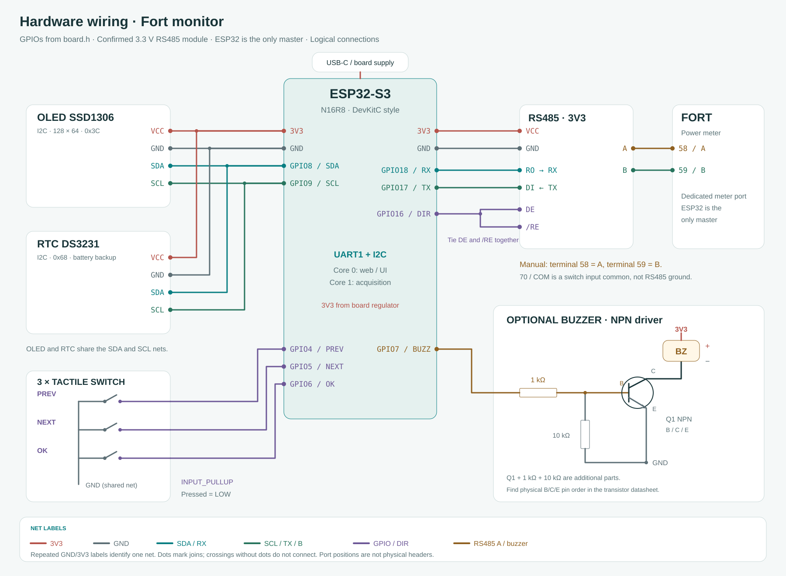
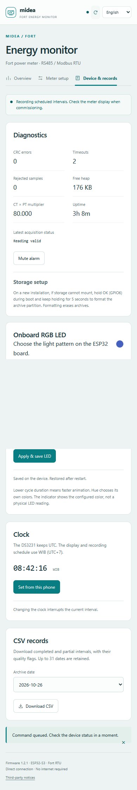
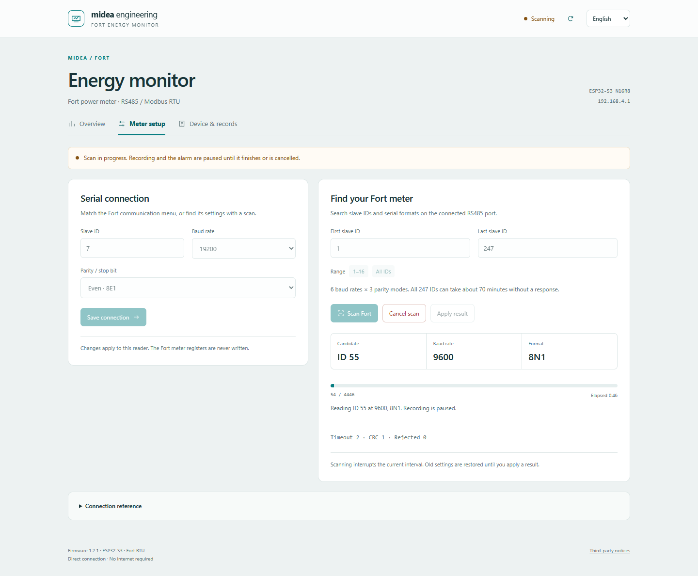
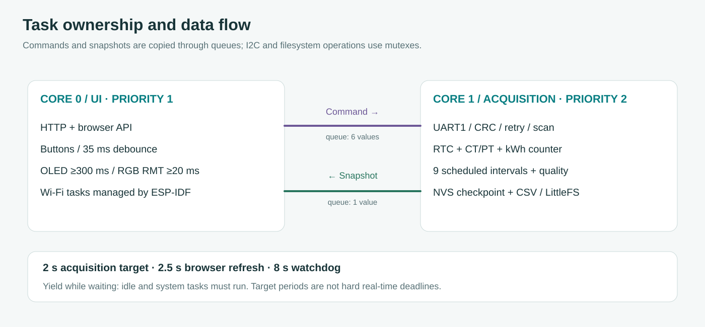

# Fort Modbus Energy Monitor

[English](README.md) · **Bahasa Indonesia**

  

Pembaca energi untuk power meter Fort existing di Midea, menggunakan ESP32-S3 N16R8. Perangkat membaca kWh impor melalui Modbus RTU, mencatat interval setengah jam terjadwal, dan menyediakan dashboard melalui hotspot ESP32. ESP32 menjadi satu-satunya master pada port RS485 Fort tersebut.

Dashboard memakai **React dan komponen React Bits asli**, dibundel lokal. Bahasa awal English; pilih **Indonesia** untuk menerjemahkan seluruh antarmuka. Tidak membutuhkan internet saat dipakai di meter. Firmware baru tetap perlu diuji pada Fort fisik; hasil compile atau simulasi browser bukan bukti ketelitian pengukuran. Lihat [hasil validasi](docs/id/VALIDATION.md).

## Isi panduan

1. [Sambungan hardware](#1-sambungan-hardware)
2. [Build dan upload](#2-build-dan-upload)
3. [Menyalakan pertama kali](#3-menyalakan-pertama-kali)
4. [Scan Fort](#scan-fort)
5. [Perhitungan dan kualitas interval](#4-perhitungan-dan-kualitas-interval)
6. [RTOS dan scheduling](#5-rtos-dan-scheduling)
7. [UART dan kontrol RS485](#6-uart-dan-kontrol-rs485)
8. [Build dashboard React](#7-build-dashboard-react)
9. [Pengujian dan pemeliharaan](#8-pengujian-dan-pemeliharaan)

## Dashboard



Angka pada gambar berasal dari API simulasi. Grafik memakai nilai interval yang sama dengan tabel, bukan tren beban buatan. Nilai yang belum tersedia tetap kosong. [Tampilan HP](docs/assets/ui-mobile-id.png) · [Kontrol scan](docs/assets/ui-scan-desktop.png).

## 1. Sambungan hardware

Ikuti tulisan **GPIO** pada board, bukan nomor urut kaki header. Cabut USB saat memasang kabel tegangan rendah. Modul RS485 yang dibeli sudah dikonfirmasi kompatibel dengan TTL ESP32 3,3 V.

| Pin modul | Sambungkan ke | Fungsi |
| --- | --- | --- |
| OLED VCC / GND | 3V3 / GND | SSD1306 128×64, alamat I2C 0x3C |
| OLED SDA / SCL | GPIO8 / GPIO9 | I2C bersama RTC |
| DS3231 VCC / GND | 3V3 / GND | Alamat I2C 0x68 |
| DS3231 SDA / SCL | GPIO8 / GPIO9 | Cabang pada jalur yang sama dengan OLED |
| RS485 VCC / GND | 3V3 / GND | Suplai dan ground logika |
| RS485 RO | GPIO18 / UART1 RX | Output modul → input ESP32 |
| RS485 DI | GPIO17 / UART1 TX | Output ESP32 → input modul |
| RS485 DE dan /RE | Keduanya ke GPIO16 | HIGH kirim, LOW terima |
| RS485 A / B | Fort 58/A / 59/B | Terminal komunikasi meter |
| PREV / NEXT / OK | GPIO4 / GPIO5 / GPIO6; kontak lain ke GND | Internal pull-up, aktif LOW |
| Buzzer, opsional | GPIO7 melalui driver | Aktif HIGH; boleh belum dipasang |

SQW dan 32K DS3231 tidak dipakai. OLED dan RTC masing-masing memakai empat kabel, dengan SDA/SCL bercabang ke GPIO8/9 yang sama. Semua GND modul menuju GND ESP32. **70/COM Fort adalah common switch input, bukan ground RS485.** Sumber pin ada di [board.h](firmware/include/board.h).

<details>
<summary>Diagram lengkap, termasuk tombol dan driver buzzer opsional</summary>



Diagram memakai label English untuk konsistensi teknis. Posisi port bersifat logis, bukan foto board. Label 3V3/GND yang sama adalah satu net; persilangan tanpa titik tidak tersambung. Driver buzzer membutuhkan tambahan NPN, resistor basis 1 kΩ dan pull-down 10 kΩ. Susunan kaki fisik B/C/E mengikuti datasheet transistor.

</details>

[Tutorial pemasangan per kabel](docs/id/WIRING.md) membahas kontak tactile, baterai RTC, buzzer opsional dan [netlist 31 sambungan](docs/wiring-netlist.csv).

## 2. Build dan upload

Buka direktori **firmware** di VS Code/PlatformIO karena `platformio.ini` berada di sana. Tutup Serial Monitor sebelum upload.

```powershell
cd firmware
pio run -e esp32s3
pio run -e esp32s3 --target upload --upload-port COM10
pio device monitor -e esp32s3 --port COM10
```

Ganti COM10 sesuai port board. Jika `pio` tidak ada di PATH, pakai `& "$env:USERPROFILE\.platformio\penv\Scripts\platformio.exe"`. Melalui VS Code: **Project Tasks → esp32s3 → General → Upload**. Satu-satunya target yang didukung adalah `esp32s3`, memakai flash 16 MB dan PSRAM OPI untuk N16R8.

Aset browser hasil build ikut disimpan bersama source firmware. Build PlatformIO biasa memeriksa hash aset dan **tidak memerlukan Node/npm**. Node diperlukan saat mengubah source web, dijelaskan pada [bagian 7](#7-build-dashboard-react).

| Dependency | Versi terkunci | Peran |
| --- | --- | --- |
| PlatformIO Core | 6.1.16 | Tool build/development |
| Espressif32 / Arduino ESP32 | 6.10.0 / 2.0.17 | Toolchain dan runtime perangkat |
| SSD1306 / GFX / BusIO | 2.5.13 / 1.11.11 / 1.17.0 | Driver OLED/I2C |
| RTClib | 2.1.4 | Kalender dan konversi UTC; transaksi RTC diperiksa firmware |
| ArduinoJson | 7.3.1 | JSON API |
| Node.js (build web saja) | 24.22.1 | Runtime build web reproducible |
| React / React DOM | 19.3.1 | Aplikasi browser |
| GSAP | 3.15.0 | Transisi React Bits |
| esbuild / Playwright | 0.28.2 / 1.62.1 | Build web dan tes browser |

PlatformIO memasang dependency firmware otomatis. Versi dikunci pada [platformio.ini](firmware/platformio.ini), [package.json](package.json) dan lockfile. Untuk flash BIN langsung, ikuti [FLASHING](docs/id/FLASHING.md): app-only dan factory mempunyai offset berbeda.

## 3. Menyalakan pertama kali

1. Nyalakan ESP32. Startup tidak menunggu Serial USB. Animasi OLED dan pola buzzer berlangsung sekitar 1,5 detik; tanpa OLED pun perangkat tetap boot.
2. Hubungkan HP ke **Midea Engineering AP**, password **betahdijre12345**. Tetap di jaringan ini walau muncul pesan tanpa internet. Buka **http://192.168.4.1**.
3. Pastikan footer menunjukkan **Firmware 1.2.1**. Pilihan **Indonesia** di kanan atas disimpan pada browser, bukan pada meter.
4. Pada pemasangan baru, LittleFS bisa belum berformat valid. Jika mount gagal, tahan **OK / GPIO6** saat boot dan terus tahan lima detik. Tindakan ini memformat partisi arsip dan menghapus arsip. Tidak ada format otomatis saat gagal mount.
5. Buka **Perangkat & arsip → Atur dari HP ini** untuk mengatur RTC. DS3231 menyimpan UTC; layar dan interval memakai WIB. Jam HP harus benar.
6. Buka **Koneksi meter**. Masukkan setting Fort atau jalankan scan. Default pembaca adalah ID 1, 9600, 8N1; manual dari box tidak membuktikan slave ID unit yang sedang terpasang.

### Kontrol lokal

### Posisi OLED dan LED RGB bawaan

Seluruh layar OLED diputar **180° secara default**, termasuk animasi boot dan pesan pemulihan storage. Ubah `OLED_ROTATE_180 = false` di [board.h](firmware/include/board.h), lalu build/upload untuk orientasi normal. `oled.setRotation(2)` diterapkan sekali sebelum gambar pertama. Ilustrasi menunjukkan tampilan yang terbaca setelah pemasangan.

Buka **Perangkat & arsip → LED RGB bawaan**. Pilih **Mati**, **Warna tetap**, **Putaran hue**, **Kedip**, atau **Breathing**. Atur kecerahan **0–255**, warna, dan satu siklus **0,5–30 detik**, lalu tekan **Terapkan & simpan LED**. Siklus lebih pendek berarti lebih cepat. Warna dipakai oleh warna tetap/kedip/breathing; hue memilih warna sendiri. Menggeser slider belum mengirim perintah. Status berubah setelah task akuisisi memprosesnya. Jika ada peringatan penyimpanan, pengaturan belum dapat diandalkan setelah restart.

Default: Hue, brightness **128/255**, siklus **8 detik**, **GPIO38** sesuai board pemasangan ini. Variabel master `RGB_LED_ENABLED`, `RGB_LED_PIN`, `RGB_LED_DEFAULT_BRIGHTNESS`, dan `RGB_LED_DEFAULT_PERIOD_MS` ada di [board.h](firmware/include/board.h). Pengaturan web tersimpan mengalahkan default brightness/periode. Saat animasi boot, default compile digunakan sampai core 1 memulihkan record NVS. Jika mengganti default pada board yang sudah punya pengaturan tersimpan, terapkan nilai yang sama melalui web juga.

Firmware memilih GPIO38 secara eksplisit; alias LED builtin variant framework menunjuk GPIO48 sehingga tidak dipakai driver ini. [Panduan Espressif DevKitC v1.1](https://docs.espressif.com/projects/esp-dev-kits/en/latest/esp32s3/esp32-s3-devkitc-1/user_guide_v1.1.html) menyebut GPIO38 pada revisi tersebut. DevKitC versi awal menggunakan GPIO48; ganti `RGB_LED_PIN` ke 48 hanya jika board fisiknya memang memerlukan. LED bawaan tidak perlu kabel tambahan. Driver ini untuk pixel addressable **RGB tiga kanal**, tanpa kanal putih terpisah RGBW. Status diterapkan adalah konfirmasi konfigurasi, bukan sensor cahaya.



PREV/NEXT berpindah di antara halaman utama, pagi, sore, AP dan diagnostik OLED ([referensi layar](docs/assets/oled-pages.svg)). Tombol memakai pull-up internal dengan debounce stabil 35 ms.

| Kontrol | Aksi |
| --- | --- |
| OK singkat di halaman interval | Pilih interval berikut pada shift tersebut |
| OK singkat di halaman AP | Tampilkan/sembunyikan password |
| OK singkat di halaman lain | Toggle mute alarm |
| OK ditahan 900 ms setelah debounce | Toggle mute sekali; melepas tombol tidak menambah aksi singkat |
| OK ditahan lima detik saat boot, hanya jika mount gagal | Format partisi arsip |

Buzzer aktif opsional memakai pola startup sekitar 1,5 detik, kemudian alarm singkat berkala untuk RTC invalid, meter offline atau storage bermasalah. Alarm ditunda selama scan. Buzzer yang belum dipasang tidak menghentikan operasi.

## Scan Fort



Coba **1–16** dahulu. Jika belum ditemukan, pilih **Semua ID** untuk **1–247**. Jika ID sudah diketahui, isi awal dan akhir dengan ID yang sama. ID pembaca saat ini diperiksa dengan seluruh 18 format serial terlebih dahulu jika termasuk rentang, kemudian kombinasi ID lain dicoba tanpa pengulangan.

Scan mencakup baud 1200, 2400, 4800, 9600, 19200, 38400 dan parity N/E/O dengan satu stop bit. Rentang penuh memiliki **4.446 kandidat**, sehingga tanpa respons bisa memerlukan sekitar **70 menit**. Kandidat harus memberi respons fungsi 03 yang valid pada register energi dan CT/PT: CRC, ID, panjang, fungsi serta rentang rasio diperiksa. Ini menunjukkan kompatibilitas protokol, bukan autentikasi model meter.

Klik **Terapkan hasil** untuk menyimpan setting pembaca ke NVS. Menemukan hasil saja tidak mengganti konfigurasi aktif. **Batalkan scan** diproses antarkandidat; satu kandidat maksimal dua jendela respons 800 ms. Menutup browser tidak membatalkan scan dan reload mengambil progres kembali dari perangkat. Hasil di RAM hilang setelah reboot.

Selama scan, polling normal dijeda, kontinuitas interval diputus, dan alarm ditunda. Saat selesai/batal/tidak ditemukan, setting UART lama dipulihkan sampai hasil diterapkan. Sebaiknya lakukan scan di luar jam pencatatan produksi. [Commissioning](docs/id/COMMISSIONING.md) mencakup pengujian batal, reboot, meter offline dan kualitas data.

## 4. Perhitungan dan kualitas interval

Alamat berikut adalah **alamat PDU hexadecimal zero-based**, tanpa tambahan 40001:

| Alamat | Word | Isi | Konversi |
| --- | --- | --- | --- |
| 0x002C–0x002E | 3 | PT numerator, PT denominator, CT multiplier | ratio = numerator / denominator × CT |
| 0x0082–0x0083 | 2 | Energi impor sekunder, unsigned big-endian 32-bit | kWh primer = raw × 0,001 × ratio |
| 0x006A–0x006B | 2 | Daya aktif total, signed big-endian 32-bit | kW primer = raw × 0,0001 × ratio |

Skala CT/PT diterapkan sekali. Counter integer sekunder menghindari pengurangan dua float32 primer besar yang kehilangan resolusi. Aritmetika energi memakai `double`; resolusi nyata adalah **0,001 × ratio kWh**, bukan jumlah digit desimal layar.

| Pagi / WIB | Sore / WIB |
| --- | --- |
| 06.00–06.30 | 16.30–17.00 |
| 06.30–07.00 | 17.00–17.30 |
| 07.00–07.30 | 17.30–18.00 |
| 07.30–08.00 | |
| 08.00–08.30 | |
| 08.30–09.00 | |

Energi interval = counter akhir − awal. Bila batas terletak di antara dua sampel kontinu yang berjarak maksimal 15 detik, counter batas diinterpolasi linear. Karena itu hasil lengkap memakai kode `complete_estimated`. Gap, startup terlambat, scan, reboot, perubahan waktu dan penurunan counter memutus kontinuitas. Interval parsial atau hilang tidak diganti nol; interval yang sudah selesai tetap dipertahankan.

RTC diperiksa lewat ACK, jumlah byte, BCD, kalender, mode 24 jam dan oscillator-stop flag. Pembacaan energi diapit dua timestamp RTC; jendela lebih dari dua detik atau transaksi lebih dari 2,5 detik tidak dipakai untuk interval. Pemeriksaan lonjakan memakai batas awal 100 MW yang harus disesuaikan kapasitas instalasi.

CSV menyimpan penanda kualitas dengan retensi 31 tanggal. Versi 1.2 memakai kode shift/kualitas English; CSV lama tidak diubah. API mempertahankan `quality` lama dan menambah `quality_code` serta `error_code` English. Referensi manual dan contoh CRC cetak yang salah ada di [DESIGN](docs/id/DESIGN.md).

## 5. RTOS dan scheduling



| Konteks | Core / prioritas | Kepemilikan |
| --- | --- | --- |
| Task loop Arduino | Core 0 / prioritas 1 | HTTP sinkron, debounce tombol, OLED, buzzer, RGB/RMT |
| `fort-acquisition` | Core 1 / prioritas 2, stack 12.288 byte | UART1, Preferences/NVS, tracker, CT/PT, RTC, penulisan arsip, scan |
| Task sistem ESP-IDF | Dikelola framework | Wi-Fi, TCP/IP dan layanan sistem; tidak dipin aplikasi ini |

UI mengirim `Command` melalui **queue enam item**, tanpa menunggu slot kosong. Queue penuh menghasilkan HTTP 503. Akuisisi menimpa **queue snapshot satu item** lewat `xQueueOverwrite`; UI membaca salinannya memakai `xQueuePeek`. UI tidak mengubah tracker hidup dan tidak memegang pointer ke `Day` yang sedang dimutasi.

Mutex I2C mencegah transaksi RTC dan OLED menyisip. Mutex filesystem melindungi penggantian arsip dan ekspor. HTTP menyalin CSV di bawah 8 KiB lalu melepas mutex sebelum transfer ke klien. UART dan Preferences hanya diakses task akuisisi, sehingga tidak memerlukan mutex lintas task.

| Operasi | Aturan waktu |
| --- | --- |
| Poll energi/daya | Target dua detik; retry bisa memperpanjang |
| Refresh CT/PT | 60 detik, jeda percobaan minimal lima detik; dibatalkan jika kegagalan berkepanjangan |
| Loop akuisisi | Yield 100 ms normal, 10 ms antarkandidat scan |
| Menunggu UART | Yield satu tick FreeRTOS selama belum ada respons |
| OLED | Minimal 300 ms antarpenggambaran, dilewati jika mutex tidak didapat |
| Status browser | 2,5 detik, timeout request empat detik |
| Checkpoint/arsip | Saat perubahan status/hari/setting dan paling lambat setiap lima menit |
| Watchdog | Delapan detik; di-feed pada loop UI, percobaan UART dan tiap potongan aset |

Ini **target kooperatif, bukan jaminan hard real-time**. Klien aset yang lambat dapat memakai task UI sinkron hingga deadline transfer lima detik; akuisisi di core 1 tetap berjalan. Delay memberi waktu untuk idle/task sistem. Memaksakan utilisasi CPU penuh tidak memperbaiki sampling. Urutan task dan batas mutex dijelaskan pada [desain teknis](docs/DESIGN.md#task-and-lock-model).

## 6. UART dan kontrol RS485


Request delapan byte: ID, fungsi 03, alamat high/low, jumlah word high/low, CRC low/high. CRC16 mulai dari 0xFFFF, shift LSB-first dengan polynomial 0xA001, mencakup enam byte awal. Respons diperiksa ID, fungsi, byte count, total panjang, CRC dan exception 0x83.

Urutan transaksi: buang maksimal 128 byte RX lama → tunggu minimal t3.5 → GPIO16 HIGH → delay 30 µs → `UART.write` → `UART.flush` → GPIO16 LOW → kumpulkan respons. Deadline respons 800 ms dimulai setelah TX flush. Polling normal maksimal tiga percobaan dengan backoff; scan satu percobaan per register.

**UART dan I2C tidak memakai bit banging.** `HardwareSerial(1)` memakai UART1, sedangkan `Wire` memakai peripheral I2C hardware pada 100 kHz. GPIO16 hanya memilih arah transceiver, bukan membangkitkan bit serial. CPU membentuk frame, menghitung CRC, parsing, memperbarui tracker dan menggambar buffer OLED. Driver RX 128 byte; buffer frame 16 byte untuk respons yang dipakai maksimal 11 byte. Timestamp diambil saat buffer UART dibaca, sehingga t1.5 per byte tidak diklaim presisi.

## 7. Build dashboard React

Source ada di [web/](web/). React DOM dan GSAP dieksekusi di **browser HP**, bukan di ESP32. ESP32 melayani byte gzip dari flash dan JSON API. CSS, ikon, dua bahasa dan notice dependency tersedia lokal; tidak ada CDN/font eksternal atau upload filesystem terpisah untuk dashboard.

Gunakan **Node 24.22.1**, sesuai `.node-version`, untuk build web:

```sh
npm ci
npm run build:web
npm run check:web
```

Build menghasilkan [web_ui.h](firmware/include/web_ui.h) dan [manifest](web/bundle.json) berisi hash input, ukuran aset dan versi dependency. Batas build **160 KiB gzip**. Aset dikirim ke lwIP dalam potongan maksimal 1 KiB dengan yield dan feed watchdog; bundle JS tidak disalin utuh ke `String` Arduino.

React Bits `FadeContent` dan `SpotlightCard` dikunci pada commit `e12c22192ac7b4b452c5e2feb9b586d74765d696`. Reveal halaman mengikuti reduced motion; panel energi memakai cahaya pointer/fokus tanpa animasi ambient terus-menerus. Angka meter langsung ditampilkan, tidak dianimasikan melewati nilai palsu. [Provenance dan lisensi komponen](web/vendor/react-bits/README.md).

Setelah mengubah source web, rebuild aset sebelum PlatformIO. `tools/pio_web.py` menolak aset lama agar compile firmware tidak diam-diam membawa UI sebelumnya. Ukuran aktual tercatat pada [VALIDATION](docs/id/VALIDATION.md).

## 8. Pengujian dan pemeliharaan

```powershell
.\tools\test.ps1
python tools/check_docs.py
npm run test:ui
```

Untuk Linux/macOS, perintah g++ ada pada [panduan kontribusi](CONTRIBUTING.id.md). Pasang browser dengan `npx playwright install chromium`, atau pakai Edge: `node tools/preview-test.cjs playwright msedge`.

Tes mencakup CRC/frame, sembilan interval, batas waktu/gap, pemulihan reboot, debounce, scan dan kegagalan filesystem. Tes browser melayani **array gzip firmware**, memeriksa dua bahasa, error jaringan dan layout HP/desktop. Tes ini tidak menjalankan transceiver UART, Fort fisik, baterai RTC atau power-cut flash; ikuti [commissioning](docs/id/COMMISSIONING.md).

Struktur: `firmware/` kode perangkat; `web/` source browser; `tools/` build/tes; `docs/` panduan English; `docs/id/` panduan Indonesia. Baca [AGENTS.md](AGENTS.md), [CONTRIBUTING](CONTRIBUTING.id.md) dan [CHANGELOG](CHANGELOG.id.md) sebelum perubahan kepemilikan peripheral atau register.

Kode dan dokumentasi orisinal memakai **GPL-3.0-only**. React Bits, React, GSAP, library firmware dan manual Fort tetap memakai ketentuan masing-masing; tidak dilisensikan ulang oleh repo ini. Lihat [LICENSE](LICENSE), [NOTICE](NOTICE) dan notice dependency di dashboard offline.
