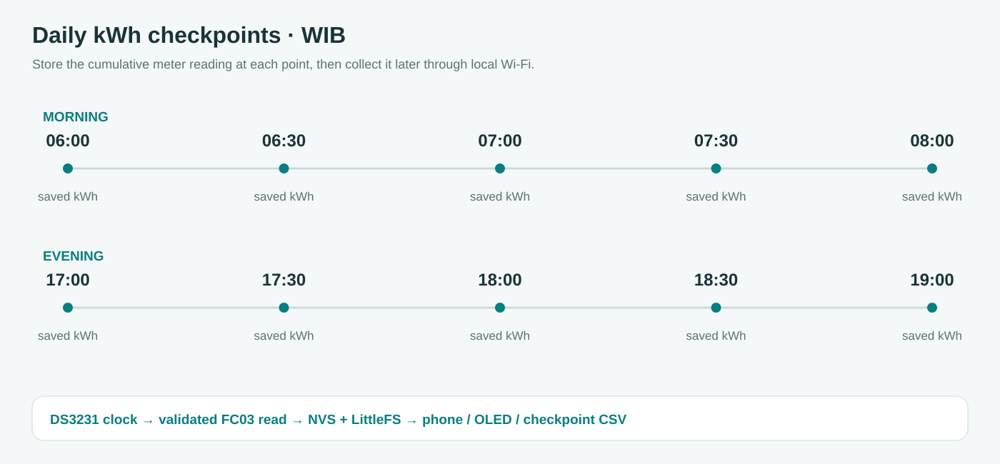
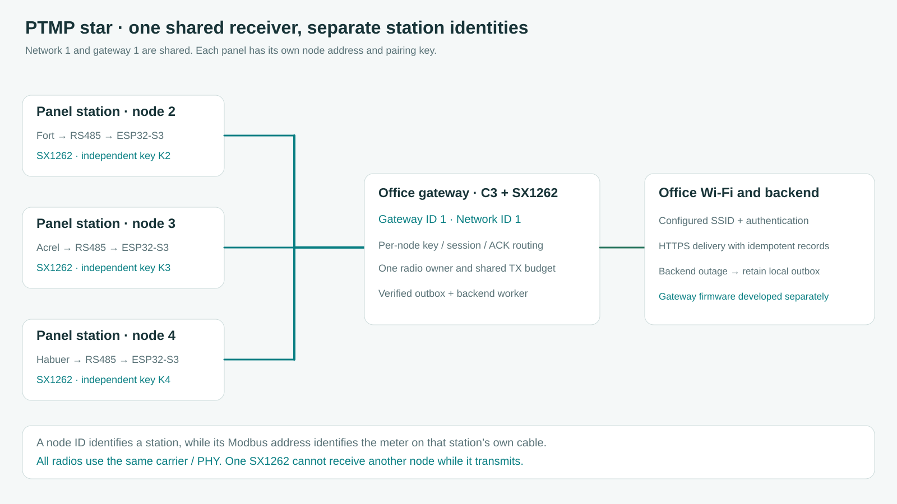
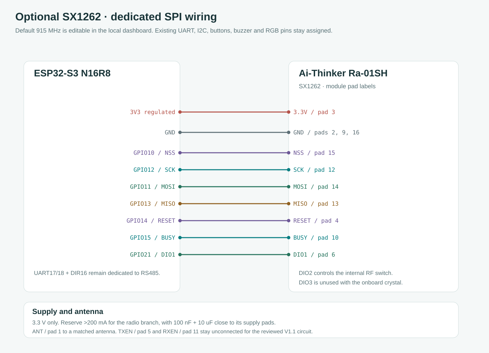
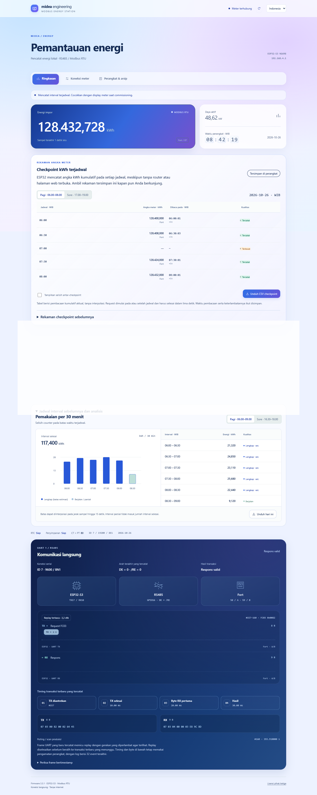
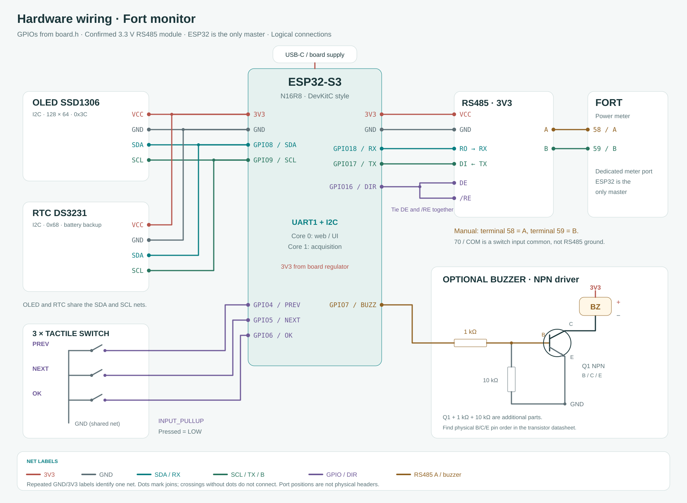
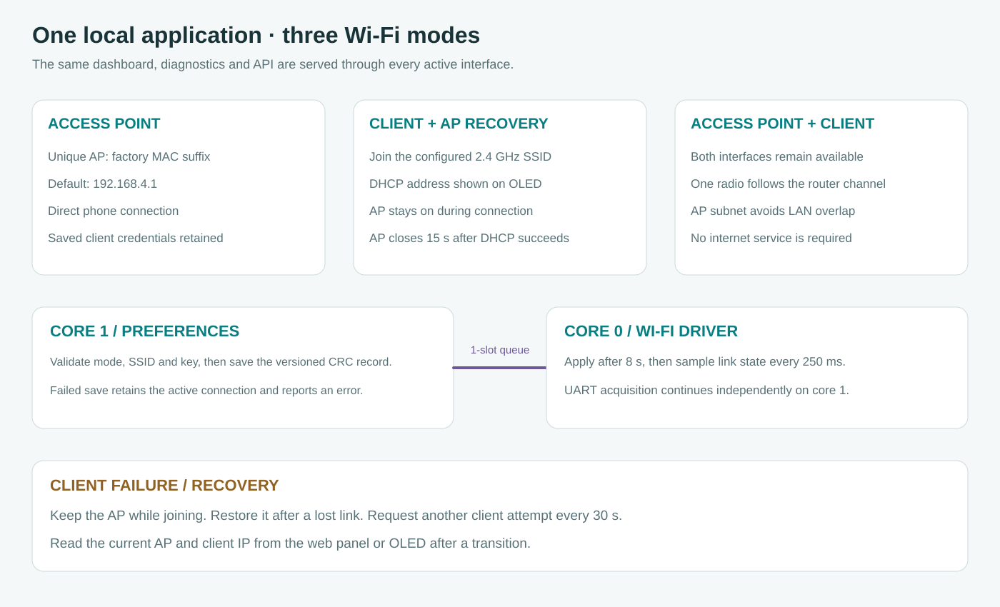
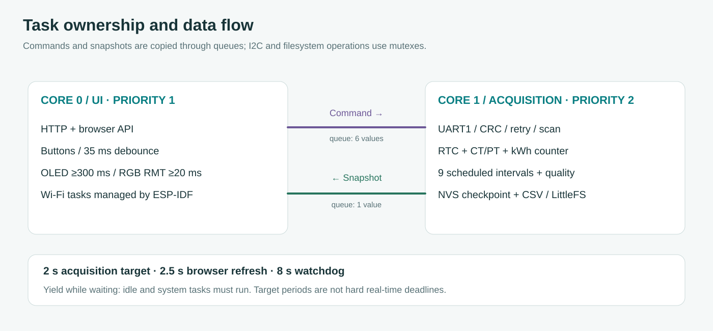
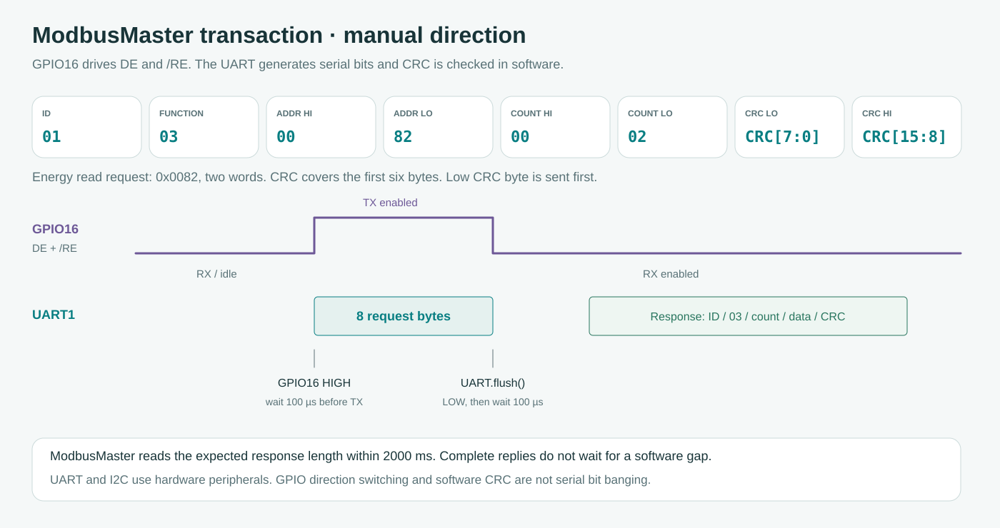

# Modbus Energy Station

[English](README.md) · **Bahasa Indonesia**

       

Untuk pemasangan banyak unit, baca [kesiapan perangkat](docs/id/FLEET_READINESS.md). Station baru harus menyimpan profil meter sebelum merekam.

Atur Wi-Fi (termasuk Enterprise) dan LoRa lewat panel lokal. Panduan: [Wi-Fi Enterprise](docs/id/ENTERPRISE_WIFI.md) dan [LoRa](docs/id/LORA.md).

ESP32-S3 N16R8 membaca meter Fort, Habuer, Acrel dan Schneider PM5100 lewat RS485, lalu menyimpan sepuluh checkpoint kWh setiap hari memakai RTC DS3231. Data tetap ada tanpa Wi-Fi; dashboard dipakai untuk pengaturan, diagnosis dan ekspor.

Jadwal checkpoint harian (WIB): **06.00, 06.30, 07.00, 07.30, 08.00; 17.00, 17.30, 18.00, 18.30, 19.00**. Waktu baca aktual disimpan. Checkpoint yang terlewat tidak diisi pembacaan setelahnya. [Detail checkpoint](docs/id/CHECKPOINTS.md).



Wi-Fi Enterprise mendukung PEAP/MSCHAPv2. Pilih SSID, isi kredensial, lalu gunakan CA publik bawaan atau unggah CA privat. Pemeriksaan sertifikat tetap aktif. [Panduan Wi-Fi Enterprise](docs/id/ENTERPRISE_WIFI.md).


Pada **terminal komputer di root repo**, jalankan `python tools/setup-core.py` sekali lalu buka ulang terminal PlatformIO. Langkah ini memasang Core terkelola yang dipin untuk build turunan SDK.

ADL400 mengikuti hasil scan: total energi 0x0000, UInt32 / 100 × PT × CT dan float listrik ABCD. Pilihan ADL400 tetap satu tanpa submenu sumber energi. [ADL400](docs/id/ADL400_FIX.md).

Pengiriman data IoT ke website Energy Record melalui HTTPS tersedia sebagai **fitur pengembangan opsional yang nonaktif secara default**. Lihat [panduan HTTPS uplink](docs/IOT_HTTPS.md); fitur ini tidak mengubah jalur Modbus, RTC, dan LoRa.

## Listrik terputus dan LoRa opsional

Data disimpan dengan verifikasi NVS/berkas dan pemulihan staging. Konfigurasi meter yang rusak menghentikan pencatatan, bukan mengganti profil secara diam-diam. [Batas pemulihan saat listrik mati](docs/id/POWER_LOSS.md).

LoRa nonaktif secara default. Atur ID node/gateway, parameter RF dan key bersama melalui panel. Gateway ESP32-C3 memakai firmware terpisah. [Wiring dan pengaturan SX1262](docs/id/LORA.md) · [Protokol radio](docs/id/LORA_PROTOCOL.md).

Untuk beberapa node, setiap Node ID harus unik; Gateway ID dan Network ID disamakan. [Pengaturan PTMP](docs/id/LORA_PTMP.md) · [Pengembangan gateway](docs/id/GATEWAY_PROMPT.md).






## Profil meter

Pilih **Fort**, **Habuer**, **Acrel ADL400**, **Acrel ACR10R-DxxTE** atau **Acrel APM800/801/810** melalui **Meter setup → Model meter**, lalu simpan sebelum menjalankan scan. Pilihan ini mengatur register, dekode rasio trafo, diagnostik dan probe awal. Fort tetap menjadi default setelah upgrade instalasi lama, sedangkan checkpoint yang sudah tercatat tetap menyimpan identitas model asalnya.

ADL400 memakai energi total `0x0000` (UInt32 ABCD, `/100 × PT × CT` sekali). Register forward `0x000A` hanya untuk arsip historis. Terminal RS485 Acrel **21/A1, 22/B1**; Fort **58/A, 59/B**. [Profil meter](docs/id/METER_PROFILES.md) · [Wiring Acrel](docs/assets/wiring-acrel-adl400.svg).

Habuer mengikuti [sketch referensi yang berhasil diuji pengguna](docs/id/HABUER.md), dengan pembacaan terpisah untuk PF, frekuensi, kWh aktif kumulatif dan kvarh reaktif. Total aktif dibaca pada `0x0034`, dua word dibagi 10, tanpa pengali trafo tambahan. Panduan tersebut menjelaskan urutan pembacaan dan [wiring Habuer lengkap](docs/assets/wiring-habuer.svg).

Acrel ACR10R-DxxTE dan APM800/801/810 juga tersedia. Kedua profil memerlukan binding perangkat tersimpan yang sudah dicocokkan dengan LCD sebelum pencatatan karena manual ACR tidak menjelaskan unit/urutan energi, sedangkan manual APM berbeda antara tabel dan contoh. [Setup dan detail register](docs/id/ACREL_ACR_APM.md).

## Pencarian meter dan record bernama

Di **Meter setup → Pencarian meter dan perangkat tersimpan**, jalankan probe FC03, periksa hasilnya, lalu simpan. Maksimal empat perangkat bernama tetap tersimpan setelah reboot. Model yang belum diverifikasi hanya untuk diagnosis. [Prosedur discovery](docs/id/METER_DISCOVERY.md).

## Dashboard



Dashboard disajikan langsung oleh ESP32 dan tidak memerlukan internet. Bahasa dapat diganti di header. Gambar screenshot memakai data simulasi, bukan hasil pengukuran lapangan.

## 1. Sambungan hardware

Instalasi yang dikonfirmasi sekarang memakai **transceiver manual**. GPIO16 terhubung ke DE dan /RE yang disatukan, sehingga HIGH mengaktifkan driver sekaligus mematikan receiver, lalu LOW melepas bus dan mengaktifkan penerimaan. DI/RO merupakan sisi TTL modul, sedangkan A/B merupakan pasangan diferensial menuju meter.

| Koneksi ESP32 | Tujuan | Fungsi |
| --- | --- | --- |
| GPIO17 / TX UART1 | DI RS485 | Byte request dari ESP32 |
| GPIO18 / RX UART1 | RO RS485 | Byte respons ke ESP32 |
| GPIO16 | DE dan /RE disatukan | Kontrol arah manual |
| 3V3 dan GND | VCC/GND transceiver kompatibel | Catu rangkaian tegangan rendah |
| GPIO8 / SDA | SDA OLED dan DS3231 | Data I2C bersama |
| GPIO9 / SCL | SCL OLED dan DS3231 | Clock I2C bersama |
| 3V3 dan GND | VCC/GND OLED dan RTC | Catu bersama |
| GPIO4, GPIO5, GPIO6 | PREV, NEXT, OK ke GND | Pull-up internal, ditekan berarti LOW |
| GPIO7 | Input driver buzzer opsional | Pola buzzer aktif |
| GPIO48 | LED RGB bawaan | Tanpa kabel tambahan |

Hubungkan **A modul ke terminal Fort 58/A** dan **B ke terminal 59/B**. Terminal 70/COM merupakan common input sakelar meter, bukan ground RS485. Port meter ini khusus untuk ESP32 sebagai satu-satunya master.



Diagram menunjukkan net listrik, bukan urutan header fisik. Label 3V3/GND berulang menunjuk net yang sama, titik menandai sambungan, dan persilangan tanpa titik tidak tersambung. Driver buzzer dua kabel memakai NPN, resistor basis 1 kΩ serta pull-down 10 kΩ sebagai komponen tambahan. Urutan B/C/E fisik harus mengikuti datasheet transistor yang dipakai.

[Modul arah otomatis](docs/assets/rs485-auto.svg) tetap tersedia sebagai alternatif eksplisit. Pilih Automatic pada Meter setup dan biarkan GPIO16 tidak terhubung jika memakai modul tersebut. Default konfigurasi baru serta migrasi v1 mengikuti instalasi manual yang telah dikonfirmasi.

## 2. Build dan upload

Buka direktori **`firmware/`** pada PlatformIO karena `platformio.ini` berada di sana, lalu tutup Serial Monitor yang sedang memegang port upload. Jalankan perintah berikut pada terminal komputer yang sudah berada di `firmware/`:

```sh
pio run -e esp32s3
pio run -e esp32s3 -t upload
pio device monitor -e esp32s3
```

Build biasa memakai header web yang sudah disimpan dan tidak memerlukan Node. PlatformIO memasang dependency display/RTC/JSON yang dikunci serta menemukan library FortMeter lokal secara otomatis, termasuk source ModbusMaster yang sama dengan diagnostik mandiri. [FLASHING](docs/id/FLASHING.md) menjelaskan offset app/factory dan ZIP library untuk Arduino IDE.

| Komponen | Versi atau konfigurasi |
| --- | --- |
| PlatformIO Core | 6.1.19 |
| pioarduino / Arduino ESP32 | 55.03.311 / 3.3.11 |
| Memori target | Flash 16 MB, OPI PSRAM, ESP32-S3 N16R8 |
| RadioLib | 7.8.1, MIT, raw LoRa SX1262 |
| FortMeter / ModbusMaster | 3.5.0 / 2.0.1+fort.1, source lokal |
| Adafruit SSD1306 / GFX / BusIO | 2.5.13 / 1.11.11 / 1.17.0 |
| RTClib / ArduinoJson | 2.1.4 / 7.3.1 |
| React / React DOM / Motion | 19.3.1 / 19.3.1 / 14.7.1 |
| GSAP untuk referensi FadeContent | 3.15.0, tidak dimuat dalam bundle runtime saat ini |
| Node / esbuild / Playwright | 24.22.1 / 0.28.2 / 1.62.1 |

## 3. Menyalakan pertama kali

Hubungkan HP ke **Midea Engineering-XXXXXXXXXXXX** dengan password **betahdijre12345**, lalu buka **http://192.168.4.1**. Pastikan footer menunjukkan Firmware 3.5.0, pilih model yang dipasang, samakan slave ID/baud/parity dengan meter, dan pilih Manual direction. Probe kontak mengikuti model tersimpan: Fort `0x0058/2`, Acrel `0x0064/1`, atau Habuer `0x0030/2`, sebelum meminta parameter pengukurannya. Saat kontak gagal, pembacaan kembali ke retry terbatas setiap tiga detik.

Pada board baru, LittleFS mungkin belum memiliki filesystem yang dapat dipakai. Firmware tidak melakukan format otomatis: hanya sesudah mount gagal, tahan OK saat boot dan lanjutkan selama lima detik sesuai petunjuk OLED. Prosedur ini menghapus arsip CSV, sedangkan migrasi konfigurasi v1 tidak sengaja menghapus checkpoint hari atau interval lengkap yang sudah tersimpan.

### Mode AP dan client Wi-Fi

Pada **Perangkat & arsip → Koneksi Wi-Fi**, pilih AP, client dengan pemulihan AP, atau mode ganda. Pilih SSID hasil scan 2,4 GHz atau isi manual, lalu simpan. AP pemulihan tersedia bila koneksi client gagal. [Pengaturan Wi-Fi](docs/id/ENTERPRISE_WIFI.md).



### Diagnostik tanpa mengganti firmware

Buka **Meter setup → Diagnostic console**, ketik `intermediate` di **Command input**, lalu pilih **Run command** untuk menjalankan contoh arus pada manual. Masukkan `diagnose` secara terpisah bila memerlukan observasi RX pasif dan plan register yang lebih luas. Output memuat TX/RX mentah, status ModbusMaster dan word hasil baca. Nilai uji tidak masuk rekaman interval. Panduan [DIAGNOSTICS](docs/id/DIAGNOSTICS.md) menjelaskan alur serta cara menyimpan OUTPUT.

## Scan meter yang dipilih

Mulai dari format tersimpan dan ID yang diketahui atau rentang kecil. Probe mengikuti model tersimpan, dengan `0x0058/2` tetap menjadi default Fort. Kandidat dengan data atau exception ber-CRC sah diuji sekali lagi sebelum menjadi hasil. Apply result menyimpan setting pembaca, bukan register meter, serta belum membuktikan skala energi. Pencarian 247 ID dan 18 format mempunyai 4.446 kandidat dan dapat memerlukan sekitar tiga jam bila semuanya mencapai timeout dua detik.

### Posisi OLED dan LED RGB bawaan

`OLED_ROTATE_180` pada [board.h](firmware/include/board.h) memutar semua layar 180° sebelum frame pertama, termasuk boot dan pemulihan storage. LED RGB menggunakan GPIO48. Pola, warna, kecerahan dan periodenya dapat disimpan dari Perangkat & arsip. RMT asinkron pada core 0 mengirim data LED dan tidak menghasilkan waveform UART.

### Kontrol lokal

| Kontrol | Aksi |
| --- | --- |
| PREV / GPIO4 | Halaman OLED sebelumnya |
| NEXT / GPIO5 | Halaman berikutnya |
| OK / GPIO6, singkat | Lihat checkpoint tersimpan berikutnya atau buka opsi Network |
| OK ditahan 900 ms | Toggle mute alarm |
| OK ditahan saat boot ketika filesystem gagal | Konfirmasi format arsip lima detik |

Tombol memakai pull-up internal dan debounce stabil 35 ms, dengan satu event long-press per penahanan. Buzzer boot berbunyi sekitar 1,5 detik. Alarm setelah startup berupa pulsa 120 ms setiap sepuluh detik ketika waktu, storage atau pengukuran belum tersedia, serta dinonaktifkan selama scan atau maintenance yang disengaja.

## 4. Perhitungan dan kualitas interval

Pada Fort, counter sekunder `0x0082–0x0083` dibaca sebagai integer unsigned high-word-first dan dibagi 1000. Nilainya tetap tersedia saat validasi rasio gagal. Counter energi utama serta tracker interval menghitung `kWh_sekunder × (PT numerator / PT denominator) × CT`, dengan rasio pada `0x002C–0x002E`. CT/PT hanya diterapkan sekali dan kalkulasi kumulatif memakai `double`.

Acrel menggunakan skala sekunder dan layout PT/CT sendiri. Habuer memakai total meter tanpa pengali CT/PT tambahan, dan empat parameter referensi harus lolos sebelum snapshot baru diterima. Counter utama serta checkpoint hanya memakai energi aktif yang diterima. Energi reaktif tersedia sebagai telemetry langsung.

Float primer Fort `0x008A–0x008B` merupakan tampilan diagnostik terpisah. Perintah `primary` mencetak dua kandidat urutan word untuk dibandingkan dengan halaman Fort yang sesuai, tanpa memilih angka yang terlihat masuk akal secara otomatis. Ketidakselarasan kolom panjang energi pada scan manual tetap dicatat di [DESIGN](docs/id/DESIGN.md).

| Checkpoint pagi, WIB | Checkpoint sore, WIB |
| --- | --- |
| 06.00 | 17.00 |
| 06.30 | 17.30 |
| 07.00 | 18.00 |
| 07.30 | 18.30 |
| 08.00 | 19.00 |

Tabel menyimpan angka kumulatif meter. Selisih opsional dihitung dari dua checkpoint berurutan dalam shift yang sama dengan pemeriksaan konfigurasi serta kontinuitas. Nilai checkpoint mentah tidak diinterpolasi. Enam interval pagi dan tiga interval sore versi sebelumnya tetap tersedia melalui **Jadwal interval sebelumnya dan analisis**, dengan API ekspor serta arsip lama dipertahankan. [CHECKPOINTS](docs/id/CHECKPOINTS.md) menjelaskan perbedaan serta aturan capture/persistensinya.

## 5. RTOS dan scheduling



Core 1 memiliki UART1, kontrol arah, transaksi ModbusMaster, mutasi tracker dan Preferences. Core 0 menangani HTTP, OLED/tombol dan RGB. Kedua core bertukar perintah serta salinan snapshot melalui antrean RTOS, sementara I2C dan filesystem memakai mutex dengan waktu tunggu terbatas. Akuisisi menargetkan dua detik, pembacaan pembanding sekitar sepuluh detik, dan kontak gagal dicoba lagi setelah tiga detik. Periode ini memberi waktu ke scheduler dan bukan jaminan hard real-time.

Monitor proses mengambil sampel aktivitas non-idle pada tick FreeRTOS serta menampilkan heap/PSRAM, state task dan stack high-water. Persentase tersebut membantu pemeriksaan headroom, tetapi bukan profiler waktu instruksi. [Desain teknis](docs/id/DESIGN.md) menjelaskan pembatalan, revisi mode, urutan lock dan persistensi secara lebih rinci.

## 6. UART dan kontrol RS485



Transaksi membuang RX lama yang sudah berada di buffer, lalu preTransmission mengaktifkan DIR16 dan menunggu 100 µs. UART hardware mengirim request, `flush()` menunggu transmisi selesai, dan postTransmission melepas DIR16 serta menunggu 100 µs sebelum penerimaan. ModbusMaster menyelesaikan respons berdasarkan panjang yang diharapkan dalam timeout, tanpa menunggu detektor gap software lama. Jeda antarreques default 200 ms mengikuti sketch acuan yang berhasil.

Adapter merekam byte dan memeriksa ID, FC03, count yang diminta, panjang tepat serta CRC, termasuk CRC exception. Echo persis, byte tambahan dan input berlebih tidak menjadi data energi. UART dan I2C menggunakan peripheral hardware. Perubahan GPIO arah serta perhitungan CRC tidak melakukan serial bit banging. Source bersama dan patch ModbusMaster tersedia pada [library FortMeter](firmware/lib/FortMeter/src/FortTransport.h).

## 7. Build dashboard React

Sesudah mengubah `web/`, `package.json` atau lockfile, gunakan Node 24.22.1 dan jalankan **dari root repository**, yaitu folder yang memuat `package.json`:

```sh
npm ci
npm run build:web
npm run check:web
```

Simpan `firmware/include/web_ui.h` dan `web/bundle.json` bersama perubahan source sebelum compile firmware. Guard Python menolak input yang belum sinkron agar firmware tidak membawa dashboard lama. Payload gzip harus di bawah 160 KiB dan dikirim dalam potongan terbatas. Tidak diperlukan CDN, font eksternal atau upload filesystem web terpisah.

## 8. Pengujian dan pemeliharaan

`tools/test.ps1` menguji logika native, INO sebenarnya dan source ModbusMaster sebenarnya, sedangkan `python tools/check_docs.py` memeriksa link, vektor, pin, versi dan provenance. Tes browser merender byte gzip hasil build dengan API simulasi, sementara PlatformIO mengompilasi target fisik `esp32s3` dan sketch mandiri. [VALIDATION](docs/id/VALIDATION.md) mencatat hasil aktual beserta uji fisik yang belum dilakukan.

Kode asli proyek memakai **GPL-3.0-only**. Ketentuan dependency, patch ModbusMaster serta kepemilikan manual Fort dijelaskan dalam [NOTICE](NOTICE). React Bits dan dependency lain mempertahankan lisensinya. Baca [AGENTS](AGENTS.md), [CONTRIBUTING](CONTRIBUTING.id.md) dan [CHANGELOG](CHANGELOG.id.md) sebelum mengubah kepemilikan peripheral, transport atau profil register.

Halaman Network OLED juga menyediakan pilihan mode Wi-Fi, scan SSID, editor password tersamarkan dan IP AP khusus. [Panduan OLED](docs/id/OLED.md) menjelaskan tiga tombol beserta pengulangan cepat dan tools long press. Jam web berjalan di antara polling dari acuan waktu perangkat yang diperbarui lima menit sekali, sementara penyetelan RTC tetap eksplisit.

Animasi wajah 772 frame menjadi screensaver idle dengan waktu 10–3600 detik atau opsi nonaktif dari web. Default-nya 60 detik. Tekanan fisik pertama membangunkan dashboard dan tidak menjalankan aksi tombol lain.

OLED menampilkan logo Midea, diikuti animasi pemuatan. Orientasi dan durasi splash ada di [board.h](firmware/include/board.h). [Panduan OLED](docs/id/OLED.md#frame-pertama-saat-boot).

Panel komunikasi menganimasikan frame TX/RX yang teramati. Timestamp dan byte mentah tetap tersedia di bawahnya; animasi bukan pengukuran tambahan. [Demo simulasi](docs/assets/ui-flow-demo.mp4) · [Panduan web](docs/id/WEB.md#membaca-diagram-komunikasi).

Schneider PM5110 memakai **energi aktif D+R (Delivered + Received)** di alamat PDU **0x0A8F** sebagai **kWh utama** pencatatan, Float32 ABCD tanpa pengali CT/PT tambahan. Profil Delivered-only tetap tersedia untuk membaca arsip lama, bukan pencatatan baru. Lihat [hasil uji dan migrasi PM5110](docs/id/SCHNEIDER_PM5100.md).
