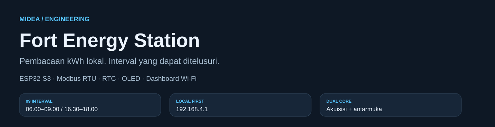
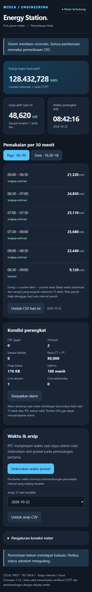
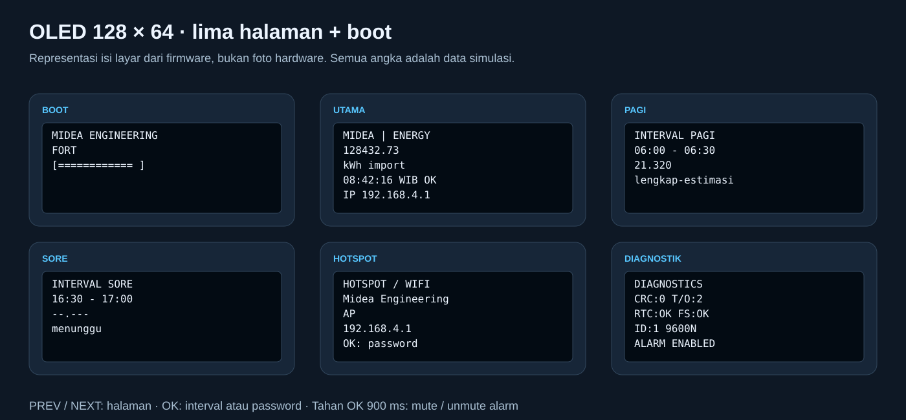

<p align="center">
  
</p>

<p align="center">
  
  
  
  
  
  
</p>

# ESP32 Modbus Energy Monitor

**Fort Energy Station** adalah pembaca energi impor kWh Fort melalui Modbus RTU RS485, menggunakan ESP32-S3 N16R8, RTC DS3231, OLED SSD1306, tiga tombol, dan buzzer. HP tersambung langsung ke hotspot ESP32 untuk melihat dashboard dan mengunduh hasil interval 30 menit.

**Status:** firmware sudah berhasil dibangun; tes logika dan dashboard dengan data simulasi sudah lulus. Pengujian hardware pada ESP32 dan Fort fisik belum dilakukan. Rincian hasil ada di [VALIDATION](docs/VALIDATION.md); temuan dan perbaikan audit ada di [AUDIT](docs/AUDIT.md).

| Akses perangkat | Nilai |
| --- | --- |
| Wi-Fi / SSID | **Midea Engineering AP** |
| Password | **betahdijre12345** |
| Dashboard | **http://192.168.4.1** |
| Zona waktu tampilan dan interval | **WIB / UTC+7** |
| Default pembaca Modbus | **Slave 1 · 9600 baud · 8N1** |
| Topologi terkonfirmasi | Port Fort masih kosong; ESP32 menjadi satu-satunya master |

Dashboard bekerja tanpa internet, cloud, CDN atau aplikasi HP tambahan. IP juga tampil pada halaman utama OLED. Modul RS485 yang digunakan sudah dikonfirmasi kompatibel dengan TTL ESP32 3,3 V.

## Daftar isi

- [Preview web dan OLED](#preview-web-dan-oled)
- [Fitur dan jadwal interval](#fitur-dan-jadwal-interval)
- [Scan Fort dari dashboard](#scan-fort-dari-dashboard)
- [Framework dan library](#framework-dan-library)
- [Komponen](#komponen)
- [Wiring lengkap](#wiring-lengkap)
- [Tutorial wiring langkah demi langkah](#tutorial-wiring-langkah-demi-langkah)
- [Build dan upload](#build-dan-upload)
- [Menyalakan pertama kali](#menyalakan-pertama-kali)
- [Tombol dan navigasi](#tombol-dan-navigasi)
- [Perhitungan kWh dan kualitas data](#perhitungan-kwh-dan-kualitas-data)
- [Arsitektur dan struktur project](#arsitektur-dan-struktur-project)
- [Pengujian](#pengujian)
- [Troubleshooting](#troubleshooting)
- [Kontribusi dan GitHub](#kontribusi-dan-github)

## Preview web dan OLED

Gambar web berikut diambil dari **HTML firmware yang sebenarnya**, menggunakan API simulasi di browser. Angka kWh, kW dan diagnostik adalah contoh, bukan hasil meter pabrik.

<p align="center">
  
</p>

<details>
<summary>Lihat dashboard di layar HP</summary>

<p align="center">
  
</p>

Pada HP, tabel berubah menjadi daftar interval agar nilai dan status terlihat tanpa geser horizontal. Tab sore menampilkan tiga interval 16.30–18.00.

</details>

Representasi halaman OLED di bawah mengikuti isi firmware. Ini ilustrasi SVG, bukan foto layar perangkat.



## Fitur dan jadwal interval

| Fitur | Implementasi |
| --- | --- |
| Pembacaan utama | Counter energi impor sekunder, dikonversi ke kWh primer dengan rasio CT/PT meter |
| Daya saat ini | Total active power, kW primer |
| Integritas komunikasi | CRC16, validasi ID/fungsi/panjang, timeout, maksimum tiga percobaan |
| Scan Fort | Pencarian ID 1–247, enam baud dan parity N/E/O; progres, batal dan terapkan hasil dari web |
| Pengolahan waktu | DS3231 menyimpan UTC; tampilan dan batas interval memakai WIB |
| Kontrol lokal | OLED 128×64, tiga tombol, debounce 35 ms, long press 900 ms |
| Boot | Animasi OLED dan pola bunyi aktif dalam durasi sekitar 1,5 detik |
| Alarm | Peringatan singkat berkala untuk meter offline, RTC invalid atau storage error; dapat di-mute |
| Penyimpanan | Checkpoint NVS dengan CRC; CSV LittleFS; retensi 31 tanggal terakhir |
| Web | Status meter, pergantian shift, sinkronisasi RTC dari HP, setting pembaca, ekspor CSV |
| Eksekusi | Akuisisi di core 1; web/UI di core 0; queue dan mutex FreeRTOS |

| Shift pagi | Shift sore / malam |
| --- | --- |
| 06.00–06.30 | 16.30–17.00 |
| 06.30–07.00 | 17.00–17.30 |
| 07.00–07.30 | 17.30–18.00 |
| 07.30–08.00 | — |
| 08.00–08.30 | — |
| 08.30–09.00 | — |

Seluruh interval berjalan otomatis berdasarkan kalender RTC, bukan 30 menit sejak alat dinyalakan. Sebaiknya perangkat sudah aktif dan terhubung sebelum batas pertama shift.

## Scan Fort dari dashboard

Preview berikut memakai respons API simulasi, bukan pembacaan Fort fisik.


[Preview Scan Fort di HP (simulasi)](docs/assets/ui-scan-mobile.png)

### Cara update dan menjalankan scan

1. Sambungkan RS485 sesuai [wiring lengkap](#wiring-lengkap): RO → GPIO18, DI → GPIO17, DE dan /RE → GPIO16, A → Fort 58/A, B → Fort 59/B. Modul dan Fort harus terhubung agar scan bisa mendapat respons; ESP32 saja tidak dapat menemukan meter.
2. Buka folder **firmware** di VS Code/PlatformIO. Tutup Serial Monitor agar port tidak sedang dipakai. Jalankan **PlatformIO → Project Tasks → esp32s3 → General → Upload**. Gunakan environment **esp32s3** untuk board N16R8 fisik.
3. Setelah upload selesai, hubungkan HP ke **Midea Engineering AP**, password **betahdijre12345**. Tetap gunakan Wi-Fi ini walaupun HP menampilkan tanpa internet. Buka **http://192.168.4.1** dan pastikan footer menunjukkan **Firmware 1.1.0**; reload halaman bila masih melihat UI lama.
4. Buka **Pengaturan koneksi meter → Scan Fort**. Untuk percobaan cepat, isi ID awal **1** dan akhir **16**. Jika belum ditemukan, ulangi dengan **1–247** agar seluruh ID diperiksa. Jika ID meter sudah diketahui, isi awal dan akhir dengan ID yang sama.
5. Tekan **Scan Fort**. Lihat kandidat ID/baud/parity dan jumlah kombinasi yang sudah selesai pada progress bar. Gunakan **Batalkan scan** untuk menghentikan pencarian. Menutup/reload halaman tidak membatalkan scan; progres diambil kembali dari ESP32.
6. Saat hasil muncul, tekan **Terapkan hasil**. Contoh hasil **ID 7 · 19200 · 8E1** hanya ilustrasi; gunakan nilai yang benar-benar ditemukan perangkatmu. Tombol ini menyimpan setting pembaca ESP32 ke NVS; menu komunikasi pada Fort tidak diubah.
7. Periksa form slave ID/baud/parity sudah mengikuti hasil, lalu tunggu pembacaan normal. Status **Meter terhubung** dan nilai kWh akan muncul bila pembacaan berhasil. Jika status storage bermasalah, jangan menganggap konfigurasi pasti tersimpan; periksa [commissioning](docs/COMMISSIONING.md). Sinkronkan RTC dari HP bila waktu belum valid, lalu bandingkan kWh dan rasio CT/PT dengan display Fort.

Alternatif upload melalui terminal PowerShell dari root project (ganti `COM10` jika port board berbeda):

```powershell
cd firmware
& "$env:USERPROFILE\.platformio\penv\Scripts\platformio.exe" run -e esp32s3 --target upload --upload-port COM10
```

### Cara kerja dan batas scan

 Firmware mencoba setting pembaca saat ini lebih dulu, lalu seluruh 18 mode pada ID tersebut jika masuk rentang, dilanjutkan seluruh kombinasi ID pada rentang tersebut, baud 9600/19200/38400/4800/2400/1200 dan parity N/E/O. Setiap kombinasi hanya dicoba sekali, timeout respons 800 ms. Rentang penuh mencakup 4.446 kombinasi dan bisa memerlukan sekitar 70 menit bila tidak ada respons; gunakan rentang lebih kecil bila ID diperkirakan diketahui.

Scan hanya memakai fungsi 03 pada register energi dan CT/PT yang sudah digunakan pembacaan normal. Hasil harus lulus CRC, ID, fungsi, panjang serta batas rasio CT/PT. Pencarian berhenti pada respons kompatibel pertama; ini bukan autentikasi identitas/model meter. Tekan **Terapkan hasil** untuk menyimpan koneksi pembaca ke NVS. Scan tidak mengubah menu komunikasi meter.

**Batalkan scan** menghentikan pencarian setelah kandidat aktif selesai (biasanya kurang dari dua detik setelah perintah diproses). Setelah selesai/batal/tidak ditemukan, pembaca memakai setting lama sampai hasil diterapkan. Scan berjalan di core 1; web, OLED dan RTC tetap diproses. Pencatatan energi dijeda dan kesinambungan interval diputus agar gap scan tidak menjadi interval lengkap; alarm ditunda selama scan. Hasil scan hanya ada di RAM dan tidak bertahan setelah reboot. Jika tidak ditemukan, periksa wiring A/B dan rentang ID. Scan tidak berjalan otomatis saat boot atau saat meter offline.

## Framework dan library

<p>
  
  
  
  
  
</p>

| Bagian | Versi yang dipakai | Fungsi |
| --- | --- | --- |
| PlatformIO Core | 6.1.16 pada build lokal | Mengelola toolchain, dependency, build dan upload |
| Platform Espressif32 | **6.10.0** | Platform ESP32 yang dikunci di konfigurasi |
| Framework Arduino ESP32 | **2.0.17** | Runtime Arduino/ESP-IDF bawaan platform tersebut |
| Adafruit SSD1306 | **2.5.13** | Driver OLED I2C |
| Adafruit GFX Library | **1.11.11** | Teks, garis, ikon sederhana dan animasi |
| Adafruit BusIO | **1.17.0** | Dependency komunikasi Adafruit |
| RTClib | **2.1.4** | Utilitas tanggal/waktu; transaksi DS3231 diperiksa oleh driver firmware |
| ArduinoJson | **7.3.1** | JSON untuk API dashboard |
| WiFi, WebServer, Wire, Preferences, LittleFS | Bawaan framework | AP/HTTP, I2C, konfigurasi dan arsip |
| FreeRTOS | Bawaan ESP-IDF pada framework | Task dua core, queue, mutex dan scheduling |

Versi library eksternal dikunci di [platformio.ini](firmware/platformio.ini). PlatformIO mengunduhnya otomatis pada build pertama; tidak perlu memasang library satu-satu. Semua badge/icon di README adalah SVG lokal; tidak bergantung pada layanan badge eksternal.

## Komponen

| Komponen | Jumlah dipakai | Catatan |
| --- | --- | --- |
| ESP32-S3 N16R8 | 1 | Target DevKitC-style, flash 16 MB, PSRAM OPI 8 MB |
| Modul TTL–RS485 3,3 V | 1 | Modul milik pengguna kompatibel TTL ESP32 |
| Fort power meter | 1 | Unit existing; komunikasi A/B pada terminal 58/59 sesuai manual |
| OLED SSD1306 I2C 0,96 inci | 1 | Layout 128×64, alamat awal 0x3C |
| RTC DS3231 | 1 | Dengan baterai yang sesuai modul |
| Tactile switch | 3 dari 10 | PREV, NEXT, OK |
| Buzzer aktif 3 V/5 V | 1 | Contoh wiring memakai buzzer dua kaki dengan driver NPN pada 3V3 |
| Transistor NPN + resistor 1 kΩ + 10 kΩ | Masing-masing 1 | Tambahan driver buzzer dua kaki; belum ada dalam daftar belanja awal |
| Jumper, breadboard/terminal rail, USB data | Sesuai kebutuhan | Membagi 3V3/GND dan pemasangan awal |

Alternatif buzzer tiga pin dengan driver bawaan dijelaskan pada [panduan buzzer](docs/WIRING.md#buzzer-dua-kaki-dengan-driver-npn).

## Wiring lengkap


**Cara membaca:** titik menunjukkan sambungan listrik; garis yang melintas tanpa titik tidak tersambung. Label `3V3` dan `GND` yang sama adalah satu net/rail bersama. Port pada gambar ditempatkan untuk keterbacaan, bukan meniru posisi header fisik board. Cari pin berdasarkan tulisan **GPIO**, bukan nomor urut kaki.

### Peta koneksi utama

| Pin / terminal asal | Sambungkan ke | Fungsi |
| --- | --- | --- |
| ESP32 **3V3** | Rail + → VCC OLED, RTC dan modul RS485 | Suplai modul 3,3 V |
| ESP32 **GND** | Rail − → GND OLED, RTC, RS485, tombol dan driver buzzer | Ground logika bersama |
| ESP32 **GPIO8** | SDA OLED **dan** SDA DS3231 | Shared I2C data |
| ESP32 **GPIO9** | SCL OLED **dan** SCL DS3231 | Shared I2C clock |
| ESP32 **GPIO18** | **RO** modul RS485 | UART RX menerima dari modul |
| ESP32 **GPIO17** | **DI** modul RS485 | UART TX mengirim ke modul |
| ESP32 **GPIO16** | **DE dan /RE disatukan** | Kontrol arah half-duplex |
| RS485 **A** | Fort **58 / A** | Jalur A |
| RS485 **B** | Fort **59 / B** | Jalur B |
| ESP32 **GPIO4** | Kontak A PREV; kontak B → GND | Halaman sebelumnya |
| ESP32 **GPIO5** | Kontak A NEXT; kontak B → GND | Halaman berikutnya |
| ESP32 **GPIO6** | Kontak A OK; kontak B → GND | Pilih/mute |
| ESP32 **GPIO7** | Resistor **1 kΩ** → basis NPN | Kendali buzzer |

Terminal **58/A dan 59/B** terverifikasi pada manual halaman PDF 7/Tabel 3 dan PDF 9/Gambar 5. **70/COM adalah common switch input**, sehingga tidak dipakai sebagai ground RS485 pada wiring ini. ESP32 mendapat daya dari USB board; suplai dan koneksi pengukuran Fort existing tidak diubah.

## Tutorial wiring langkah demi langkah

### 1. Siapkan rail 3V3 dan GND

Dengan USB board dilepas, hubungkan pin `3V3` ESP32 ke rail positif breadboard dan satu pin `GND` ke rail negatif. VCC modul berikut bercabang ke rail positif; GND logika ke rail negatif. Jika rail breadboard terputus di tengah, jembatani bagian yang dipakai.

### 2. Sambungkan OLED — empat kabel

1. `OLED VCC` → rail **3V3**.
2. `OLED GND` → rail **GND**.
3. `OLED SDA` → **GPIO8**.
4. `OLED SCL` → **GPIO9**.

Gunakan nama pin pada modul, karena urutan header berbeda antar breakout. Firmware memakai alamat `0x3C`; ubah `OLED_ADDRESS` di [board.h](firmware/include/board.h) jika unitmu beralamat `0x3D`.

### 3. Sambungkan DS3231 — empat kabel

1. `DS3231 VCC` → rail **3V3**.
2. `DS3231 GND` → rail **GND**.
3. `DS3231 SDA` → titik **GPIO8 yang sama dengan OLED**.
4. `DS3231 SCL` → titik **GPIO9 yang sama dengan OLED**.

Tidak perlu kabel untuk `SQW`, `32K` atau pin tambahan lainnya. OLED dan RTC berbagi I2C dengan alamat berbeda. Pasang baterai sesuai breakout; lihat [RTC dan baterai](docs/WIRING.md#rtc-dan-baterai).

### 4. Sambungkan RS485 ke ESP32 dan Fort

1. `RS485 VCC` → **3V3**, `RS485 GND` → **GND**.
2. `RS485 RO` → **GPIO18**. RO adalah keluaran receiver, jadi masuk ke RX ESP32.
3. `RS485 DI` → **GPIO17**. DI adalah masukan driver, jadi menerima TX ESP32.
4. Satukan `DE` dan `/RE`, lalu hubungkan titik gabung itu ke **GPIO16**. `/RE` kadang ditulis `RE` dengan garis di atas huruf.
5. `RS485 A` → Fort **58 / A**.
6. `RS485 B` → Fort **59 / B**.

Untuk breakout auto-direction yang hanya menyediakan RX/TX tanpa DE-/RE, lihat [alternatif modul](docs/WIRING.md#modul-rs485-yang-digunakan). Setting slave/baud/parity pembaca dapat diubah dari dashboard.

### 5. Sambungkan tiga tactile switch


Pada switch empat kaki, dua kaki pasangan A sudah terhubung, demikian pula pasangan B. Cari pasangan dengan continuity meter. Gunakan **satu kaki A dan satu kaki B**, sehingga GPIO baru terhubung ke GND saat ditekan.

1. PREV: satu kontak → **GPIO4**, kontak lainnya → **GND**.
2. NEXT: satu kontak → **GPIO5**, kontak lainnya → **GND**.
3. OK: satu kontak → **GPIO6**, kontak lainnya → **GND**.

Tidak perlu resistor pull-up eksternal pada wiring standar ini: firmware memakai `INPUT_PULLUP`. Dilepas = HIGH, ditekan = LOW.

### 6. Sambungkan buzzer aktif dua kaki

Driver pada diagram lengkap memakai NPN sebagai sakelar:

1. **GPIO7 → resistor 1 kΩ → basis (B)** NPN.
2. **Emitor (E) → GND**.
3. **Kolektor (C) → buzzer (−)**.
4. **Buzzer (+) → 3V3** untuk buzzer yang mendukung suplai 3 V.
5. **Resistor 10 kΩ → antara basis dan GND**, menjaga driver mati saat boot.

Posisi fisik B/C/E mengikuti datasheet transistor; susunan berbeda antar part/package. Untuk buzzer elektromagnetik, tambahkan diode flyback sesuai datasheet: katoda di suplai `+`, anoda di kolektor/buzzer `−`. Alternatif modul tiga pin ada di [WIRING](docs/WIRING.md#buzzer-dua-kaki-dengan-driver-npn).

### 7. Cek sambungan lalu nyalakan

Cocokkan kabel dengan tabel atau [netlist CSV](docs/wiring-netlist.csv). Hubungkan USB board, lalu periksa animasi, bunyi boot, dan IP. Jika OLED belum tampil, hotspot tetap dapat berjalan. Uji penerimaan lengkap ada di [COMMISSIONING](docs/COMMISSIONING.md).

## Build dan upload

### PlatformIO di VS Code

1. Install VS Code dan ekstensi **PlatformIO IDE**.
2. Buka folder **`firmware`** sebagai project PlatformIO.
3. Sambungkan USB data ke ESP32-S3.
4. Klik **Build**, lalu **Upload**, kemudian **Serial Monitor** pada 115200 baud.

Atau, dari terminal root:

```powershell
cd firmware
pio run
pio run --target upload
pio device monitor
```

Jika `pio` belum masuk PATH di Windows:

```powershell
cd firmware
& "$env:USERPROFILE\.platformio\penv\Scripts\python.exe" -m platformio run
& "$env:USERPROFILE\.platformio\penv\Scripts\python.exe" -m platformio run --target upload
```

Konfigurasi memakai flash **16 MB QIO**, PSRAM **8 MB OPI** (`qio_opi`), dan USB native. GPIO19/20 dipakai USB native dan tidak dipakai komponen. Untuk mode upload manual: tahan **BOOT**, tekan/lepas **RESET**, lepas BOOT, lalu pilih port yang muncul.

Web ditanam dalam aplikasi; **tidak perlu `uploadfs`**. Binary build ada di `firmware/.pio/build/esp32s3/`. Paket rilis lokal menyediakan factory image dan panduan offset di folder `output/firmware/`. Panduan sumbernya ada di [FLASHING](docs/FLASHING.md). `output` berisi hasil generasi dan diabaikan Git.

### Simulasi di Cirkit Designer

Gunakan profil **`cirkit` (flash 8 MB)** dan bundle ZIP khusus, bukan app-only BIN. Build dengan `pio run -e cirkit`, lalu dari root jalankan `python tools/package_cirkit.py`. Pada **Code → Firmware → Load Firmware → Choose firmware**, pilih `output/firmware/midea-fort-cirkit-8mb.zip`, kemudian **Import**. Cirkit harus menampilkan role Application, Bootloader, dan Partitions. Lihat [panduan simulator](docs/FLASHING.md#cirkit-designer-import-zip-dengan-profil-8-mb).

Profil default `esp32s3` tetap untuk N16R8 fisik. Keberhasilan impor/boot simulator bukan pengganti pengujian hardware atau bukti seluruh fungsi Wi-Fi/RTC/Modbus sudah tersimulasikan.

## Menyalakan pertama kali

1. Jika filesystem belum terbentuk, tahan **OK** sambil menyalakan. Setelah pesan format muncul, tetap tahan **5 detik**. Ini menginisialisasi LittleFS dan menghapus arsip filesystem; tidak ada format otomatis.
2. Sambungkan HP ke **Midea Engineering AP**, password **betahdijre12345**. Pilih tetap terhubung ketika jaringan disebut tidak memiliki internet.
3. Buka **http://192.168.4.1**.
4. Tekan **Sinkronkan waktu ponsel**. Pastikan jam/tanggal HP benar; setelah berhasil, OLED dan web menampilkan WIB.
5. Periksa RTC, storage dan meter. **ID 1** adalah titik awal dari contoh manual; **9600/8N1** adalah default manual. Cocokkan dengan setting meter melalui pengaturan koneksi bila perlu.
6. Bandingkan **energi impor primer**, kW dan rasio CT/PT dengan halaman Fort yang sesuai.
7. Aktifkan sebelum awal shift; unduh CSV setelah interval selesai.

Untuk alat berisi arsip, lakukan update firmware biasa. Format bukan langkah pemulihan pertama. Prosedur uji power-cut ada di [COMMISSIONING](docs/COMMISSIONING.md).

## Tombol dan navigasi

| Tombol | Tekan singkat | Tahan |
| --- | --- | --- |
| PREV / GPIO4 | Halaman sebelumnya | Satu perpindahan setelah long press |
| NEXT / GPIO5 | Halaman berikutnya | Satu perpindahan setelah long press |
| OK / GPIO6, pagi/sore | Interval berikutnya | 900 ms: mute/unmute |
| OK / GPIO6, hotspot | Tampilkan/sembunyikan password | 900 ms: mute/unmute |
| OK / GPIO6, utama/diagnostik | Mute/unmute | 900 ms: mute/unmute |
| OK ditahan saat boot | — | Jika mount gagal: tahan tambahan 5 detik untuk format |

Urutan halaman: **utama → pagi → sore → hotspot → diagnostik**. Debounce 35 ms stabil; long press menghasilkan satu event tanpa short press tambahan saat dilepas.

## Perhitungan kWh dan kualitas data

```text
PT               = register 0x002C / register 0x002D
CT               = register 0x002E
kWh primer       = uint32 big-endian(0x0082–0x0083) × 0,001 × PT × CT
kW primer        = int32 big-endian(0x006A–0x006B) × 0,0001 × PT × CT
kWh per interval = counter akhir − counter awal
```

Counter energi menentukan konsumsi; nilai kW menjadi informasi beban saat ini. Alamat adalah PDU hexadecimal seperti manual, tanpa menambah 40001. Meter hanya dibaca dengan fungsi 03.

| Status | Perlakuan |
| --- | --- |
| `menunggu` | Belum mulai |
| `berjalan` | Selisih sementara di web; belum final |
| `lengkap-estimasi` | Kedua batas tersedia; interpolasi sampel dekat batas dapat digunakan |
| `parsial` | Startup terlambat, reboot, RTC/CT/PT berubah, reset counter atau gap berlebihan |
| `tidak-tersedia` | Tidak ada batas counter yang memadai |

Batas interpolasi antarsampel **15 detik**. CSV kosong berarti belum dapat ditentukan; `0.000000` berarti nol yang valid. Konsumsi CSV hanya diisi untuk interval lengkap. Contoh simulasi:

```csv
date,shift,start_wib,end_wib,start_kwh,end_kwh,consumption_kwh,quality
2026-10-22,pagi,06:00,06:30,1000.000000,1006.000000,6.000000,lengkap-estimasi
2026-10-22,pagi,06:30,07:00,,,,parsial
```

Saat ESP32 mati, RTC menjaga waktu tetapi tidak membaca meter. Interval yang terputus tidak direkonstruksi sebagai data lengkap. Register, resolusi, salah cetak CRC manual dan batas pemulihan dibahas di [DESIGN](docs/DESIGN.md).

## Arsitektur dan struktur project


```text
.
├── AGENTS.md                 # Aturan kerja agent dan sumber kebenaran
├── README.md                 # Panduan utama + semua visual
├── CHANGELOG.md              # Riwayat perubahan
├── CONTRIBUTING.md           # Alur developer
├── .github/workflows/ci.yml  # Build firmware, tes dan audit docs
├── firmware/
│   ├── platformio.ini        # Board, framework dan library yang dikunci
│   ├── include/              # Pin, versi, tracker, debounce, recovery, HTML
│   ├── src/main.cpp          # Driver, RTOS, persistence, HTTP dan UI
│   └── test/test_energy.cpp  # Tes logika dan fault injection
├── docs/
│   ├── assets/               # SVG dan screenshot untuk GitHub
│   ├── wiring-netlist.csv    # Sambungan point-to-point
│   ├── WIRING.md             # Wiring terperinci
│   ├── DESIGN.md             # Register, protokol dan arsitektur
│   ├── COMMISSIONING.md      # Uji penerimaan hardware
│   ├── AUDIT.md              # Temuan dan perbaikan audit
│   └── VALIDATION.md         # Hasil pengujian dan batasnya
├── tools/                    # Tes, generator SVG, audit docs dan paket
└── Fort Power Meter_User Manual_compressed.pdf
```

## Pengujian

Logika C++ di Windows dari root (memerlukan `g++`):

```powershell
.\tools\test.ps1
```

Pemeriksaan dokumentasi, aset, versi dan link:

```powershell
python tools/generate_docs.py
python tools/check_docs.py
```

Pengujian UI (Node hanya untuk development, bukan dependency firmware):

```powershell
npm ci
npx playwright install chromium
npm run test:ui
```

Bisa memakai Edge yang sudah terpasang: `node tools/preview-test.cjs playwright msedge`. Tes memakai API simulasi localhost. CI tersedia di [.github/workflows/ci.yml](.github/workflows/ci.yml); hasil lokal yang benar-benar dijalankan dicatat di [VALIDATION](docs/VALIDATION.md).

## Troubleshooting

| Gejala | Periksa / lakukan |
| --- | --- |
| OLED kosong | VCC/GND, GPIO8/9, alamat 0x3C/0x3D, controller SSD1306 dan ukuran 128×64 |
| Meter offline / timeout | RO→GPIO18, DI→GPIO17, DE-/RE→GPIO16, A→58, B→59, slave/baud/parity |
| CRC gagal terus bertambah | A/B, arah transceiver dan kondisi kabel/terminasi |
| RTC invalid | SDA/SCL, suplai, baterai dan sinkronisasi dari HP |
| Storage error pada pemasangan pertama | Inisialisasi fisik OK saat boot sesuai prosedur |
| HP terhubung tetapi dashboard tidak terbuka | Tetap di AP tanpa internet; ketik `http://192.168.4.1` |
| kWh berbeda faktor tetap | Rasio CT/PT dan halaman energi impor primer yang dibandingkan |
| Konsumsi interval kosong | Lihat kualitas; startup terlambat atau data terputus |
| Buzzer diam | GPIO7, driver, polaritas, suplai dan status mute |

## Kontribusi dan GitHub

Baca [AGENTS.md](AGENTS.md) sebelum perubahan agent dan [CONTRIBUTING](CONTRIBUTING.md) untuk alur developer. Source, dokumentasi, SVG, screenshot dan workflow siap dimasukkan ke repository. `.pio/`, `node_modules/`, `tmp/` serta hasil generasi `output/` diabaikan Git; bagikan binary melalui paket rilis terpisah.

Kode dan dokumentasi/aset orisinal project dilisensikan dengan **GNU GPL versi 3** (`GPL-3.0-only`); lihat [LICENSE](LICENSE) dan [NOTICE](NOTICE). Dependency dan manual Fort tetap mengikuti hak/lisensi asalnya. Riwayat perubahan ada di [CHANGELOG](CHANGELOG.md).
