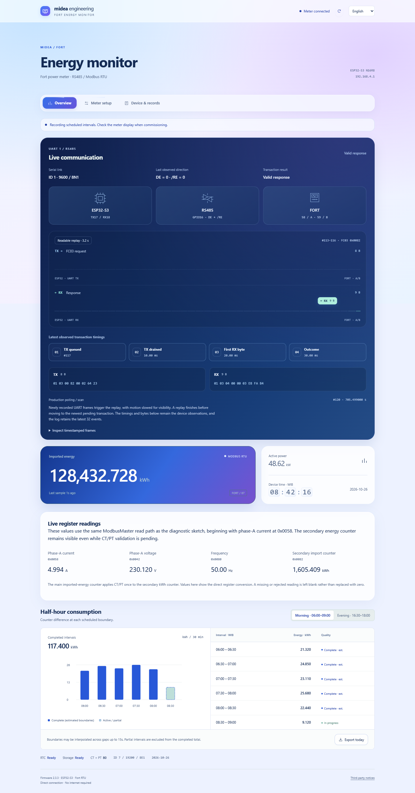

# Fort Modbus Energy Monitor

**English** · [Bahasa Indonesia](README.id.md)

  

An ESP32-S3 reader for the existing Fort power meter at Midea. It reads imported kWh over Modbus RTU, records scheduled half-hour intervals, and serves a dashboard directly to a phone over Wi-Fi. The Fort RS485 port is dedicated to this reader; the ESP32 is its only master.

The firmware builds for a generic DevKitC-style **ESP32-S3 N16R8**. The dashboard uses **React and actual React Bits components**, bundled locally. English is the default language; the language selector switches the full interface to Indonesian. No internet connection is needed at the meter.

New releases need commissioning against the physical Fort meter. Compilation and browser tests do not establish measurement accuracy or wiring acceptance. [Validation results](docs/VALIDATION.md) identify what has actually been tested.

## Contents

1. [Connect the hardware](#1-connect-the-hardware)
2. [Build and upload](#2-build-and-upload)
3. [First startup and meter scan](#3-first-startup-and-meter-scan)
4. [Energy calculation and recording quality](#4-energy-calculation-and-recording-quality)
5. [Tasks, ownership and scheduling](#5-tasks-ownership-and-scheduling)
6. [UART frames and RS485 direction](#6-uart-frames-and-rs485-direction)
7. [Browser build and memory use](#7-browser-build-and-memory-use)
8. [Tests and maintenance](#8-tests-and-maintenance)

## Dashboard



The screenshot uses simulated API data. The chart is built from the same interval values as the table; it is not a synthetic load trend. Missing readings remain blank. [Phone layout](docs/assets/ui-mobile.png) · [Meter scan](docs/assets/ui-scan-desktop.png).

## 1. Connect the hardware

Use the **GPIO labels** printed on the board, not header position numbers. Disconnect USB while assembling the low-voltage connections. The purchased RS485 module is confirmed compatible with ESP32 3.3 V TTL.

| Module pin | ESP32-S3 connection | Purpose |
| --- | --- | --- |
| OLED VCC / GND | 3V3 / GND | SSD1306, 128×64, I2C address 0x3C |
| OLED SDA / SCL | GPIO8 / GPIO9 | Shared I2C bus |
| DS3231 VCC / GND | 3V3 / GND | RTC, I2C address 0x68 |
| DS3231 SDA / SCL | GPIO8 / GPIO9 | Connect to the same nets as the OLED |
| RS485 VCC / GND | 3V3 / GND | Transceiver supply and logic ground |
| RS485 RO | GPIO18, UART1 RX | Transceiver output → ESP32 input |
| RS485 DI | GPIO17, UART1 TX | ESP32 output → transceiver input |
| RS485 DE and /RE | Both tied to GPIO16 | HIGH transmits; LOW receives |
| RS485 A / B | Fort 58/A / 59/B | The meter communication terminals |
| PREV / NEXT / OK buttons | GPIO4 / GPIO5 / GPIO6; other contact to GND | Internal pull-ups, active LOW |
| Buzzer control, optional | GPIO7 → driver | Active HIGH; may be left unconnected |

DS3231 SQW and 32K are unused. OLED and RTC each need four connections; their SDA/SCL wires branch to the same two GPIOs. All module GND pins share ESP32 GND. **Fort 70/COM is a switch-input common, not RS485 ground.** The GPIO mapping is defined in [board.h](firmware/include/board.h).

<details>
<summary>Full wiring diagram, including optional buttons and buzzer driver</summary>


Port positions in this drawing are logical, not a photograph of the board. Repeated 3V3/GND labels are connected nets; a crossing without a dot is not a connection. The buzzer driver requires an NPN transistor, 1 kΩ base resistor and 10 kΩ pull-down; these are additional parts. Physical B/C/E pin order depends on the transistor package.

</details>

Follow the [step-by-step wiring guide](docs/WIRING.md) when assembling. It covers tactile contacts, the optional buzzer, RTC battery and the [31-wire netlist](docs/wiring-netlist.csv).

## 2. Build and upload

Open the **firmware** directory in VS Code/PlatformIO; it contains `platformio.ini`. Close Serial Monitor before uploading.

```powershell
cd firmware
pio run -e esp32s3
pio run -e esp32s3 --target upload --upload-port COM10
pio device monitor -e esp32s3 --port COM10
```

Replace COM10 with the board's actual port. If `pio` is not on PATH, use `& "$env:USERPROFILE\.platformio\penv\Scripts\platformio.exe"` in its place. The VS Code equivalent is **Project Tasks → esp32s3 → General → Upload**. The only supported target is `esp32s3`: 16 MB flash and OPI PSRAM for N16R8.

The generated browser assets are committed with the firmware. A normal PlatformIO build verifies their hashes and **does not need Node or npm**. Install Node dependencies only when editing the web source; see [section 7](#7-browser-build-and-memory-use).

| Dependency | Pinned version | Role |
| --- | --- | --- |
| PlatformIO Core | 6.1.16 | Development/build tool |
| Espressif32 / Arduino ESP32 | 6.10.0 / 2.0.17 | Toolchain and device runtime |
| Adafruit SSD1306 / GFX / BusIO | 2.5.13 / 1.11.11 / 1.17.0 | OLED and I2C driver support |
| RTClib | 2.1.4 | Calendar/UTC conversion; checked DS3231 transactions are in the firmware |
| ArduinoJson | 7.3.1 | HTTP JSON |
| Node.js (web build only) | 24.22.1 | Reproducible browser build runtime |
| React / React DOM | 19.3.1 | Browser application |
| GSAP | 3.15.0 | React Bits page transitions |
| esbuild | 0.28.2 | Browser bundler, development only |
| Playwright | 1.62.1 | Browser regression tests |

Versions come from [platformio.ini](firmware/platformio.ini), [package.json](package.json) and its lockfile. PlatformIO resolves firmware libraries automatically.

For raw BIN flashing, use the offsets in [FLASHING](docs/FLASHING.md). An application BIN and a merged factory BIN have different purposes; do not put app-only firmware at address 0x0.

## 3. First startup and meter scan

1. Power the board. Startup does not wait for USB Serial. The OLED animation and buzzer pattern take about 1.5 seconds; a missing OLED does not prevent startup.
2. Connect the phone to **Midea Engineering AP**, password **betahdijre12345**. Stay on this network when the phone reports that it has no internet. Open **http://192.168.4.1**.
3. Check the footer reports **Firmware 1.2.0**. English is the default; select **Indonesia** to switch language. This preference belongs to the browser, not to the meter.
4. On a new installation, LittleFS may not yet contain a valid filesystem. If mounting fails, hold the physical **OK button (GPIO6)** during boot and keep holding for five seconds. This formats the archive partition and erases archives. Firmware never formats it automatically.
5. In **Device & records**, choose **Set from this phone** to set the DS3231. It stores UTC; the screen and interval schedule use WIB. The phone's clock must be correct.
6. Open **Meter setup**. Either enter the Fort communication settings or run **Scan Fort**. Defaults are slave 1, 9600 baud, 8N1. A manual supplied with the meter does not prove the installed slave ID.

### Local controls

PREV/NEXT cycle through the main, morning, evening, AP and diagnostics OLED pages ([screen reference](docs/assets/oled-pages.svg)). Inputs use internal pull-ups and a 35 ms stable debounce window.

| Control | Action |
| --- | --- |
| OK short press on an interval page | Select the next interval in that shift |
| OK short press on the AP page | Show/hide the AP password |
| OK short press on other pages | Toggle alarm mute |
| OK held for 900 ms after debounce | Toggle mute once; release does not add a short action |
| OK held at boot for five seconds, only after mount failure | Format the archive partition |

The optional active buzzer has a roughly 1.5 s startup pattern. Afterwards it gives a short periodic alarm for invalid RTC, offline meter or storage faults; scan temporarily suppresses it. Leaving the buzzer unconnected does not stop operation.

<a id="scan-fort-dari-dashboard"></a>

### Scan Fort from the dashboard


Start with IDs **1–16** for a short search. If no result is found, select **All IDs** to search **1–247**. If the ID is known, use that value for both ends. The configured ID gets all 18 serial formats first when it is inside the range. The rest of the range is searched without repeating combinations.

There are six baud rates—1200, 2400, 4800, 9600, 19200 and 38400—and N/E/O parity with one stop bit. A full search has **4,446 candidates** and can take about **70 minutes** without a response. A candidate is accepted only after valid function-03 responses from both the energy and CT/PT registers, including CRC, length, slave ID and ratio range checks. This is protocol compatibility, not authentication of a meter model.

Choose **Apply result** to store the reader settings in NVS. Scan completion alone does not replace the current settings. **Cancel scan** is processed between candidates; a candidate has at most two 800 ms response windows. Closing the browser does not cancel the scan, and reloading recovers progress from the ESP32. Results are held in RAM until reboot.

Scanning pauses normal acquisition and interrupts interval continuity. The alarm is suppressed while scanning. After a match, cancellation or exhaustion, the old UART settings are restored until a result is applied. Use scan outside a production recording window when possible. [Commissioning checks](docs/COMMISSIONING.md) cover cancellation, reboot, missing meter and data quality.

## 4. Energy calculation and recording quality

The firmware reads these **zero-based hexadecimal PDU addresses**, without a 40001 offset:

| Address | Words | Meaning | Conversion |
| --- | --- | --- | --- |
| 0x002C–0x002E | 3 | PT numerator, PT denominator, CT multiplier | ratio = PT numerator / PT denominator × CT |
| 0x0082–0x0083 | 2 | Imported secondary active energy, unsigned big-endian 32-bit | primary kWh = raw × 0.001 × ratio |
| 0x006A–0x006B | 2 | Total active power, signed big-endian 32-bit | primary kW = raw × 0.0001 × ratio |

Scaling is applied once. The integer secondary counter avoids subtracting large primary float32 values with poor resolution. Energy arithmetic uses `double`; the actual counter resolution is **0.001 × ratio kWh**, regardless of the number of decimal places shown.

| Morning / WIB | Evening / WIB |
| --- | --- |
| 06:00–06:30 | 16:30–17:00 |
| 06:30–07:00 | 17:00–17:30 |
| 07:00–07:30 | 17:30–18:00 |
| 07:30–08:00 | |
| 08:00–08:30 | |
| 08:30–09:00 | |

Consumption is the difference between boundary counters. When a boundary falls between two continuous samples no more than 15 seconds apart, the tracker interpolates it linearly. Consequently the complete flag is named `complete_estimated`, not a claim of exact boundary sampling. Gaps, late startup, scans, reboot, clock changes and counter decreases interrupt continuity; partial or missing intervals are never replaced with zero. Completed intervals survive interruption.

The DS3231 is checked for ACK, byte count, valid BCD/calendar, 24-hour mode and oscillator-stop flag. Energy is time-bracketed by RTC reads; a window over two seconds or a transaction over 2.5 seconds is not accepted for interval accounting. A 100 MW sanity limit rejects implausible energy jumps; configure it for the actual installation before acceptance.

CSV exports retain quality flags and up to 31 dates. Version 1.2 uses English shift/quality codes; existing CSV files are preserved in their original format. The status API retains legacy `quality` and adds stable English `quality_code` and `error_code` fields. Register references and the manual's inconsistent CRC example are documented in [DESIGN](docs/DESIGN.md).

## 5. Tasks, ownership and scheduling


| Context | Core / priority | Owned work |
| --- | --- | --- |
| Arduino loop task | Core 0 / priority 1 | Synchronous HTTP, button debounce, OLED, buzzer |
| `fort-acquisition` | Core 1 / priority 2; 12,288-byte stack | UART1, Preferences/NVS, tracker, CT/PT, RTC reads, archive writes, scan state |
| ESP-IDF system tasks | Managed by the framework | Wi-Fi, TCP/IP and other services; they are not pinned by this application |

The UI sends `Command` values through a **six-item queue** with zero enqueue wait. A full queue returns HTTP 503. Acquisition publishes a **one-item snapshot queue** using `xQueueOverwrite`; the UI reads a copy with `xQueuePeek`. It never edits the live tracker. These are value copies, not shared pointers into a mutable `Day`.

I2C is protected by a mutex because RTC and OLED share the bus. The filesystem mutex protects archive replacement/export; HTTP copies CSV files smaller than 8 KiB and releases the lock before sending. UART and Preferences need no cross-task mutex because only the acquisition task accesses them.

| Operation | Scheduling rule |
| --- | --- |
| Energy/power poll | 2-second target; retries may extend it |
| CT/PT refresh | Every 60 seconds, at least 5 seconds between attempts; invalidated after prolonged failure |
| Acquisition loop | 100 ms yield normally; 10 ms between scan candidates |
| UART receive wait | Yields one FreeRTOS tick while awaiting data |
| OLED | At least 300 ms between draw attempts; skipped if its mutex cannot be taken |
| Browser status | Every 2.5 seconds; 4-second request timeout |
| Checkpoint/archive | Status/day/config changes and at most 5 minutes between periodic saves |
| Watchdog | 8 seconds; fed per UI loop, UART attempt and asset-transfer chunk |

These are cooperative timing targets, **not hard real-time guarantees**. A slow HTTP asset client can occupy the synchronous UI task for up to its five-second transfer deadline, while acquisition continues on core 1. Delays let idle/system tasks run; keeping both CPUs busy would reduce reliability rather than improve sampling. [Detailed scheduling and lock bounds](docs/DESIGN.md#task-and-lock-model) explain the execution order.

## 6. UART frames and RS485 direction


A request is eight bytes: slave ID, function 03, register address high/low, count high/low, CRC low/high. CRC16 starts at 0xFFFF, shifts LSB first with polynomial 0xA001, and covers the six request bytes. Responses are checked for ID, function, byte count, total length, CRC and exception 0x83.

The direction sequence is explicit: drain up to 128 stale RX bytes → wait at least the calculated t3.5 gap → GPIO16 HIGH → 30 µs turnaround delay → `UART.write` → `UART.flush` → GPIO16 LOW → collect the response. The 800 ms receive deadline starts after TX flush. Polling uses up to three attempts with bounded backoff; scan uses one attempt per register.

**There is no software bit banging for UART or I2C.** `HardwareSerial(1)` drives UART1; `Wire` drives the hardware I2C controller at 100 kHz. GPIO16 controls transceiver direction, not individual serial bits. CPU work includes framing, CRC, parsing, tracker arithmetic and composing the OLED buffer. RX uses a 128-byte driver buffer and a fixed 16-byte frame buffer for responses up to 11 bytes. Since timestamps are observed while draining the UART buffer, the firmware does not claim exact per-byte t1.5 validation.

## 7. Browser build and memory use

Authoring files live in [web/](web/). React DOM and GSAP execute in the **phone/browser**, not on the ESP32. The board serves gzip bytes stored in flash and provides the JSON API. Both translations, CSS, icons and dependency notices are local; no CDN, external font, hosted API or separate filesystem upload is required.

Use **Node 24.22.1** (recorded in `.node-version`) for web builds:

```sh
npm ci
npm run build:web
npm run check:web
```

The build writes [web_ui.h](firmware/include/web_ui.h) and a [bundle manifest](web/bundle.json) with source hashes, per-asset sizes and dependency versions. The build fails above **160 KiB compressed**. Static bytes are sent to lwIP in chunks up to 1 KiB with scheduler yields and watchdog resets; the entire JS bundle is never copied into an Arduino `String`.

Actual React Bits `FadeContent` and `SpotlightCard` are vendored at commit `e12c22192ac7b4b452c5e2feb9b586d74765d696`. Page reveals respect reduced motion; the energy panel uses pointer/focus lighting without a continuous ambient animation. Numeric readings are displayed directly, without counting up through values the meter never reported. [Component provenance and license](web/vendor/react-bits/README.md).

For technical changes, edit the web source and rebuild before PlatformIO. `tools/pio_web.py` rejects stale assets, preventing a successful firmware build from silently carrying the previous UI. [VALIDATION](docs/VALIDATION.md) records actual payload and firmware sizes.

## 8. Tests and maintenance

```powershell
.\tools\test.ps1
python tools/check_docs.py
npm run test:ui
```

Linux/macOS native tests: `g++ -std=c++11 -Wall -Wextra -Werror -Ifirmware/include firmware/test/test_energy.cpp -o /tmp/fort-test && /tmp/fort-test`. Install a Playwright browser with `npx playwright install chromium`, or use Edge: `node tools/preview-test.cjs playwright msedge`.

Tests cover CRC/frame rejection, nine interval windows, boundaries/gaps, reboot recovery, debounce, scan enumeration/cancellation and filesystem fault paths. Browser tests serve the **embedded gzip arrays**, exercise both languages and network failures, and check phone/desktop layouts. They cannot validate the actual UART transceiver, meter scaling, RTC battery or power-cut endurance. Follow the [acceptance procedure](docs/COMMISSIONING.md).

Repository map: `firmware/` device code; `web/` browser source; `tools/` build/tests; `docs/` English guides and diagrams; `docs/id/` Indonesian guides. Read [AGENTS.md](AGENTS.md) and [CONTRIBUTING](CONTRIBUTING.md) before changing ownership or register handling. [Changelog](CHANGELOG.md) · [Firmware design](docs/DESIGN.md) · [Wiring](docs/WIRING.md) · [Flashing](docs/FLASHING.md).

Original project code and documentation are **GPL-3.0-only**. React Bits, React, GSAP, firmware libraries and the supplied Fort manual retain their own terms; they are not relicensed by this repository. See [LICENSE](LICENSE), [NOTICE](NOTICE) and the offline dashboard's third-party notices.
