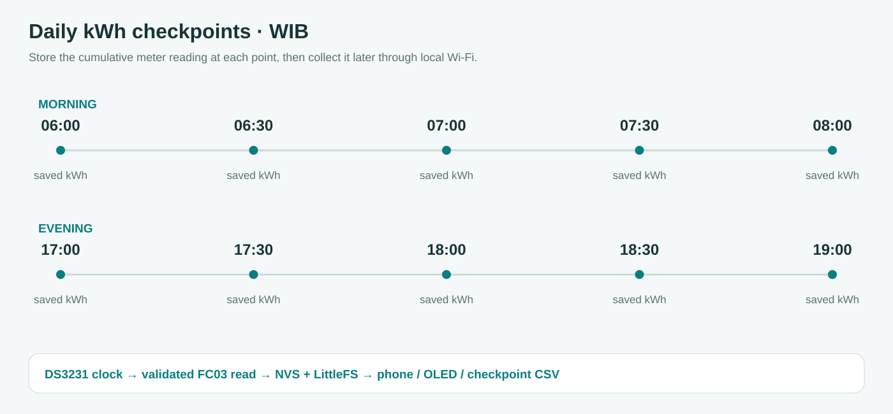
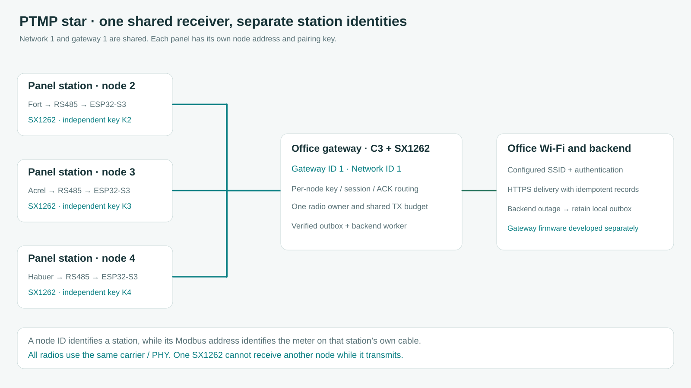
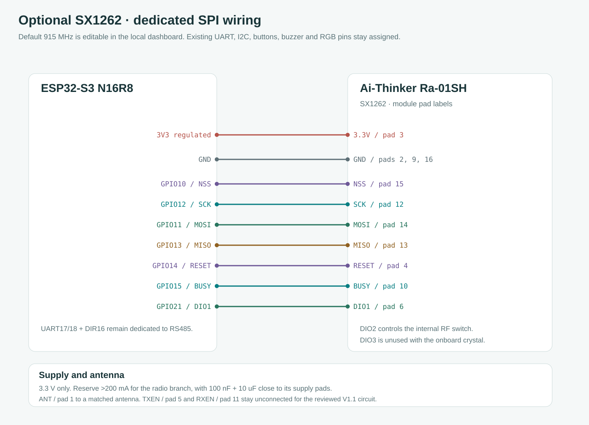
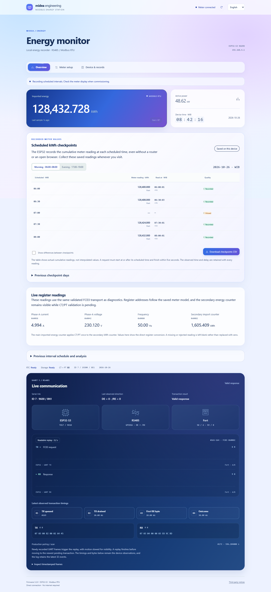
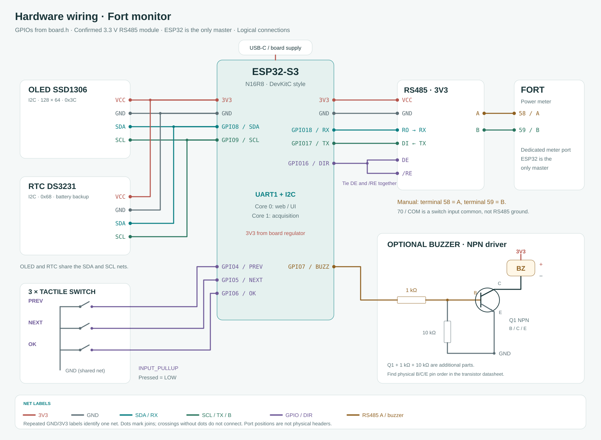
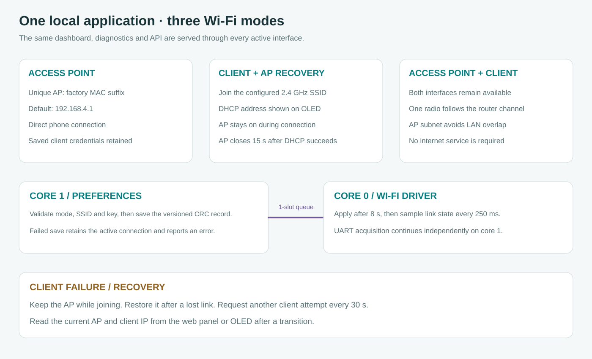
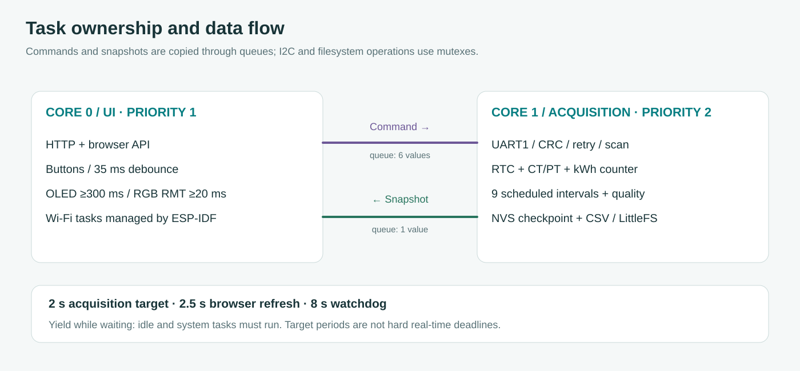
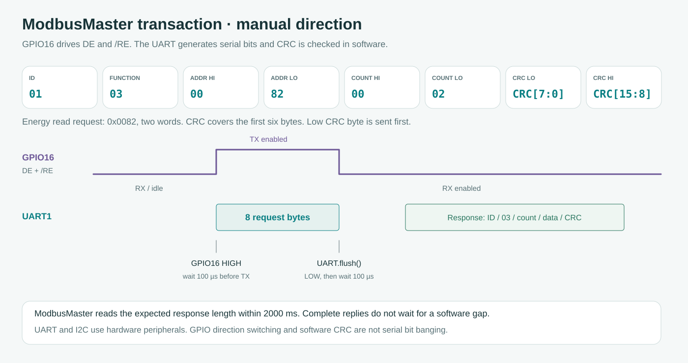

# Modbus Energy Station

**English** · [Bahasa Indonesia](README.id.md)

       

For multi-unit deployment, see [fleet readiness](docs/FLEET_READINESS.md). New stations require a saved meter profile before recording.

Configure Wi-Fi (including Enterprise) and LoRa in the local panel. Guides: [Wi-Fi Enterprise](docs/ENTERPRISE_WIFI.md) and [LoRa](docs/LORA.md). An **opt-in development-only** HTTPS exporter for the Energy Record IoT v1 endpoint is documented in [HTTPS uplink](docs/IOT_HTTPS.md); disabled by default. For a no-gateway factory trial, use the [direct Wi-Fi pilot checklist](docs/DIRECT_WIFI_PILOT.md).

ESP32-S3 N16R8 reads Fort, Habuer, Acrel and Schneider PM5100 meters over RS485 and saves ten daily kWh checkpoints using a DS3231 RTC. Records stay on the device without Wi-Fi; the dashboard handles setup, diagnostics and export.

Daily checkpoint times (WIB): **06:00, 06:30, 07:00, 07:30, 08:00; 17:00, 17:30, 18:00, 18:30, 19:00**. Each record keeps its actual reading time. Missed checkpoints are never filled with later values. [Checkpoint details](docs/CHECKPOINTS.md).



WPA2-Enterprise supports PEAP/MSCHAPv2. Select an Enterprise SSID, enter credentials and use the built-in public CA bundle or upload your private CA. Certificate checks stay enabled. [Enterprise Wi-Fi setup](docs/ENTERPRISE_WIFI.md).

ADL400 now follows the verified field scan: total energy 0x0000, UInt32 / 100 × PT × CT, and ABCD electrical floats. There is one ADL400 selection with no energy-source submenu. [ADL400](docs/ADL400_FIX.md).

## Power interruption and optional LoRa

Records are saved and verified in NVS/filesystem with staging recovery. Invalid stored meter settings stop production instead of selecting a different profile. [Power-loss and recovery limits](docs/POWER_LOSS.md).

LoRa starts disabled. Set the node/gateway IDs, matching RF settings and shared key in the panel. The ESP32-C3 gateway runs separate firmware. [SX1262 wiring and setup](docs/LORA.md) · [Radio protocol](docs/LORA_PROTOCOL.md).

For multiple nodes, assign unique Node IDs and a common Gateway/Network ID. [PTMP setup](docs/LORA_PTMP.md) · [Gateway development](docs/GATEWAY_PROMPT.md).






## Meter profiles

Choose **Fort**, **Habuer**, **Acrel ADL400**, **Acrel ACR10R-DxxTE** or **Acrel APM800/801/810** in **Meter setup → Meter model**, then save the reader settings before starting a scan. That choice selects a complete register profile for acquisition, transformer ratios, diagnostics and scan defaults. It does not configure the meter itself. Fort remains the default after upgrading an existing installation, and saved checkpoints retain their original model identity.

ADL400 uses total energy at `0x0000` (UInt32 ABCD, `/100 × PT × CT` once). The older `0x000A` forward counter is retained only for historical records. RS485 terminals: Acrel **21/A1, 22/B1**; Fort **58/A, 59/B**. [Meter profiles](docs/METER_PROFILES.md) · [Acrel wiring](docs/assets/wiring-acrel-adl400.svg).

Habuer follows the [owner's working reference sketch](docs/HABUER.md), with separate reads for PF, frequency, cumulative active kWh and reactive kvarh. Its active total comes from `0x0034`, two words divided by 10, without an additional transformer multiplier. The guide includes the exact read plan, supported values and [complete Habuer wiring](docs/assets/wiring-habuer.svg).

Acrel ACR10R-DxxTE and APM800/801/810 are also selectable. These profiles use a verified saved-device binding before production recording because the supplied manuals omit ACR energy units/order and disagree on the APM primary-energy address. [Setup and register details](docs/ACREL_ACR_APM.md).

## Discovery and saved meters

In **Meter setup → Meter discovery and saved devices**, run FC03 probes and confirm the result before saving it. Up to four named devices persist after reboot. Unverified models remain diagnostic-only. [Discovery procedure](docs/METER_DISCOVERY.md).

## Dashboard



The ESP32 serves the dashboard locally; internet access is not required. English/Indonesian can be switched in the header. Screenshots contain simulated data, not field measurements.

## 1. Connect the hardware

The confirmed installation now uses a **manual-direction transceiver**. Connect GPIO16 to both DE and /RE so that a HIGH level enables the transmitter and disables the receiver, then a LOW level releases the bus and enables reception. The transceiver's DI and RO labels describe its TTL signals. They are not the A/B pair that goes to the meter.

| ESP32 connection | Destination | Purpose |
| --- | --- | --- |
| GPIO17 / UART1 TX | RS485 DI | Request bytes from ESP32 |
| GPIO18 / UART1 RX | RS485 RO | Response bytes into ESP32 |
| GPIO16 | RS485 DE and /RE joined | Manual direction control |
| 3V3 and GND | Compatible transceiver VCC and GND | Local low-voltage supply |
| GPIO8 / SDA | OLED SDA and DS3231 SDA | Shared I2C data |
| GPIO9 / SCL | OLED SCL and DS3231 SCL | Shared I2C clock |
| 3V3 and GND | OLED/RTC VCC and GND | Shared low-voltage supply |
| GPIO4, GPIO5, GPIO6 | PREV, NEXT, OK switches to GND | Internal pull-ups, pressed is LOW |
| GPIO7 | Optional buzzer driver input | Active buzzer pattern |
| GPIO48 | Onboard addressable RGB LED | No external connection |

Connect RS485 **A to Fort terminal 58/A** and **B to terminal 59/B**. Terminal 70/COM belongs to the meter's switch inputs and is not an RS485 ground terminal. The meter port is dedicated to this ESP32, which is its only master.



The diagram shows electrical nets rather than physical header positions. Repeated 3V3/GND labels refer to the same respective net. Dots mark joins, whereas crossings without dots do not. The optional two-wire buzzer uses an NPN low-side driver, a 1 kΩ base resistor and a 10 kΩ pull-down, which are additional parts. A transistor's physical B/C/E order must come from its part/package datasheet.

An [automatic-direction module](docs/assets/rs485-auto.svg) remains an explicit alternative. Select Automatic in Meter setup before using it and leave GPIO16 disconnected. The installed manual module is the default for a fresh configuration and for migration from v1.

## 2. Build and upload

From the repository-root **computer terminal**, run `python tools/setup-core.py` once and restart the PlatformIO terminal. This pins the managed Core used by SDK child builds.

Open **`firmware/`** in PlatformIO because that directory contains `platformio.ini`, close any Serial Monitor holding the upload port, then build the `esp32s3` environment. From a computer terminal already in `firmware/`, the commands are:

```sh
pio run -e esp32s3
pio run -e esp32s3 -t upload
pio device monitor -e esp32s3
```

A normal firmware build uses the committed web header and does not require Node. PlatformIO installs the pinned display/RTC/JSON dependencies and finds the local FortMeter library automatically. The same library contains the ModbusMaster source used by the standalone diagnostic. [FLASHING](docs/FLASHING.md) explains app/factory offsets and the separate Arduino library ZIP.

| Component | Pinned version or configuration |
| --- | --- |
| pioarduino Core | 6.2.0 |
| pioarduino platform / Arduino ESP32 | 55.03.312-1 / 3.3.12 |
| Target memory | 16 MB flash, OPI PSRAM, ESP32-S3 N16R8 |
| RadioLib | 7.8.1, MIT, SX1262 raw LoRa |
| FortMeter / ModbusMaster | 3.5.0 / 2.0.1+fort.1, local source |
| Adafruit SSD1306 / GFX / BusIO | 2.5.13 / 1.11.11 / 1.17.0 |
| RTClib / ArduinoJson | 2.1.4 / 7.3.1 |
| React / React DOM / Motion | 19.3.1 / 19.3.1 / 14.7.1 |
| GSAP for preserved FadeContent reference | 3.15.0, excluded from the current runtime bundle |
| Node / esbuild / Playwright | 24.22.1 / 0.28.2 / 1.62.1 |

## 3. First startup and meter scan

Join **Midea Engineering-XXXXXXXXXXXX** with password **betahdijre12345**, then open **http://192.168.4.1**. Check that the footer says Firmware 3.5.0, select the installed model, match its slave ID/baud/parity in Meter setup, and confirm Manual direction. Contact testing uses that profile's FC03 probe: Fort `0x0058/2`, Acrel `0x0064/1`, or Habuer `0x0030/2`, before requesting its measurement plan. When contact fails it returns to a bounded retry rather than immediately querying every register.

On a new board, LittleFS may have no usable filesystem yet. The firmware does not format it automatically: only after a mount failure, hold OK through boot and continue holding for the five-second confirmation shown on the OLED. This erases CSV archives. Existing completed records and the active-day checkpoint are not deliberately cleared during the v1 configuration migration.

### AP and client Wi-Fi modes

Under **Device & records → Wi-Fi**, select AP, client with recovery AP, or dual mode. Choose a scanned 2.4 GHz SSID or enter it manually; then save. The recovery AP remains available if joining fails. [Wi-Fi setup](docs/ENTERPRISE_WIFI.md).



### Diagnostics without replacing the firmware

Open **Meter setup → Diagnostic console**, enter `intermediate` in **Command input**, and choose **Run command** to repeat the selected profile's contact probe. Enter `diagnose` separately when you need passive RX observation followed by the configured register plan. The output includes raw TX/RX, ModbusMaster status and decoded words, while test values stay outside production interval records. [DIAGNOSTICS](docs/DIAGNOSTICS.md) explains the commands and how to save their output.

### Scan the selected meter from the dashboard

Start with the saved serial format and a known ID or a small range. The probe follows the saved model, with `0x0058/2` retained as the Fort default. A candidate that returns valid data or a CRC-verified exception is queried again before it becomes a result. Applying that result saves reader settings, not meter registers, and does not certify the energy scale. A full 247-ID, 18-format search has 4,446 candidates and can take about three hours when every probe reaches the default two-second timeout.

### OLED mounting and onboard RGB

The OLED is rotated 180° through `OLED_ROTATE_180` in [board.h](firmware/include/board.h), before the first boot frame, so startup and recovery messages follow the installed orientation. The RGB LED uses GPIO48. Its mode, color, brightness and cycle can be saved from Device & records. LED writes use core 0's asynchronous RMT driver and do not generate the UART waveform.

### Local controls

| Control | Action |
| --- | --- |
| PREV / GPIO4 | Previous OLED page |
| NEXT / GPIO5 | Next OLED page |
| OK / GPIO6, short press | Browse the five saved checkpoints or open Network options on its page |
| OK, held 900 ms | Toggle alarm mute outside Network options |
| OK held at boot after filesystem failure | Five-second archive-format confirmation |

Switches use internal pull-ups and 35 ms stable-state debouncing, with one long-press event per hold. The boot buzzer sequence lasts about 1.5 seconds. After startup the fault indication is a 120 ms pulse every ten seconds when RTC, storage or measurement is unavailable, and is suppressed during a deliberate scan or maintenance session.

The supplied 772-frame face animation now serves as an idle screensaver, with a web-configurable 10–3600-second delay or disable option. The first physical button press wakes the dashboard and is consumed before it can run an action.

The Network OLED page also provides Wi-Fi mode selection, SSID scanning, a masked password editor and custom AP IPv4 entry. The [OLED guide](docs/OLED.md) describes PREV/NEXT, fast repeat and long-press tools. The web clock now runs between polls from a device-time reference and re-anchors every five minutes, while RTC changes remain explicit.

## 4. Energy calculation and recording quality

For Fort, the live secondary counter is read from `0x0082–0x0083` as a high-word-first unsigned integer divided by 1000. It is available even when ratio validation fails. The main imported-energy value and interval tracker use `secondary_kWh × (PT numerator / PT denominator) × CT`, with the three ratios read at `0x002C–0x002E`. CT/PT is applied once and cumulative calculations use `double`.

Acrel uses its own secondary scale and PT/CT layout. Habuer uses a meter-reported total with no extra CT/PT multiplication, and requires all four reference parameters before accepting a new snapshot. The main counter and checkpoints use only accepted active-energy readings. Reactive energy remains live telemetry.

The Fort primary float pair at `0x008A–0x008B` is a separate diagnostic view. The console's `primary` command prints both word-order candidates so they can be compared with the corresponding Fort display. It does not silently choose the plausible-looking number or change the production counter. The scanned energy table's length inconsistency is documented in [DESIGN](docs/DESIGN.md#fort-register-reference).

| Morning checkpoints, WIB | Evening checkpoints, WIB |
| --- | --- |
| 06:00 | 17:00 |
| 06:30 | 17:30 |
| 07:00 | 18:00 |
| 07:30 | 18:30 |
| 08:00 | 19:00 |

The table stores cumulative readings rather than half-hour usage. Optional differences are computed from adjacent recorded points within the same shift, with configuration and continuity checks. Raw checkpoints are never interpolated. The earlier six morning and three evening interval windows remain available under **Previous interval schedule and analysis**, with their existing export API and archives preserved. See [CHECKPOINTS](docs/CHECKPOINTS.md) for the distinction and the exact capture/persistence rules.

## 5. Tasks, ownership and scheduling



Core 1 owns UART1, direction control, ModbusMaster transactions, tracker mutation and Preferences. Core 0 handles HTTP, OLED/buttons and RGB, while commands and copied snapshots cross RTOS queues. I2C and filesystem operations have bounded mutex waits. The acquisition period is a two-second target, electrical comparison values refresh about every ten seconds, and a failed contact probe backs off for three seconds. These periods yield to the scheduler and are not hard real-time guarantees.

The process monitor samples non-idle activity at FreeRTOS tick boundaries and shows heap/PSRAM plus owned/idle task state and stack high-water values. It is useful for headroom checks, but its percentages are not instruction-level profiling. [The design guide](docs/DESIGN.md#task-and-lock-model) covers cancellation, command revisions, lock order and persistence in more detail.

## 6. UART frames and RS485 direction



A transaction drains buffered stale RX, calls preTransmission to assert DIR16 and wait 100 µs, lets the hardware UART send the request, waits for `flush()`, then calls postTransmission to release DIR16 and wait another 100 µs before receiving. ModbusMaster completes a response from its expected length within the timeout rather than waiting for the old software gap detector. The default 200 ms inter-request spacing follows the working reference sketch.

The adapter records the bytes and independently checks response ID, FC03, requested count, exact length and CRC, including exception CRCs. Exact echo, extra trailing bytes and oversized input cannot become energy. UART serialization and I2C are hardware peripherals. GPIO direction switching and the software CRC loop are not serial bit banging. The [shared transport source](firmware/lib/FortMeter/src/FortTransport.h) and documented ModbusMaster patch make those boundaries inspectable.

## 7. Browser build and memory use

After changing `web/`, `package.json` or the lockfile, use Node 24.22.1 and run the following **from the repository root**, where `package.json` resides:

```sh
npm ci
npm run build:web
npm run check:web
```

Commit `firmware/include/web_ui.h` and `web/bundle.json` with those source changes before building firmware. The Python-only PlatformIO guard rejects stale inputs with recovery instructions instead of compiling an older dashboard. The gzip payload must remain below 160 KiB and is served in bounded chunks. No CDN, external font or separate filesystem web upload is required.

## 8. Tests and maintenance

Run `tools/test.ps1` for native logic, the actual standalone INO and the actual ModbusMaster transport. Run `python tools/check_docs.py` for links, vectors, pins, versions and provenance. Browser checks render the generated gzip bytes with simulated APIs, while PlatformIO builds the physical `esp32s3` target and the standalone sketch. [VALIDATION](docs/VALIDATION.md) records actual outcomes and the remaining hardware checks, including confirmation that integrated readings agree with the meter.

Original project code is **GPL-3.0-only**. Dependency terms, the ModbusMaster source patch and the Fort manual's separate ownership are explained in [NOTICE](NOTICE). React Bits and the other dependencies retain their own licenses. Read [AGENTS](AGENTS.md), [CONTRIBUTING](CONTRIBUTING.md) and [CHANGELOG](CHANGELOG.md) before changing peripheral ownership, protocol handling or the register profile.

The OLED shows a Midea boot logo, followed by the loading bar. Set orientation and splash duration in [board.h](firmware/include/board.h). [OLED guide](docs/OLED.md#first-boot-frame).

The communication view animates observed TX/RX frames; timestamps and raw bytes remain available beneath the replay. Animations are not additional meter measurements. [Simulated demo](docs/assets/ui-flow-demo.mp4) · [Web guide](docs/WEB.md#reading-the-communication-diagram).

Schneider PM5110 production recording uses the **D+R (Delivered + Received) active-energy counter** at PDU **0x0A8F**, Float32 ABCD, directly in kWh. The older Delivered-only profile remains archived and is excluded from new meter selection. See [PM5110 D+R field validation and migration](docs/SCHNEIDER_PM5100.md).
