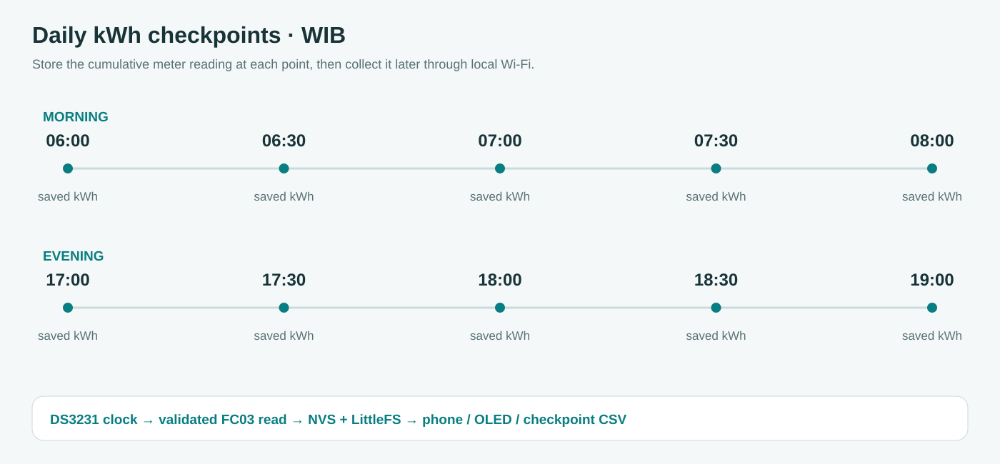
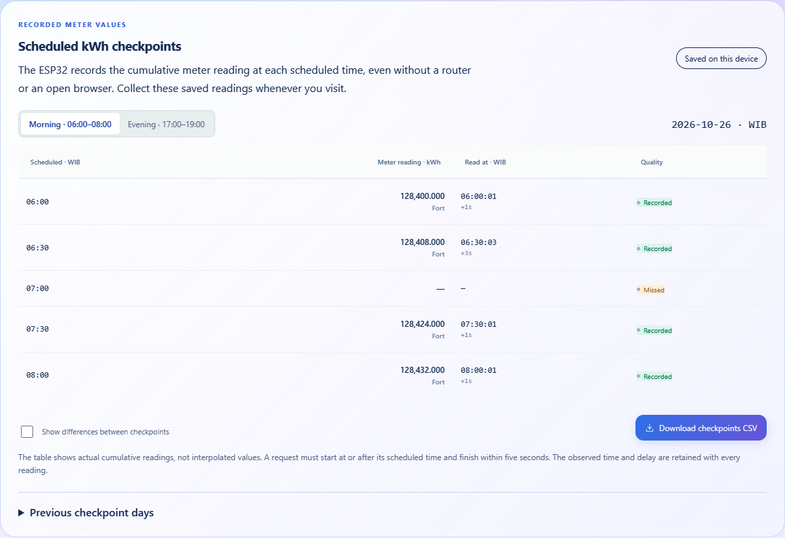

# Scheduled kWh checkpoints

**English** · [Bahasa Indonesia](id/CHECKPOINTS.md)

## What the device saves

The primary record is the cumulative imported-energy value at a scheduled checkpoint. It is not the consumption since the previous checkpoint. If 07:00 records 128,400.000 kWh and 07:30 records 128,408.000 kWh, those two readings remain available when a technician visits at 09:20. The optional difference is 8.000 kWh, while the original cumulative values remain unchanged.

The ESP32 stores these records. It does not add memory to the Fort or write registers in the meter. The logger must remain powered, with a valid DS3231 clock and accepted meter readings, when the checkpoint occurs. Router coverage, a connected phone and an open web page are not required for recording.

## Daily schedule

All schedule labels and archive dates use WIB, UTC+7. The DS3231 stores UTC.

| Morning | Evening |
| --- | --- |
| 06:00 | 17:00 |
| 06:30 | 17:30 |
| 07:00 | 18:00 |
| 07:30 | 18:30 |
| 08:00 | 19:00 |

The schedule is defined in `CAPTURE_MINUTES` in [checkpoint_log.h](../firmware/include/checkpoint_log.h). It has a separate record schema from the earlier nine interval windows. This release does not convert old interpolated interval boundaries into raw checkpoints. The new checkpoint series starts when the upgraded firmware runs, so a checkpoint that already passed before installation cannot be reconstructed.

## Collect readings after the scheduled time

1. Connect the phone to **Midea Engineering AP**, password **betahdijre12345**, and open **http://192.168.4.1**. In client or combined mode, the device's current local address also works.
2. Open **Overview → Scheduled kWh checkpoints** and verify the displayed record date. Choose Morning or Evening to view its five rows. The meter-reading column contains cumulative kWh, and Read at shows the actual response time in WIB.
3. Choose **Download checkpoints CSV** to save the displayed day. To collect an earlier day, expand **Previous checkpoint days**, select its date and then download the CSV. The current day and previous available days are retained for a rolling 31-day range.
4. Enable **Show differences between checkpoints** when consumption between readings is useful. The default view remains the original meter readings. On OLED, PREV/NEXT selects the morning or evening capture page, and short OK cycles its five saved readings with their record date.

A Recorded row is immutable for that day. Its observed time and delay remain attached to the reading. Waiting means the checkpoint has not been finalized. Missed means no acceptable read was recorded inside its admission window. The storage badge refers to the stored day, so always check its date if storage is reporting a backlog.

## Timing and admission

Normal acquisition targets a two-second cycle. From two seconds before an unfilled checkpoint through five seconds after it, the acquisition task gives kWh priority over optional power/electrical refreshes and defers ratio refresh when existing ratios are valid. An eligible checkpoint can retry at a 250 ms target, still subject to the shared transport's spacing and bounded response timeout. Handshake backoff does not prevent a direct energy read during this priority period.

A checkpoint accepts the first validated energy read whose RTC bracket begins at or after the target and ends no later than target + 5 seconds. The bracket must be ordered, span at most two RTC seconds and complete within 2500 monotonic milliseconds. The saved value is the accepted secondary UINT32 counter converted with its validated PT numerator, denominator and CT once. The record keeps those inputs as well as the cumulative `double` value.

DS3231 reads have whole-second resolution, and the meter updates its own counter internally. The scheduled label therefore does not assert an atomic sample at precisely 07:00:00.000. Both software bracket timestamps and the response delay are retained so that the actual observation is visible. Raw checkpoints are never interpolated, filled with zero on failure, or populated later with a value taken outside the window.

Invalid RTC, absent power, unavailable readings or active maintenance can leave a checkpoint missed. Diagnostic test values never enter production records. A clock correction cannot overwrite an already recorded or missed row, and an earlier calendar day is rejected when it would precede retained records.

## Differences are derived data

There are four adjacent pairs per shift, giving eight possible differences per day. No difference is taken from 08:00 to 17:00. A pair must have two recorded endpoints with matching meter/serial/ratio metadata and the same uninterrupted recording generation. Reboots, detected resets, changed settings and excessive accepted-sample gaps invalidate a crossing difference without deleting the raw readings.

A valid difference represents the change between the actual observed endpoints, whose times may differ slightly from the nominal labels. An unavailable difference remains blank in CSV and displays as a dash in the UI. The earlier continuity-tracked nine intervals retain their own semantics and can be opened under **Previous interval schedule and analysis** or exported through `/api/export`.

## Persistence, retention and recovery

Core 1 exclusively mutates captures and writes Preferences. Each day is encoded as a 426-byte record with an explicit little-endian schema, schedule marker, day/revision/generation fields, ten fixed-size rows and CRC16. Encoding does not depend on C++ structure padding. Captured rows retain the request/response UTC times, raw counter, cumulative value, serial metadata, ratios and continuity generation. Decoding checks CRC, schema, calendar, timing bounds and the stored value's agreement with its source.

A changed record is written immediately to the `captures` NVS key and `/c<day>.bin` in LittleFS. A flushed temporary file is verified before installation, and the existing backup-preserving rename policy retains a recoverable copy on failure. Boot recovery compares valid NVS, archive, backup, temporary and previous-day records. Corrupt data does not trigger automatic formatting.

If the filesystem cannot archive a completed day, one previous day can be pinned under `capture_prev` while a new current day uses `captures`. A further rollover is blocked if it would overwrite that unarchived previous day. The UI reports storage attention and retains available records for download. Failed storage is retried, while identical successful NVS records are not rewritten on each retry. Successful archival applies the documented 31-day retention range.

An upgrade preserves the legacy `day` NVS record and `/d<day>.csv` files. The physical format confirmation after a filesystem mount failure erases filesystem archives, including checkpoint days, so export available records before using it. NVS and filesystem power-loss behavior still require the on-board acceptance checks in [COMMISSIONING](COMMISSIONING.md).

## API and CSV

`/api/status` carries the current `checkpoints` projection. Read-only `/api/checkpoints?day=<day>` returns a selected day, and adding `&format=csv` downloads it. `/api/history?kind=checkpoints` lists available checkpoint days, including current/previous NVS records during a filesystem failure. The earlier history/export endpoints retain their interval format.

CSV columns include the record date, shift, scheduled WIB time, actual bracket times, response delay, cumulative kWh, secondary raw count, PT numerator/denominator, CT, slave ID, baud/parity, status and optional difference from the preceding checkpoint. A blank value represents unavailable data rather than zero. File names begin with `fort-checkpoints-` to distinguish this export from the older interval CSV.

Schema 2 retains the 426-byte layout and records the immutable meter profile in row byte 38. Schema 1 remains readable as Fort. Energy validation uses the stored profile scale and ratios, and differences never cross a model change. The table and CSV retain each row’s original model. See [Meter profiles](METER_PROFILES.md) for migration and conversion details.
