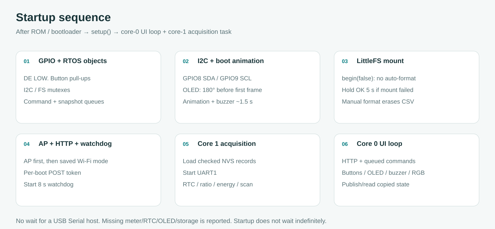

# Firmware design

**English** · [Bahasa Indonesia](id/DESIGN.md)

This guide describes the implementation in `firmware/src/main.cpp`, `energy.h`, `scan.h`, `led.h` and `recovery.h`. Timeouts and scheduling intervals are bounds or targets in the code, not measurements of the physical installation.

## Fort register reference

The primary reference is the scanned `Fort Power Meter_User Manual_compressed.pdf` at the repository root. Addresses below match the manual's hexadecimal PDU addresses; there is no 40001 translation.

| PDF page / printed page | Reference |
| --- | --- |
| 7, table 3; 9, figure 5 | RS485 58/A and 59/B. Terminal 70/COM belongs to switch inputs. |
| 18 / 16, §7.1 | Half-duplex RTU, 1200–38400 baud, default 9600, N81/E81/O81; default N81 |
| 26 / 24, tables 13–14 | Function 03 example; high word/high byte first for the integer data |
| 27 / 25, table 17 | PT numerator 0x002C, denominator 0x002D, CT multiplier 0x002E |
| 29 / 27, table 17 | Active power 0x006A–0x006B, signed 32-bit, 0.0001 kW |
| 30 / 28, table 17 | Imported secondary energy 0x0082–0x0083, unsigned 32-bit, 0.001 kWh; primary float at 0x008A–0x008B |

The application uses only **function 03**. Configuration changes select the reader's UART settings and slave ID; there is no meter register-write path.

The request `01 03 00 58 00 02 45 D8` has a correct CRC. The manual's response `01 03 04 00 00 C3 17 72 E5` does not: the calculated CRC bytes are **EA CD**. Tests reject the printed response and accept the corrected one. The secondary-energy table says length “3” while giving an unsigned long and two register addresses. The reader requests two words/four bytes. These discrepancies are recorded rather than copied into protocol exceptions.

## Startup order

1. Start Serial without waiting for a host. Set GPIO16 LOW and buzzer LOW, configure button pull-ups, allocate mutexes and queues.
2. Start hardware I2C at 100 kHz on GPIO8/9 with a 40 ms timeout. Probe the OLED before allocating its display buffer; apply `OLED_ROTATE_180` with GFX rotation 2 before drawing. Initialize the RGB RMT driver. Run the roughly 1.5 s boot animation/buzzer pattern; missing OLED skips drawing.
3. Mount LittleFS with `begin(false)`. On failure, a physically held OK button can authorize a five-second format. Existing archives are not automatically destroyed.
4. Start the AP at 192.168.4.1/24, channel 6, up to four clients. Generate a new random POST token, publish an initial snapshot, register HTTP routes and start the watchdog.
5. Create the core-1 acquisition task. That task opens Preferences, validates its settings/checkpoint and starts UART1. The Arduino loop handles UI/HTTP on core 0.

Allocation/task-creation failures are fatal and trigger restart. Missing meter, RTC, OLED or filesystem are reported as degraded operation rather than blocking startup indefinitely.

## Task and lock model

`ARDUINO_RUNNING_CORE=0` and `ARDUINO_EVENT_RUNNING_CORE=0` are build flags. The acquisition task is explicitly created on core 1 at priority 2 with a **12,288-byte ESP-IDF task stack argument**. The Arduino loop runs at priority 1. Wi-Fi/TCP/IP tasks remain under the framework's scheduler; the application does not assign every system task to a core.

| Resource | Access rule | Wait bound in the caller |
| --- | --- | --- |
| UART1, Preferences, tracker, scanner | Acquisition task only | No cross-task lock needed |
| Command queue | Core 0 sends, core 1 drains before each loop | Six values; enqueue wait 0; HTTP 503 if full |
| Snapshot queue | Core 1 overwrites, core 0 peeks | One `Snapshot` value; no pointer sharing |
| I2C mutex | RTC transactions and OLED rendering | 80 ms read / 100 ms write / 30 ms OLED |
| Filesystem mutex | Acquisition archive replacement; UI history/export | 200 ms archive write / 100 ms HTTP |

The snapshot contains a copy of the day, active settings, scan progress, diagnostics and latest values. Only acquisition mutates its live state. Core 0 cannot update the tracker indirectly through a pointer. HTTP config/time/mute/scan/LED requests are parsed and queued; NVS writes and UART reconfiguration happen on core 1.

The normal acquisition loop checks commands, validates RTC, handles day/clock changes, refreshes ratios when due, and polls energy/power every two seconds. It then publishes and yields 100 ms. A scan substitutes one candidate probe for normal meter polling, publishes, and yields 10 ms. RTC/day transitions continue during scan.

Timing uses unsigned subtraction on `millis()`/`micros()` to tolerate rollover. Polling is soft scheduled: one unanswered register can consume three 800 ms response windows plus wire time/gaps/backoff. It is not a fixed-frequency sampling interrupt. Each receive wait yields a tick and each attempt feeds the eight-second watchdog. UI drawing is requested no more often than every 300 ms, while the loop yields 5 ms.

The SSD1306 buffer is 128×64/8 = 1024 pixel bytes. I2C transfer and rendering occupy the UI task while drawing; mutex ownership prevents RTC traffic from interleaving. This is bounded cooperative access, not simultaneous bus transactions.

## UART and transceiver state

`HardwareSerial bus(1)` selects UART1. GPIO17 is TX, GPIO18 is RX. GPIO16 connects to both DE and active-low /RE: HIGH enables the driver and disables the receiver; LOW releases the driver and enables receiving. A module with automatic direction can leave GPIO16 unused, but turnaround/local-echo behavior must be checked on the actual module.

A transaction drains at most 128 stale RX bytes, waits the silent gap, sets direction HIGH, waits 30 µs, sends eight bytes and waits for `flush()` to finish transmission before returning LOW. UART hardware generates the start/data/parity/stop bits. The software does not toggle TX for each bit.

For normal 8N1, a character is 10 bits; E/O parity uses 11. The gap is `ceil(3.5 × bits / baud)` seconds, or 1.75 ms above 19200 baud. The pre-request delay rounds upward to RTOS milliseconds plus one millisecond. Received bytes are observed through the driver buffer, so this does not provide accurate t1.5 timestamps for every wire byte.

Since1.4.0 the shared engine uses a256-byte driver ring and a64-byte local frame buffer. Trace/flow records retain a labeled16-byte prefix; full diagnostic HEX can contain64bytes. RX FIFO threshold is1byte at the documented Fort rates (16bytes for experimental higher rates), with a1-symbol RX timeout to reduce buffer coalescing. These settings do not establish per-byte wire timing. Overflow, empty response, CRC mismatch, wrong ID/function/length/count and valid exception 0x83 are rejected. CRC16 is computed in software with initial 0xFFFF and reflected polynomial 0xA001; low CRC byte is transmitted first. The normal path uses up to three attempts and backoff, while scan uses one attempt per register. Scan counters are separate from normal polling counters.

## RTC, counter conversion and continuity

DS3231 stores UTC. The driver checks ACK/length, oscillator-stop flag, valid BCD/calendar, 24-hour mode and century range before accepting a timestamp. An explicit phone sync writes UTC, clears OSF and verifies the resulting time. The day/interval key uses `UTC + 7 hours`, preserving WIB calendar boundaries.

Energy is `unsigned_raw × 0.001 × PT_numerator / PT_denominator × CT`. Power is `signed_raw × 0.0001 × ratio`. Ratio words must be nonzero and no higher than 9999. Ratios refresh after 60 seconds with at least five seconds between retries; sustained stale ratios stop conversion. A ratio change invalidates the baseline instead of mixing scales.

Energy polling is bracketed by RTC reads. Timestamp windows above two seconds or transactions above 2.5 seconds do not feed the tracker. The tracker rejects backward/duplicate timestamps, NaN/negative values and the wrong day. Boundary interpolation is allowed only across monotonic samples no more than 15 seconds apart. Counter decreases, including possible rollover, are treated as discontinuities because a reset cannot reliably be distinguished from wrap.

The jump check uses a compile-time 100,000 kW limit plus two counter ticks of tolerance. It is an installation sanity check, not a metrology guarantee. Update the limit for the plant's actual capacity during commissioning.

## Scan controller

`scan.h` is an allocation-free enumerator/state machine. States are `idle`, `running`, `found`, `cancelled`, `exhausted`. Within an inclusive ID range, all six baud rates and three parities are tried exactly once: `(last − first + 1) × 18` candidates. The configured ID gets all modes first if it belongs to the range. UART is restarted only when baud/parity changes, not for each slave ID.

Version1.4.0 tests a configurable FC03 probe (default0x0034/1word). Matching data or a valid exception stops discovery; energy/ratio validation remains in normal acquisition. Current-format mode has one combination per ID, matrix mode has18. Silent unsupported addresses remain a known limitation. No broadcast/write requests or model authentication are involved.

Starting scan interrupts and checkpoints the tracker, clears the energy baseline and pauses normal polling. Completed intervals remain. Cancellation is processed between candidates, each with at most two 800 ms response windows. End/cancel restores the saved serial settings and invalidates ratio/baseline state. Apply-result goes through the same checked NVS config path as a manual setting. Manual settings are rejected during scan at both HTTP and task layers; duplicate start cannot reset an active scan. Reboot forgets progress/results.

## Persistence and export

Preferences records include schema magic and an application CRC. A checkpoint stores `Day`; recovery calls `Tracker::interrupt()` so reboot cannot bridge an unobserved gap. NVS provides its own underlying commit behavior, but the app has no second checkpoint journal and does not reconstruct the tracker from CSV.

CSV archive replacement writes `/pending.csv`, rotates the old file to `.bak`, installs the replacement, then removes the backup. `installArchive` preserves recoverable data when a rename/restore fails. Export falls back to `.bak` if the main file is absent. Retention removes dates older than 31 stored calendar days only after a successful current write. There is no automatic formatting after mount failure.

HTTP copies a bounded CSV under the filesystem mutex and sends it after unlocking. A full/corrupt filesystem is reported, not silently replaced. RTC battery backup maintains time; it does not keep ESP32 sampling while power is off. Power-cut/endurance behavior needs hardware testing.

## HTTP and browser delivery

`GET /api/status`, `/api/history`, `/api/export[?day=epoch_day]`; `POST /api/led`, `/api/config`, `/api/time`, `/api/mute`, `/api/scan/start`, `/api/scan/cancel`, `/api/scan/apply`. POST uses a per-boot token and bounded numeric/range parsing. Commands return 202 for queue acceptance, not a claim of completed NVS/RTC work. Status must be checked afterwards. A backwards calendar date is rejected while the current RTC/day is valid.

The AP password and HTTP token define the current access boundary. There is no separate login/TLS, OTA, cloud, captive DNS or NTP. Whoever has AP access can read/export and change reader settings. Phone time sync is explicit.

The React app uses local gzip assets generated into PROGMEM arrays. HTML, JS, CSS and third-party notices have separate endpoints and correct MIME/Content-Encoding headers. Asset payloads are sent from flash in at most 1 KiB nonblocking lwIP sends, yielding/feed-watchdog per iteration, with a five-second transfer deadline. The synchronous UI task can be occupied during this transfer; core-1 acquisition does not depend on it. This avoids allocating a whole JS bundle in heap or sitting inside a long `WiFiClient::write` retry loop.

React/React DOM, GSAP and React Bits execute in the browser. Both language catalogs are bundled locally; language selection is stored in browser localStorage with an English fallback when storage is blocked. Live values are never animated through synthetic counter values. CSS and React Bits handle reduced motion. No CDN/font/API request is needed outside the AP.

## References

- [Modbus serial-line specification](https://www.modbus.org/file/secure/modbusoverserial.pdf)
- [Espressif FreeRTOS task API](https://docs.espressif.com/projects/esp-idf/en/stable/esp32s3/api-reference/system/freertos_idf.html)
- [DS3231 datasheet](https://www.analog.com/media/en/technical-documentation/data-sheets/DS3231.pdf)
- [React Bits provenance](../web/vendor/react-bits/README.md)

## OLED rotation and onboard RGB scheduling

`OLED_ROTATE_180` in `board.h` defaults to true. Setup calls `oled.setRotation(2)` immediately after a successful `begin`, before boot/recovery rendering. Rotation 2 retains the logical 128×64 dimensions. Every screen shares that display object; there is no per-page transform or second framebuffer. Setting false selects rotation 0. An absent OLED still skips drawing and does not prevent AP/RGB/acquisition startup.

The RGB renderer runs on core 0 in the existing Arduino loop. It also ticks during boot, the storage confirmation wait and chunked asset delivery. It targets one frame per **20 ms**; constant colors are sent only when changed. This is a cooperative animation target: synchronous HTTP/OLED work may lengthen a frame. There is no dedicated LED task, timer ISR, busy-wait fade loop or extra LED library. Core 1 exclusively loads/saves settings; the command queue carries `LedSettings` values and the snapshot publishes a copy. LED changes never interrupt the energy tracker or use the UART.

The pinned ESP-IDF 4.4 driver configures RMT TX channel 0 with one 64-symbol memory block, APB/8 clock (100 ns ticks), no carrier/loop and LOW idle. Each pixel is **24 GRB bits, MSB first**: a 1 uses 8 HIGH + 4 LOW ticks, a 0 uses 4 HIGH + 8 LOW ticks. The nominal symbol stream is 28.8 µs, followed by idle LOW until the next update (at least 20 ms). `rmt_wait_tx_done(channel, 0)` polls without waiting; a busy channel skips the frame. The only producer then calls `rmt_write_items(..., false)`. Static symbol storage remains valid until completion. Waveform generation is hardware RMT, not CPU bit banging. The RMT channel is reserved for this renderer; concurrent use by another driver is unsupported. Driver setup errors disable LED API controls and are logged; there is no pixel acknowledgement or optical self-test. The independent task watchdog remains the last recovery bound for peripheral-driver faults.

`led.h` calculates color using integer arithmetic. Hue cycles through six RGB sectors, Blink spends half a cycle lit, and Breathing uses a symmetric linear brightness ramp. Global brightness scales each channel once. Unsigned millisecond deltas and a bounded phase accumulator cross `millis()` rollover; changing mode/period restarts the phase. Default Hue/128/8000 ms is used during boot, then the snapshot applies saved settings. Off is restored after acquisition initialization, so a stored Off setting does not suppress the earlier boot lighting.

`POST /api/led` accepts `mode=off|solid|hue|blink|breathe`, `brightness=0..255`, `red/green/blue=0..255` and `period=500..30000` milliseconds, plus the session token. All fields are required and validated before narrowing integers. HTTP 202 means queued; GET `/api/status` returns the applied `led` object with those fields, `available`, physical `pin`, `stored` and `storageOK`. Color and period remain stored when unused by a selected mode. The form sends only on Apply; a status poll with unchanged values does not overwrite an unsaved draft.

Preferences key `led` uses a **12-byte fixed layout**: version 1, mode, brightness, R/G/B, little-endian 32-bit period, then little-endian Modbus CRC16 over the first ten bytes. Decode verifies length/version/CRC/range before changing the output settings. A missing key selects defaults; a corrupt key selects defaults and reports `storageOK=false`. On write failure, the chosen settings remain active in RAM, `stored=false`, and the UI warns. This status is separate from energy/checkpoint storage health. A successful write is restored at the next boot; there are no periodic LED NVS writes.

GPIO48 is the confirmed installation default; GPIO38 is the documented DevKitC v1.1 alternative; select the physical pin in `board.h` before compiling. The code intentionally accepts only these two onboard choices. This is three-channel RGB support, not a fourth white-channel RGBW protocol.

## Passive raw TX/RX capture

`trace.h` defines twelve fixed `TraceFrame` values inside the acquisition-owned snapshot. Each attempt stores the eight transmitted bytes, up to sixteen received bytes, overflow flag, slave/baud/parity, register/word count, retry number, poll/scan source and uptime at the start of the response wait. The capture allocates no heap, writes no NVS/CSV and issues no UART request. Core 1 handles START_TRACE/STOP_TRACE commands and appends after the bounded receive window, before normal validation/return paths. Capture completion does not interrupt the tracker. Existing scan behavior still interrupts recording as documented.

Classification distinguishes exact eight-byte request echo, timeout, too-short data, overflow, CRC failure, valid exception, wrong response shape and valid function-03 response. Overflow always wins over a coincidentally matching prefix. The classifier is diagnostic only; it never permits a frame, strips echoed bytes or skips CRC. The original read validator and retry/error counters remain authoritative. In particular, the legacy scan CRC counter includes short frames, and rejected includes overflow, wrong frame, exception or invalid ratios.

`POST /api/trace/start` resets count and increments generation if capture is inactive. Stop freezes any partial result. After twelve attempts capture stops automatically and frames remain until restart/new capture. Both commands use the usual POST token/queue; 202 is queue acceptance, not immediate hardware completion. Captures may mix polling and scan frames, each explicitly labeled. A transaction already underway when Start is queued is not captured retroactively. Beginning a scan does not reset the capture.

`GET /api/trace` copies a snapshot and returns version/generation/active/count/capacity, actual TX/RX GPIOs and captured frames. It does not touch UART. Full capture data is excluded from routine `/api/status`; the browser polls `/api/trace` serially at one second only while its details panel is mounted, with a four-second timeout and abort-on-close. Stop/closed UI does not erase device RAM. Export creates a local text download, without another meter request. The larger snapshot increases queue/global/stack use; build static RAM is recorded in VALIDATION, while on-target stack high-water marks still require measurement.

The trace is a UART-buffer observation with the existing receive-gap logic, not a timestamped logic-analyzer recording. Sixteen-byte overflow captures are prefixes, not the complete physical stream. Exact TX=RX establishes a repeated request, not whether the loopback is on the PCB, wiring or peripheral. A capture containing errors with Fort A/B disconnected cannot be attributed to a Fort response. Full hardware isolation still requires physical tests.

## Standalone Arduino diagnostic

`examples/FortSerialDebug/FortSerialDebug.ino` has no project headers or external libraries and uses only HardwareSerial(1), CRC16 and function 03. It reads the same documented energy/ratio registers as the main firmware. ID range 1–247 × six baud rates × N/E/O parity gives 4,446 candidates, one attempt per register. The standalone scan now detects a matching FC03 response or valid exception at 0x0034 independently of the energy profile; deeper/read retains full energy and ratio validation. UART settings found by scan are local reader RAM values; the meter is never reconfigured.

RX storage is 64 bytes, response wait 800 ms, per-request detailed frame logging four frames. It recognizes an exact standalone request echo and waits within the original deadline for a separately valid response. Concatenated/ambiguous data remains rejected. It does not change main-firmware echo handling. The x command aborts waits/scan, and no USB-attach wait blocks startup. Console commands and logs run in one cooperative loop; this sketch does not run AP/OLED/RTC/energy windows. Serial logging affects timing and is not hardware acceptance evidence. The optional partition table matches default_16MB.csv, and the sketch itself never touches NVS/filesystem.

## Manual visual audit and diagnostic follow-up — 26 October 2026

The original scanned page images were re-rendered and inspected directly: PDF page 18 / printed 16 lists 1200–38400, N81/E81/O81 and default 9600/N81; PDF page 27 / printed 25 identifies PT numerator/denominator/CT at 0x002C–0x002E and communication address/baud at 0x0034/0x0035; PDF page 30 / printed 28 identifies frequency 0x0080, secondary positive active energy 0x0082–0x0083 at 0.001 kWh, and primary float words 0x008A–0x008B. This was a visual check, not an OCR-only inference. The secondary-energy length field visibly prints 3, inconsistent with the address pair/type; the ambiguity remains documented. The code does not claim that the manual alone verifies the installed device's map.

The standalone diagnostic 1.1.0 separates passive activity, protocol reply and profile validation. `diagnose` runs three seconds of passive RX, a transport probe, then independent raw register reads only when a valid response/exception exists. `scan` stops on a matching CRC-valid response or exception rather than requiring the complete kWh profile. The main dashboard scanner retains its strict profile-matching criterion; its raw capture can show valid exceptions separately. Callback UART errors use atomic counters, with all console output outside the callback. A host test compiles the real INO with deterministic UART/console mocks and tests no-TX passive behavior, exception/data contact, wrong-ID/CRC/echo rejection, scan gating, no false kWh, valid conversion, FC03-only requests, bounds and abort. Peripheral timing remains untested by mocks.

## Runtime-configurable standalone diagnostic 1.2.0

The INO now keeps pin/timing/probe/decoding options as validated RAM configuration. Scan lists contain up to six unique baud rates and three parity modes; current mode tests only the selected format, matrix mode tests the configured cross product. The raw audit plan contains up to eight bounded queries. Energy decoding logs its selected two-word UInt32 address, three-word ratio address, finite positive scale and word order; disabling decoding prevents read/poll conversion. Function03 and all response checks remain fixed. Pin overrides exclude the known flash/PSRAM, USB, boot/console, I2C, button/buzzer and RGB resources; they are user actions, not automatic diagnosis.

A fixed sixteen-line / 96-byte console queue preserves commands while the UART/listen loop is occupied. Parsing does not execute nested commands. The outer loop drains one command at a time, deferring commands during scans; configuration changes stop automatic polling. An x at the start of a line aborts/cancels queued work, while an x inside a HEX address never aborts. Line/queue overflow reports a rejection explicitly. Case TXT files are included in the package and exercised through the actual INO parser using mocked UART/console. The host tests also verify altered probe addresses, scan counts, invalid/duplicate settings, raw-plan bounds, disabled conversion and changed address/scale/word-order conversion. These tests do not measure hardware signal quality.

## Evidence-based standalone diagnostic 1.3.0

The diagnostic now runs the configured raw plan after a silent first probe. This fixes a register-support assumption in the previous staged workflow; it does not prove the installed energy address. A per-test Evidence record separates TX attempts, RX/passive bytes, valid data/exceptions, exact echo, bad CRC/short/wrong/overflow frames, silent timeouts, local UART errors and configured energy conversions. Report labels describe observations, not module-presence sensing. The main firmware remains 1.3.0: its scanner requires both energy and ratios, and its CRC counter also includes short frames. A failed profile scan or CRC/rejected counts must not be presented as a physical-connectivity verdict.

Optional rxcheck stops UART and samples only RX as INPUT_PULLUP and INPUT_PULLDOWN (32 samples each, 1 ms spacing after 2 ms settle), then restores INPUT and UART even on abort. It does not drive RX as an output, send requests, measure supply or resolve a missing/dead module. Weak-bias-following/high-held/low-held/variable are observations with multiple possible causes, not detection claims. UART-buffer timing and weak-pull behavior remain unverified on the target.

User-labeled connected/isolated checks run the same staged test into two fixed-size RAM snapshots. Comparison checks ID, baud/parity, pins, timeout, probe, raw plan and decode settings explicitly, avoiding struct-padding comparisons. Aborted or mismatched runs cannot yield a physical inference. Validated replies during a supposedly isolated run flag contradictory isolation. Isolated RX is evidence of activity outside the claimed Fort A/B path, without identifying a specific component. Both-silent results remain unresolved and require supply/TTL measurements or a known-good comparison. Labels never substitute for a physical connection sensor.

The original PDF27 and30 images were inspected again. Register addresses/scaling are unchanged; diagnostic case05 now reads the ambiguous 0x0082 entry with one, two and three words, without kWh decoding. Extra words are raw only. Function03 remains fixed, word count is distinct from byte length, and float-primary bits are not interpreted as the secondary integer counter. Command guides, all recipes and Serial help explicitly distinguish Serial Monitor INPUT from OUTPUT copied into support chat.

## Main diagnostic runtime, event stream and process sampling — 1.4.0

The committed diagnostic_engine.h is generated from the independent INO by tools/build-diagnostic.py, with hooks for bounded logging, UART events and core1 service. Both normalReader and diagnostic use this same transport on UART1; only one is active. Plain PIO verifies generated provenance. There is no C++ include of an example file, new meter write function or diagnostic NVS profile.

The core1 owner creates maintenance only for active tests/configuration. It interrupts/checkpoints the tracker, copies defaults from the unmodified normal-reader configuration and saved connection, clears prior paired captures/counters, then executes queued commands. Read-only report/status/help/compare/plan-show can run outside maintenance without UART traffic. Accepted HTTP commands wait if the internal console queue is full; explicit stop/resume cancels pending work. A production-scan race is rejected at dequeue. Resume closes the test bus, reinstates board.h pins/saved serial settings, invalidates energy/ratio continuity, and returns to production reads. No test value is sampled by Tracker. Time/date and persistent connection mutations are blocked in maintenance.

The staging command queue holds16×96byte lines, the internal console another16lines, and the stop/resume mailbox is one byte. A separate length-one diagnostic snapshot queue carries an8KiB bounded log plus evidence; core0 uses a static receive view to avoid an8KiB handler stack frame. Logs report discarded bytes. USB output drains at most128bytes per service iteration when space exists, avoiding long-line loss or blocking the UART. Core0 Arduino loop stack is16KiB, acquisition12KiB; on-target high-water values remain acceptance measurements.

Core1 emits timestamped TX-queued/TX-complete/RX-first/frame/tail/timeout/pre-TX/error/passive events into a32-entry ring in the copied application snapshot. Service publishes at most every50ms during waits and feeds the watchdog. GET /api/uart?after=sequence returns ordered new events, a boot identifier, actual pins, ring limits and a gap flag. Core0 never reads UART to build a response. Diagnostic logs refresh at1s only while open, flow at200ms with no overlapping fetches, and process metrics at1.5s only while open. Animation preserves observed timestamp spacing at1× with polling/network delay, does not replay first-load history as live activity, and invents no frames across a gap. Packet paths/afterglow are schematic, not electrical propagation evidence.

The process sampler uses per-core tick hooks, two aligned32-bit single-ISR-writer counters per core and DRAM idle handles. Hooks increment total and non-idle samples using xTaskGetCurrentTaskHandleForCPU; hook functions and that SDK function were checked in the linked image's IRAM range0x4037xxxx. One-second unsigned counter deltas produce sampled non-idle percentages. No runtime-stats kernel ABI overrides or extra sampling tasks are introduced. Tick alignment can alias periodic work; interrupts are attributed to the interrupted task, and registration failure reports null rather than fabricated load. The task table reads only stable owned/idle handles, priority, state and byte-valued stack high-water marks; total system count includes other tasks. Heap/PSRAM figures come from the SDK. These are software observations pending target acceptance. See [operator workflow](DIAGNOSTICS.md).
