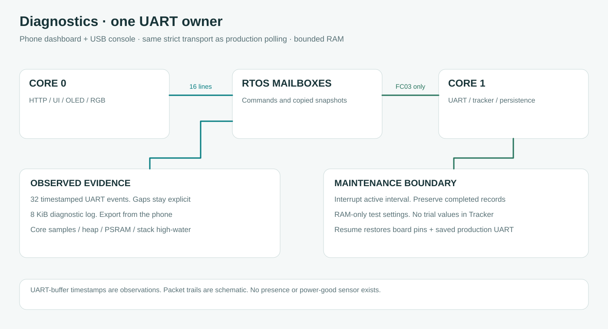

# Diagnostics in the main firmware

**English** · [Bahasa Indonesia](id/DIAGNOSTICS.md) · [Overview](../README.md)

Firmware **1.4.0** includes the standalone diagnostic capabilities. You do not need to replace the application with an INO. The access point, dashboard, buttons and RGB renderer stay available while the UART owner on core 1 runs tests.

## First run at the panel

1. Upload the main `esp32s3` firmware. On your phone, join **Midea Engineering AP**, password **betahdijre12345**, then open **http://192.168.4.1**. Check the footer says Firmware 1.4.0.
2. Open **Meter setup → Diagnostic console**. The field **Command input** is where web commands go. Commands are not messages for a support chat.
3. Select **Staged test**. It fills `diagnose` in Command input; it does not run yet. Choose **Run command**.
4. Wait for `[REPORT_END]` in **Device diagnostic output**. With default silent settings this usually takes about 10 seconds. The test listens passively for 3 seconds, probes communication, continues through its raw-register plan even if the first address is silent, then attempts configured energy/ratios. It does not automatically scan every ID/format.
5. Choose **Download output**. Keep the downloaded TXT on the phone. If you need analysis, send that output file or its full text to the support chat. Do not paste device OUTPUT back into Command input.
6. Choose **Resume measurement** when finished. Confirm the maintenance warning disappears and normal polling returns. Test values never become production interval readings.

RTC/interval sampling also pauses during active tests; the displayed device clock is the last RTC sample until resume.

Any active UART test enters maintenance and interrupts interval continuity. The current interval is partial; completed intervals remain. Closing a panel/browser does not resume measurement or cancel a test. Reopen the dashboard and use Resume measurement. A reboot restores saved production settings and clears diagnostic RAM.

The read-only commands `status`, `help`, `report`, `compare` and `plan show` can inspect retained test information without entering maintenance. While inactive, status also prints saved production settings separately. A fresh maintenance session copies the generated defaults and saved ID/format; overrides/captures belong to that session. Ordinary LED commands may wait until a long test finishes. Saved connection/time changes and production scans are blocked during maintenance.

## Choose a bounded test

Type **one command at a time into the web Command input**, then choose Run command and wait for its output. The same commands are accepted by Serial after entering diagnostics.

| Observation | Command or next action | Interpretation |
| --- | --- | --- |
| Need an initial record | `diagnose` | Current ID/format, multiple independent queries; not full discovery |
| Need passive evidence | `listen 5` | No Modbus TX for 5 seconds; an unpolled slave can legitimately be silent |
| Test one address | `probe 0080 1`, then `intermediate` | HEX address/word count; data or matching CRC-valid exception establishes a reply |
| Need raw words | `reg 0082 2` or `deeper` | No fabricated zero when invalid; raw audit remains separate from kWh |
| CRC/echo/short frames | `status`, inspect HEX, then bounded format scan | Counts alone do not establish a Fort reply |
| Suspected TTL input issue | `rxcheck` | Weak-pull observation, not module-presence/power/continuity detection |
| Compare physical A/B states | `check connected`; physically change only A/B at module; `check isolated`; `compare` | Operator labels, matching completed settings required; do not run both without the physical change |
| Need the previous evidence | `report` | No new request; retained evidence remains separate from production counters |
| Stop immediately | `x` or Stop test | Stops a wait/scan/poll and cancels queued tests; maintenance stays active |
| Finish | `resume` or Resume measurement | Restore saved production UART and pin settings; resume ordinary acquisition |

All field-test variations are listed in the [eight recipes](../examples/FortSerialDebug/README.md#choose-the-test-by-the-observation). Their non-comment command lines also work in the web input, one line per Run command. A `#` comment/file path is not a web command; multi-line paste is rejected explicitly. There are no meter writes or broadcast requests.

Runtime settings include `id`, `baud`, `parity`, guarded `pins RX TX`, `timeout`, `interval`, `probe`, raw `plan`, scan `range`/`scanmode`/`bauds`/`parities`, and diagnostic `energy`/`ratios`/`scale`/`order`/`decode`. Address values are hexadecimal PDU values, without 40001/minus-one translation; counts are 16-bit words. The documented production map is unchanged. Diagnostic overrides are RAM-only and do not change the production profile.

The energy table in the scanned manual contains an unresolved length discrepancy. Recipe 05 compares 1/2/3-word raw reads without decoding the extra word as energy. A float-primary register is not an integer-secondary counter. Do not choose a scale/order merely because the number looks plausible: compare against the corresponding meter display.

## Search connection settings without an hour-long first attempt

In **Meter setup → Find your Fort meter**, start with a known ID or a small range and **Current saved baud/parity**. This tests one selected probe per ID. IDs 1–16 take roughly 13 seconds when silent at 800 ms; all 247 IDs take about 3–4 minutes including overhead. The menu's actual ID/baud/parity is better evidence than defaults.

If required choose **All 18 baud/parity formats**. A full 1–247 matrix has 4,446 candidates and can take about 70 minutes when silent. Cancellation is processed after the current single 800 ms transaction. Do not start a full matrix as the first response to a single failed reading.

The probe address/count is editable. The default is 0x0034/1 word; a silently unsupported address can still be missed, so use the multi-address staged test or another manual-based probe. Both a matching data reply and a matching CRC-valid exception can stop discovery. A found connection is not an authenticated model or a verified energy profile. Apply result saves reader serial settings only; normal energy/ratio validation remains mandatory. Exact echo does not prematurely end the search, because some modules can echo requests at serial settings the meter does not answer.

For custom lists, enter maintenance and use e.g. `range 1 16`, `scanmode current`, `scan`; change one parameter at a time. The console's matrix lists are configurable and its `x` cancellation runs during receive waits. Stop the production scan before starting console tests; a concurrent request race is rejected explicitly at the UART owner.

## What evidence means

`TRANSPORT_DATA_CONFIRMED` means matching ID/function/count/length/CRC data. `TRANSPORT_EXCEPTION_ONLY` means a matching exception, whose register was not read. `PROFILE_DECODED_UNVERIFIED` means the explicitly configured conversion succeeded; physical display agreement is still required. `NO_RX_UNRESOLVED`, `RX_UNVALIDATED` and `ECHO_WITHOUT_REPLY` preserve uncertainty rather than identifying a failed component.

A complete received request echo is rejected, then the original timeout remains open for a separate valid reply. A request prefix followed by extra buffered bytes is logged as `TX_PREFIX_WITH_TRAILING_RX`; it is not silently stripped or accepted. Pre-TX bytes are discarded with a logged prefix/count, not reused as the next reply. Invalid/oversized/deadline-tail frames cannot become energy. Corrupt/short/rejected frame counters remain visible even if a later frame succeeds in the same request budget.

The four-pin module has no presence or power-good telemetry. Missing/unpowered/failed hardware, open RX, wrong serial settings and other silent paths can look identical. Weak-bias sampling and paired tests narrow observations without proving a specific damaged component. Both-silent results still require an independent supply/TTL measurement or a known-good link comparison.

## Live communication and process monitor

The dark communication panel polls **only new UART events** every 200 ms. The firmware records TX queued/completed, first observed RX bytes, frame completion/rejection, deadline tail, no-byte timeout, pre-TX activity, local driver errors and passive RX with microsecond counters and actual test pins. A 32-event ring makes missed events explicit. First-load history is not replayed as new traffic. No new event means no packet motion; reduced-motion preference disables movement.

The browser replays observed timestamp spacing at 1× with an approximately200 ms polling/network delay. Packet position and its 250 ms afterglow are schematic, not measured propagation through A/B or proof Fort received a request. `micros()` wraps roughly every 71 minutes; interval arithmetic uses unsigned differences. Frame HEX and sequence numbers remain inspectable independently of animation.

Open **Device & records → Process monitor** for per-core sampled non-idle ticks, free/minimum/largest heap block, PSRAM and owned/idle task state, priority and stack high-water bytes. Tick hooks do bounded work in IRAM; no extra sampling task is created. The percentage is a tick-boundary estimate over about 1 second, not instruction-time accounting. ISR work is attributed to the interrupted task. The table covers owned/idle tasks; total task count also includes system tasks. Historical minimum free stack is not current stack usage. This panel refreshes every 1.5 seconds only while open.

## Serial Monitor alternative in the main firmware

Open Arduino IDE/PlatformIO **Serial Monitor, 115200 baud, Newline**. **Type `debug` into Serial Monitor INPUT, press Enter** to enter maintenance. Then type `status`, Enter, and `diagnose`, Enter. Copy scrolling OUTPUT to the support chat if needed. Type `x`, Enter to stop a test; **type `resume`, Enter** to restore measurement. USB output drains in bounded chunks without blocking UART work; the web log retains the latest 8 KiB and reports discarded bytes. Save logs between tests. Restart clears them.

## Implementation and limits

`tools/build-diagnostic.py` generates a committed C++ class from the independent INO. The main compiler includes `firmware/include/diagnostic_engine.h`, not the example file. Both normal polling and active tests call its same transport. Plain PlatformIO builds verify provenance without Node. Host tests execute the generated production engine, including all eight recipes and CRC/ID/function/count/echo/exception cases. Browser tests use the generated gzip bytes and simulated APIs. See [validation](VALIDATION.md); none establishes physical meter acceptance.