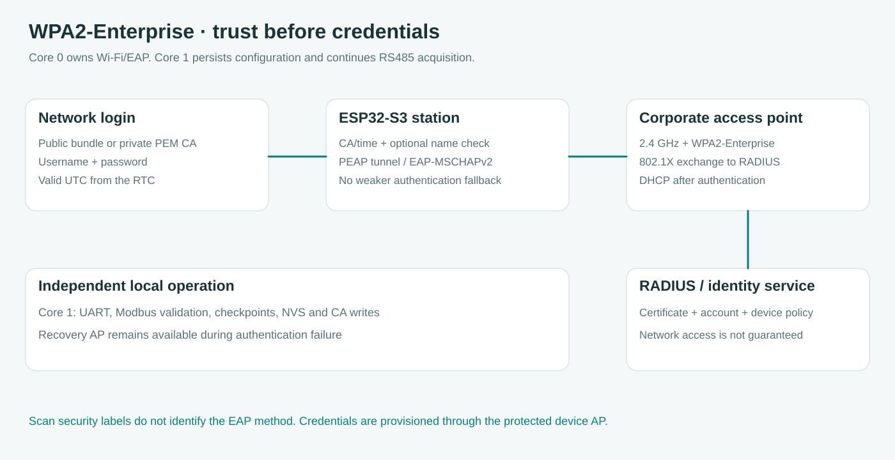

# WPA2-Enterprise connection and certificate provisioning

## November 2026: correct station initialization order

Auditing the exact pinned **Arduino-ESP32 3.3.11** source corrected the earlier assumption: `WiFi.STA.begin()` already defaults to `tryConnect=false`. The legacy `WiFi.begin()` wrapper, not the `WiFi.STA` method, can connect implicitly. The original `STA.connect(ssid,nullptr,0,nullptr,false)` is also non-associating: it sets the SSID and starts DHCP for dynamic IP. Removing it could break IP assignment. The final code therefore keeps explicit `STA.begin(false)` **and restores** non-associating `STA.connect(...,false)`, checks and enforces the WPA2-Enterprise station configuration using ESP-IDF, sets PEAP credentials and public/custom CA trust, enables EAP, and **then** calls a single `esp_wifi_connect()`.

Native adapter tests now fail final association when DHCP setup has not happened and inject faults into both config readbacks. The source references are [WiFiSTA.h](https://github.com/espressif/arduino-esp32/blob/3.3.11/libraries/WiFi/src/WiFiSTA.h), [STA.cpp](https://github.com/espressif/arduino-esp32/blob/3.3.11/libraries/WiFi/src/STA.cpp), and [NetworkInterface.cpp](https://github.com/espressif/arduino-esp32/blob/3.3.11/libraries/Network/src/NetworkInterface.cpp). This is software assurance, not proof of authentication against a particular corporate RADIUS server.

**No manual CA upload is needed for a publicly trusted RADIUS certificate.** The SDK full public CA bundle is built into the firmware. A private corporate RADIUS certificate authority does not automatically become trusted just because a Windows computer joined the network: Windows may have received that CA through management policy. In that case the ESP32 needs the same approved public CA anchor, not a user private key, or a future IT-managed provisioning mechanism. Disabling server verification or accepting an arbitrary certificate is **not** a safe compatibility mode. The optional RADIUS DNS constraint strengthens server identity; a blank name permits any server trusted by the chosen roots, so use an IT-provided server DNS when possible.

The current firmware intentionally supports **PEAP/MSCHAPv2** only; SSID scans cannot negotiate a universal EAP method or prove an installed account is authorized. Networks requiring EAP-TLS certificates, TTLS with a different phase-2 policy, NAC device enrollment or captive portals need an explicit supported profile/IT configuration. The host adapter tests assert no implicit Arduino auto-connect, exactly one post-EAP connect, failure propagation, and a 365-day synthetic retry timeline. These are software checks, not evidence of an authenticated physical RADIUS session.

## Connection results in 3.4.3

The form identifies the interface before accepting a new login. If the page was opened at the device's client address, join the recovery hotspot shown by the device and open its AP address, normally `http://192.168.4.1`. Enter a new username and password there, select the scanned SSID and save. The client address can retry an unchanged saved Enterprise profile without resending its credentials. Changing the login, trusted server or CA still requires the protected AP interface. The recovery AP name is independent of the target SSID, which is never restricted to a company name.

An SSID can now be typed manually when a scan is incomplete or the network is hidden. Reselecting the *same saved Enterprise SSID* retains its stored credentials and CA reference; changing SSID clears credential reuse. You may still replace username/password deliberately via the recovery AP. The chosen network must support the configured **PEAP with MSCHAPv2** method, and successful authentication depends on the RADIUS policy and trust chain.

A successful save confirms persistence, not authentication. The **Connection result** panel beside Save shows the eight-second changeover, release of the previous connection, authentication, DHCP and the final result. Entering either username or password switches off saved-login reuse, so replacement input cannot be silently ignored. When the driver reports a failure, the panel includes its reason and API code. An EAP configuration error also names the failed SDK operation. The last failed attempt remains available when a later retry starts or succeeds, and is retained in RAM until reboot rather than written repeatedly to flash.

The core-0 lifecycle in `network_attempt.h` waits asynchronously for the previous station connection to release, with a five-second preparation deadline checked against the actual ESP-IDF association state. Personal authentication has a 30-second deadline and Enterprise has 60 seconds. A station-associated event starts a separate 15-second DHCP deadline, subject to the overall connection deadline. Only a matching live station and a new GOT_IP event mark the attempt online. An old IP or a successful configuration call cannot do that. Failed attempts have at least a 30-second retry cooldown, while reasons 23/202 pause Enterprise retries until the profile is saved again. A full event queue stops the attempt with an explicit error instead of losing its outcome silently.

The production SDK adapter lives in `enterprise_station.cpp`. It checks the boolean Arduino station configuration result before using the official Espressif EAP functions. The shared certificate parser, immutable CA storage, system-clock bridge and SDK security compile guards remain in `enterprise_wifi.cpp`. The native test compiles this production adapter with SDK boundary doubles and injects failures at every EAP operation. It also checks a blank optional server name, public and custom trust, missing clock, credential clearing and Personal after Enterprise. These tests verify call order and error handling, not a live RADIUS authentication.

If the panel reaches its deadline without a specific driver error, it says so. A timeout cannot prove that a password is wrong, and a generic authentication rejection cannot distinguish a credential problem from certificate trust or network policy. For support, copy the **Connection result** text and Serial Monitor **OUTPUT** into the support chat. No Serial Monitor INPUT command is required for this procedure.


**English** · [Bahasa Indonesia](id/ENTERPRISE_WIFI.md) · [Dashboard guide](WEB.md)

Choose the desired 2.4 GHz network from the scan, select the PEAP authentication option if it was not detected automatically, and enter the username and password. The outer identity defaults to the username and the server DNS name can stay blank. Since firmware 3.3.1, a new Enterprise profile uses the SDK's built-in public CA bundle, so an uploaded certificate is no longer a prerequisite for saving the connection.

Open the dashboard through the ESP32 recovery AP's IP when entering new Enterprise credentials. In 3.4.1, selecting an SSID starts with automatic outer identity even if an earlier profile used a custom identity. This fixes an enabled Save button being blocked by an empty required field inside closed Advanced settings. If an explicitly edited field is missing, Save now reveals and focuses it, with a message beside the button. The same area reports saving, the confirmed result or the reason a request cannot proceed. A successful settings save is followed by the separate Wi-Fi association/authentication status and does not itself prove network access.

No corporate SSID, username, domain or RADIUS hostname is built into the client. The installation's separately configured recovery AP name remains unchanged. Scanning identifies advertised WPA2-Enterprise security, but cannot discover whether that network actually accepts PEAP with EAP-MSCHAPv2. A successful connection still depends on that method, certificate trust and the network's account/device policy.



## Runtime and API choice

The build pins pioarduino 55.03.311, Arduino-ESP32 3.3.11 and ESP-IDF 5.5.5. The adapter uses the official [EAP client API](https://docs.espressif.com/projects/esp-idf/en/v5.5.5/esp32s3/api-reference/network/esp_wifi.html), including `esp_eap_client_set_eap_methods(ESP_EAP_TYPE_PEAP)` and `esp_eap_client_use_default_cert_bundle(true)` for public trust. The pinned SDK configures PEAP phase 2 as `auth=MSCHAPV2`. The TTLS phase-2 selector is not used as a substitute for a PEAP setting, and the obsolete `esp_wpa2_config_t` example is not mixed into this IDF 5 build.

The full public bundle, certificate date checking and key-usage checking are verified by the SDK bootstrap and compile guards. Server validation is never disabled. A profile with a custom CA turns off the public bundle explicitly, uses only its pinned CA and fails if that file cannot be verified. It never silently changes its trust boundary because a file is missing. Ordinary Personal connections disable previous EAP state before using their own settings.

The custom SDK is compiled once in a shared path without spaces because ESP-IDF tooling has path limitations. `tools/sdk_bootstrap.py` verifies configuration and SDK library hashes before reuse, while the application is compiled from its original workspace. Use `python tools/setup-core.py` in the repository-root **computer terminal** to install the pinned pioarduino Core 6.2.0 if the build guard reports a different version.

## Where the certificate comes from

The public CA bundle is compiled into the firmware and requires no file upload. It can validate a RADIUS certificate whose chain reaches one of those public roots. This does not mean every corporate RADIUS server uses a public CA. A company using its own private CA still needs that public CA certificate added through Advanced Wi-Fi settings. Username and password cannot establish trust in an otherwise unknown server, and an SSID does not provide that certificate.

A private CA certificate is public trust material, separate from an account password or private key. A Windows computer that already trusts the network may contain it. From **PowerShell in the repository root**, run the following with the saved profile name listed by `netsh wlan show profiles`:

```powershell
./tools/export-wifi-trust.ps1 -ProfileName 'Your Wi-Fi profile name'
```

The helper only exports public CA certificates matching the profile's SHA1 references. It writes `output/wifi-trust/report.json` without exporting passwords/private keys or modifying the connection. Exit code 2 means that the matching certificate was unavailable in the accessible stores. A fingerprint alone cannot be converted into a certificate. In that case the public CA file must come from the operator of that network.

The RADIUS certificate DNS name is optional. If supplied, it adds a name constraint to chain and date verification. Without it, trust is limited to the selected CA roots but is not bound to one named RADIUS server. The firmware never derives a hostname from the SSID or email address. Deployments requiring a specific server identity should configure that constraint using the actual certificate name.

## Configure from the local website

1. Join the device's protected recovery AP and open its displayed AP IP address. If client mode has closed the AP, first select **Access point only** and save, then join the hotspot before entering Enterprise credentials. The default AP is **Midea Engineering-XXXXXXXXXXXX**, but that is the device hotspot, not a forced corporate client SSID. The HTTP form accepts Enterprise credentials only through the AP interface. When opened through the client IP, it shows the AP name and address link beside Save, and clicking Save explains the required route without transmitting credentials over the client interface.
2. Open **Device & records → Wi-Fi connection**, select **AP + client**, then choose the intended SSID from the scan. The picker displays signal and detectable security. Select the PEAP option when it matches the network's authentication method.
3. Enter the username and password, then choose **Save Wi-Fi settings**. For a new profile, no certificate file, outer identity or RADIUS DNS entry is required by the form. Username/password accept up to 127 UTF-8 bytes each without control characters. A new outer identity can be entered in Advanced settings if the network requires one.
4. Keep an existing private CA selected when editing that saved network. To install a private CA, upload or paste its Base-64 PEM certificate/chain in Advanced settings, up to 4096 bytes and four CA certificates. Server leaf certificates and private keys are rejected. Clearing the saved-CA selection explicitly returns to the public bundle and requires re-entering credentials. No fallback happens automatically.
5. Ensure the device has a valid RTC time. DS3231 stores UTC and the dashboard shows WIB. An invalid/missing RTC is reported as a clock prerequisite, rather than skipping certificate dates. Use the existing explicit time-setting action if necessary. Core 0 re-anchors system time from a valid RTC snapshot every five minutes or after a clock revision without writing the RTC from browser polling.
6. Wait for the execution result and the existing eight-second connection transition, then read the assigned client IP and RSSI. Saving requests a connection attempt. It does not assert that authentication or DHCP succeeded.

Saved usernames/passwords are never returned by status, written into browser storage or printed in logs. The form can reuse them for the same SSID. Changing the SSID, server constraint or CA requires fresh credentials, so a saved login cannot silently be redirected to another trust target. A new profile starts with public trust, while a saved custom profile keeps its CA until explicitly changed.

The [desktop form](assets/ui-enterprise-desktop.png) and [phone form](assets/ui-enterprise-mobile.png) show simulated API responses and test credentials. They are interface examples, not hardware authentication evidence.

## Storage, ownership and reconnection

The existing version-3 Wi-Fi record remains a 779-byte CRC16 structure with bounded EAP fields, AP address and CA SHA256 reference. An all-zero CA reference selects the public bundle in 3.3.1. A nonzero reference selects the immutable LittleFS file `/wifi-ca-<sha256>.pem`. Existing private-CA records and legacy 104/108-byte Personal/open records stay readable. No filesystem is required for a public-bundle profile, and a failed filesystem is never formatted automatically.

From 3.5.0, this payload is wrapped in verified 793-byte `wifi_a`/`wifi_b` generation banks. Legacy import, failure handling and downgrade limits are described in [fleet readiness](FLEET_READINESS.md).

Core 1 owns credential Preferences writes and custom-CA persistence. New CA files cross a bounded one-item queue and must be verified before replacing the credential record. Core 0 owns Wi-Fi and EAP calls and reads a custom CA under the filesystem lock. No changes were made to UART ownership, meter maps, checkpoint schedules or logging. Credentials remain plaintext in stock development NVS unless a separately provisioned encrypted build protects them. The runtime flash-encryption indicator alone is not proof of NVS encryption.

Association is asynchronous, with 30-second Personal and 60-second Enterprise retry spacing. Scans own the station radio until complete. The recovery AP stays available during connection failure, and client mode retains a 15-second AP grace period after obtaining an address. Enterprise rejection reasons 23/202 pause automatic retries to avoid repeatedly submitting a rejected password. Saving the corrected or unchanged profile requests another attempt. These policies do not pause meter acquisition or local records.

## Diagnose the observed failure

| Observation | Meaning and next step |
| --- | --- |
| Save previously stayed disabled through the client IP | Version 3.3.1 replaces that silent gate with an AP-address explanation beside Save. Open the AP address after joining the displayed hotspot. |
| The form previously demanded a CA before submitting | New profiles now use the compiled public CA bundle. Upload a private CA only if that network uses one. |
| `enterprise_clock_required` | The firmware lacks a recent valid RTC reference. Check the RTC and set device time before another attempt. |
| `enterprise_ca_missing` | A specifically configured private CA is missing or fails parsing/hash verification. The firmware does not substitute public trust. |
| `enterprise_api_failed` | An EAP API call failed. Retain the numeric API code and firmware version. No weaker authentication is attempted. |
| Authentication rejection, reason 23/202 | Credentials, trust/name/time, EAP compatibility or network policy can cause this. The reason alone does not establish which field failed. |
| SSID unavailable, reason 201 | The configured SSID was not found on 2.4 GHz at the receiver location. |
| Handshake timeout or repeated link loss | Retain RSSI, attempt count and numeric disconnect reason for comparison with AP/RADIUS logs. |

The dashboard shows phase, associated-versus-addressed state, IP, RSSI, attempt count, disconnect reason and API code. For support, copy Serial Monitor **OUTPUT** into the support chat. No command needs to be typed into Serial Monitor for web provisioning.

## Hardware acceptance with an IT test account

The generated-byte browser suite checks submission without a certificate upload, reload/reuse with no fake CA fingerprint, explicit private CA and DNS settings, client-interface refusal with a working AP link, both languages and phone layout. Native tests cover CRC persistence and trust-target changes, and the physical-target build compiles the real Espressif APIs. These software checks do not prove association to a particular corporate network.

On hardware, check public-chain and private-CA profiles independently, wrong/missing CA rejection, optional DNS mismatch, expired/future certificate rejection and missing RTC. Verify DHCP, coverage recovery, rejection retry pause, Personal after Enterprise and concurrent Modbus/checkpoint operation. No authorized RADIUS server or physical board is available to the automated suite, so those results remain pending.

## Planned office receiver

The optional panel-room SX1262 node and the separate office C3 gateway follow [Energy Station v1](LORA_PROTOCOL.md). The gateway owns its corporate Wi-Fi connection. Radio framing and node acknowledgements are already available, while gateway firmware and its database client remain a separate project.
