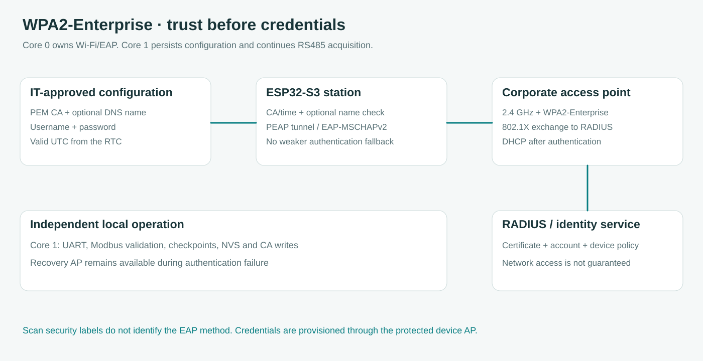

# WPA2-Enterprise connection and certificate provisioning

**English** · [Bahasa Indonesia](id/ENTERPRISE_WIFI.md) · [Dashboard guide](WEB.md)

The station supports an optional WPA2-Enterprise client using PEAP with EAP-MSCHAPv2, alongside the existing Personal and explicitly open profiles. ESP32-S3 scans 2.4 GHz networks. An advertised Enterprise security mode tells the picker that the network uses 802.1X, but it does not reveal the outer or inner EAP method. Select PEAP when it matches the network configuration, as confirmed for the reported installation.

The reported Windows configuration for Midea uses WPA2-Enterprise, AES, PEAP and EAP-MSCHAPv2 with server validation enabled. That is sufficient to implement the client method, but it does not provide the trusted CA or authorization for this device. The firmware contains no Midea account, CA or inferred RADIUS name, and successful authentication is not claimed by the software tests.



## Runtime and API choice

Firmware 3.0.0 moves from Arduino-ESP32 2.0.17 / ESP-IDF 4.4.7 to pinned Arduino-ESP32 3.3.11 / ESP-IDF 5.5.5. PlatformIO uses the [pioarduino 55.03.311 release](https://github.com/pioarduino/platform-espressif32/releases/tag/55.03.311), a community build integration that packages Espressif's Arduino core and SDK. The platform archive URL is pinned in both physical-target projects. The Python development requirement is PlatformIO 6.1.19 with its matching SCons 4.8.1 dependency.

The older public EAP API lacks the explicit server-name and allowed-method controls used by this implementation. [Espressif's EAP client API](https://docs.espressif.com/projects/esp-idf/en/v5.5.5/esp32s3/api-reference/network/esp_wifi.html) supplies `esp_eap_client_set_domain_name()` and `esp_eap_client_set_eap_methods()`. The adapter restricts the outer method to `ESP_EAP_TYPE_PEAP`, installs the supplied CA and enables certificate time checking. The pinned SDK's [EAP peer configuration](https://github.com/espressif/esp-idf/blob/v5.5.5/components/wpa_supplicant/src/eap_peer/eap.c) uses `auth=MSCHAPV2` for phase 2 by default. Review that configuration when upgrading the SDK rather than using the TTLS phase-2 selector as an assumed PEAP API.

Every EAP setup result is checked before association starts. Failure to load a CA, set the expected server name or configure a supported API blocks the attempt. There is no certificate-verification toggle, Personal retry for an Enterprise profile, built-in public CA fallback or automatic change to another EAP method. Ordinary Personal connections disable the prior EAP state before using their own configuration.


The platform uses `custom_sdkconfig` to compile the SDK with `CONFIG_MBEDTLS_HAVE_TIME_DATE=y` and certificate key-usage checks enabled. The bundled precompiled SDK disables date checking, so setting an EAP boolean alone is insufficient. Compile-time guards reject that unsafe configuration. The first build therefore compiles SDK components as well as the application. On Windows paths containing spaces, `tools/pio_paths.py` invokes `tools/sdk_bootstrap.py` to compile the same pinned SDK in a space-free PlatformIO cache. The helper checks the compiled configuration and SDK library hashes before reuse. It copies configuration metadata back to the project, while the production application is compiled from its original source directory. No test application is substituted for the release firmware. The project configuration header is named `network_settings.h` to avoid colliding with Arduino 3's `Network.h` on Windows.
## Where the certificate comes from

The CA certificate is public trust material issued by the organization or certificate authority that authenticates the Wi-Fi server. It is separate from your account password and does not require a private key. A company-managed Windows computer may already contain it, allowing a public-certificate export. A saved Wi-Fi profile can reference a CA fingerprint even when the matching certificate is unavailable in the stores accessible to an export tool. In that case, the fingerprint alone cannot be converted into a certificate. Obtain the public CA file from the team operating that Wi-Fi, rather than creating a new certificate or downloading an arbitrary one.

On a Windows computer that already has the corporate Wi-Fi profile, run this in **PowerShell in the repository root**, replacing the example with the profile name listed by `netsh wlan show profiles`:

```powershell
./tools/export-wifi-trust.ps1 -ProfileName 'Your Wi-Fi profile name'
```

The helper exports only public CA certificates matching the profile's exact SHA1 references and writes `output/wifi-trust/report.json`. It does not reveal stored passwords, export private keys or modify the Wi-Fi connection. Exit code 2 means the referenced certificate was unavailable, so there is no PEM to upload. The report stays outside the source and release package. If a matching CA is available, use its PEM file in the advanced form after checking the report. Each firmware upload still has the documented 4096-byte/four-CA limit.

You do not need to know the RADIUS hostname to use the form. **The server DNS field is optional.** When supplied, it adds a name check to CA-chain and date validation. When blank, the configured CA remains the trust boundary, but the profile does not restrict authentication to one named server. The firmware never guesses a hostname from the SSID or your email address.

| Field | Value and meaning |
| --- | --- |
| SSID and radio availability | An authorized network reachable on 2.4 GHz at the receiver location. A 5 GHz-only AP cannot be used by this ESP32-S3. |
| Authentication | Confirmation of PEAP with inner EAP-MSCHAPv2 for the device/account. Other EAP methods are not implemented by this form. |
| Outer identity | Defaults to the username. Open Advanced Wi-Fi settings only if the network needs a separate outer or anonymous identity. |
| Inner username and password | Authorized credentials in the exact format IT requires. Each field accepts up to 127 UTF-8 bytes without control characters. |
| Trusted CA | A Base-64 PEM CA certificate or chain, up to 4096 bytes and four CA certificates. DER must be exported to PEM before upload. Server leaf certificates and private keys are rejected. |
| RADIUS certificate DNS name | Optional additional server-name constraint. If provided, enter the certificate hostname without a wildcard, URL, port or name list. Leave it blank if the network profile does not specify one. |
| Device policy | Whether the ESP32 MAC, device account, network segment and unattended receiver are permitted. A successful employee laptop does not prove those permissions. |

The current UI accepts one optional DNS name. A deployment requiring an explicit list of several names needs a future allow-list implementation rather than an invented organization domain.

## Configure from the local website

1. Connect the phone or laptop to the protected **Midea Engineering AP**, then open its displayed IPv4 address. Enterprise provisioning is accepted only on requests addressed to the AP interface. The existing HTTP dashboard does not provide end-to-end TLS, so the firmware rejects Enterprise credential changes arriving through the corporate client interface.
2. Open **Device & records → Wi-Fi connection**. Select **AP + client** during commissioning so the local dashboard remains reachable after association. **Client + AP recovery** can close the AP after a stable connection and retains it again while the client is unavailable.
3. Choose the corporate SSID from the scan. Its label shows WPA2-Enterprise, RSSI and the advertised security family. Select **WPA2-Enterprise · PEAP / EAP-MSCHAPv2** only after IT confirms that method.
4. Enter your username and password. The outer identity defaults to that username. If the device already has a CA for this saved network, it is retained. Otherwise, open **Advanced Wi-Fi settings** and upload or paste the public PEM CA once. The optional server DNS name and separate outer identity are in that same section. The browser never fetches saved credentials, and subsequent visits can reuse them for the same SSID without entering them again.
5. Confirm that the device clock is valid. DS3231 stores UTC and the dashboard displays WIB. If needed, use the existing explicit time-setting action with the RTC connected. An absent or invalid RTC blocks an Enterprise attempt instead of disabling certificate date checks. Network time cannot solve initial authentication because the network is not yet available. While an Enterprise profile is active, core 0 re-anchors the system clock from a recent valid RTC snapshot every five minutes or after an explicit clock revision. This updates TLS time without writing the RTC or changing the checkpoint clock owner.
6. Choose **Save Wi-Fi settings** and wait for the matching execution result. Core 1 verifies the CA file and the NVS configuration before core 0 applies the connection after the existing eight-second delay. Record the assigned client IP and RSSI after connection. Move the browser to that network only if its policy permits access to the ESP32.

A blank new password never authorizes an open fallback. Changing the SSID clears the browser's credential-reuse selection. The separate **Keep the saved trusted CA** control is explicit, and the status response exposes only its SHA256 fingerprint and the expected server name. Closing or refreshing the page does not put EAP credentials into localStorage.

Changing the trusted server name or CA also requires entering the EAP credentials again. Saved credentials cannot be redirected to a different trust target by selecting the reuse control.

The following [desktop form](assets/ui-enterprise-desktop.png) and [phone form](assets/ui-enterprise-mobile.png) use simulated API responses and test credentials. They are interface examples, not evidence of a successful corporate login.

## Storage, ownership and reconnection

The version-3 Wi-Fi record is an explicit 779-byte CRC16 structure. It stores the authentication mode, bounded EAP fields, AP address and CA SHA256 reference. Existing 104-byte and 108-byte Personal/open records remain readable. A CA is public trust material and is stored separately in LittleFS as `/wifi-ca-<sha256>.pem`, which avoids placing a large certificate inside the existing NVS partition. Up to eight immutable CA files are retained. Unverified configuration is not applied. Previous certificate files remain available for investigation, and a missing filesystem is never formatted automatically.

Credential writes and CA persistence belong to core 1. A separate one-item queue carries a bounded new certificate, while ordinary commands carry only its request token and connection fields. The CA must be read back and validated before the credential record is replaced. Core 0 owns Wi-Fi driver/EAP calls and reads certificates under the filesystem lock. UART, meter profiles and checkpoint schedules retain their existing ownership and definitions.

This release does not automatically enable flash encryption, NVS encryption, Secure Boot or burn eFuses. The stock development build stores credentials in NVS without credential encryption and cannot promise protection against physical flash extraction. Its runtime flash-encryption indicator is not proof that NVS keys have been securely provisioned. Production credentials should use an IT-approved device account, with a separately provisioned security build when required by policy.

Association is asynchronous. Personal retries retain the existing 30-second policy, while Enterprise attempts are spaced by 60 seconds to allow the PEAP exchange more time. Radio scans own the station until completion, so association retries wait for them. The AP remains available during failure and a client-only profile retains a 15-second grace period after it obtains an address. These timers do not pause Modbus acquisition or local logging. Required certificate setup and flash writes are bounded configuration operations rather than a wait loop for Wi-Fi to connect.


An Enterprise rejection with reason 23 or 202 pauses automatic association attempts, so a saved bad password is not submitted every minute. Inspect the login and trust settings, then use Save Wi-Fi settings to request one new attempt with the saved or corrected credentials. This pause also applies after a scan, while lost coverage and handshake timeouts retain the reconnect policy. The rejection does not prove which authentication field failed.

## Diagnose the observed failure

| Observation | Interpretation and next action |
| --- | --- |
| `enterprise_clock_required` | No recent valid RTC reference was available. Check the RTC and set its time before another Enterprise attempt. |
| `enterprise_ca_missing` | The referenced CA is unavailable or fails parsing/hash verification. Reprovision it through the local AP and retain the existing files for investigation. |
| `enterprise_api_failed` | An official EAP setup call failed. Record the numeric ESP error code together with the firmware version. No weaker authentication is attempted. |
| Authentication failed, reason 23 or 202 | The stack reported an authentication failure. Credentials, certificate trust/name/time, EAP compatibility or policy can cause it. The disconnect reason alone cannot distinguish them. |
| SSID unavailable, reason 201 | The target was not found by association. Check 2.4 GHz coverage, SSID and AP policy at the actual office receiver location. |
| Handshake timeout or repeated loss | Retain the reason code, RSSI and attempt count. Ask IT to correlate the device MAC/time with RADIUS/AP logs rather than guessing that the password is wrong. |

Status includes the current phase, IP addresses, RSSI, attempt count, disconnect reason and API error code. Serial output logs sanitized attempt and reason codes without EAP credentials or certificate contents. If sharing those results, copy Serial Monitor **OUTPUT** to the support chat. No command needs to be typed into Serial Monitor for this web provisioning workflow.

## Hardware acceptance with an IT test account

Use the website connection form for each trial and retain the serial OUTPUT with its numeric reason code. With a recent valid RTC reference, verify that an authorized CA/name/account reaches DHCP, while a wrong CA, wrong server name, expired certificate and not-yet-valid certificate all fail without an assigned client address. Confirm that missing/invalid RTC blocks the attempt before EAP starts. An unsupported outer method must not trigger a different method, and a Personal profile must still work after leaving Enterprise. Use an IT test account for failure cases rather than repeatedly submitting an employee password.

Then remove AP coverage and restore it while inspecting the local checkpoint log. Verify that the recovery AP remains reachable and that association without an assigned IP is shown separately from an online client. These physical trials remain pending and are not simulated by the browser suite.

## Planned office receiver

The intended topology places the RS485 logger in the panel room and a separate Wi-Fi-connected receiver in the office, with SX1278 transport between them. This release adds optional Wi-Fi authentication to the existing station. It does not implement LoRa framing, delivery acknowledgement, radio wiring or a server/database client. Those layers can use the network status without owning EAP configuration or blocking the logger, and should be designed as separate modules when their protocol and hardware are specified.

The browser tests use simulated network responses and the physical-target build compiles the actual Espressif APIs. Successful CA parsing, certificate rejection on a test RADIUS server, PEAP authentication at Midea, DHCP, roaming/reconnection and simultaneous AP traffic still require device acceptance with authorized IT configuration. A green software suite does not establish corporate network access.
