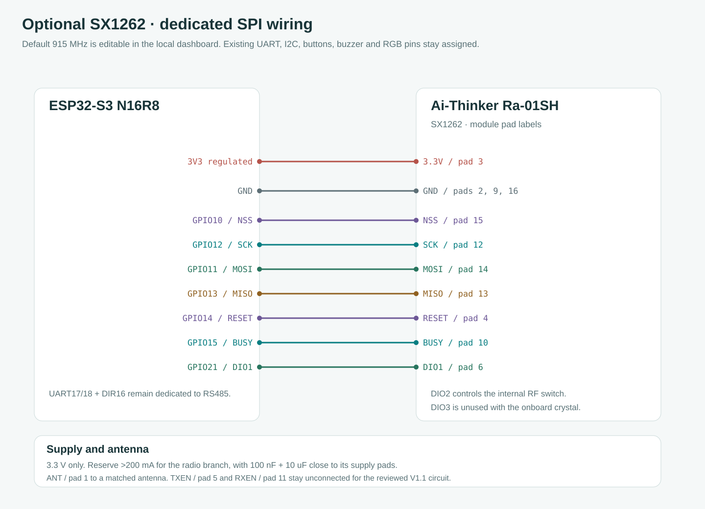
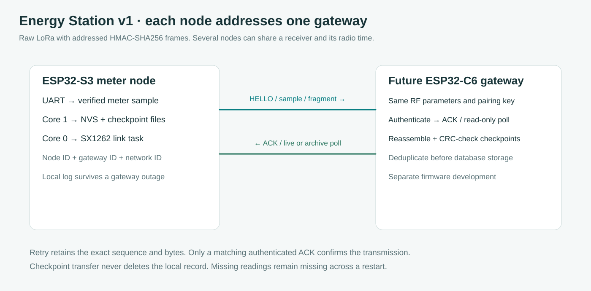

# SX1262 node and local radio controls

**English** · [Bahasa Indonesia](id/LORA.md) · [Wire protocol](LORA_PROTOCOL.md) · [Power-loss audit](POWER_LOSS.md)

For several stations sharing one office receiver, follow [PTMP setup and ID examples](LORA_PTMP.md). The [gateway development prompt](GATEWAY_PROMPT.md) is ready to copy into a separate gateway-project chat.

Firmware 3.4.0 adds an optional raw-LoRa link between this ESP32-S3 meter station and one configured gateway. The intended gateway is an ESP32-C6 with an SX1262, developed in a separate firmware project. This release implements the S3 node and publishes the gateway's wire contract. It does not include an ESP32-C6 image or claim a completed RF pairing test.

The radio defaults to **915.000 MHz**, as requested by the owner, and remains disabled until configured through the website. The carrier is editable from 803 to 930 MHz, which follows the Ra-01SH model's stated range. Node ID, gateway ID and network ID are independent of the Modbus slave address. Each station needs a unique node ID within its network.

## Connect the Ra-01SH

The [Espressif DevKitC header guide](https://documentation.espressif.com/esp-dev-kits/en/latest/esp32s3/esp32-s3-devkitc-1/user_guide_v1.1.html) was checked for the GPIO and octal-memory reservations. These assignments use the GPIO labels printed on the ESP32 board, not the ordinal position of a header pin. They avoid UART 17/18 and DIR16, I2C 8/9, buttons 4/5/6, buzzer 7, RGB 48, USB 19/20 and the N16R8 memory pins. Module pad numbers come from the visually inspected Ai-Thinker Ra-01SH Specification V1.1, PDF page 11. The source URL, SHA256 and reviewed pages are recorded in [reference provenance](references/ra-01sh-reference.json).

| ESP32-S3 or supply | Ra-01SH pad | Signal |
| --- | --- | --- |
| Regulated 3.3 V | 3 | 3.3V |
| Common GND | 2, 9 and 16 | GND, connect all three |
| GPIO10 | 15 | NSS, chip select |
| GPIO12 | 12 | SCK |
| GPIO11 | 14 | MOSI, ESP32 output |
| GPIO13 | 13 | MISO, ESP32 input |
| GPIO14 | 4 | RESET |
| GPIO15 | 10 | BUSY |
| GPIO21 | 6 | DIO1, interrupt |
| Matched 50-ohm antenna connection | 1 or the fitted antenna connector | ANT |

The reviewed page-12 circuit has a crystal and an internal RF switch controlled from DIO2 through R8. The driver sets `radio.tcxoVoltage=0` and enables DIO2 RF switching. Leave the exposed TXEN/RXEN and DIO2/DIO3 pads unconnected for that circuit. The manual contains inconsistent TXEN/RXEN labels and a copied DIO mapping table, so those are not used as a substitute for the actual schematic or SX1262 API. A board with a different RF-switch population needs its own circuit check before an external control pin is driven.

Power the radio from 3.3 V, never a GPIO output or a 5 V rail. The manufacturer specifies more than 200 mA supply capability for the radio branch. Place 100 nF and 10 uF decoupling close to its supply pads, and allow extra regulator margin for the ESP32's concurrent Wi-Fi current. A separate 3.3 V regulator can be used with common ground when the board regulator cannot keep that rail stable. Connect a matched antenna before enabling transmission. Repeated ground labels in the diagram refer to the same electrical net, and the drawing is not a board photograph. The machine-readable [netlist](wiring-lora.csv) matches the SVG.

## Configure through the ESP32 website

1. Open **Device & records → LoRa node / SX1262**. Use either the ESP32 AP address or its connected client address. Radio settings and new pairing keys use the same dashboard command authorization on either interface, independently of Enterprise credential provisioning. Keep key entry on a trusted local connection because this dashboard uses HTTP. An existing key is never returned by status.
2. Set a unique **Node ID**, the intended **Gateway ID**, and a common **Network ID**. Keep the node and gateway IDs different. These identifiers do not configure the meter or change its Modbus address.
3. Keep 915 MHz or choose the carrier needed by the installation. Open **Radio parameters and retry timing** to match bandwidth, spreading factor, coding denominator, preamble and sync word with the gateway. Power, sample interval, ACK timeout and retry count can also be edited.
4. Generate or enter a nonzero 64-digit hexadecimal pairing key. Copy the new key into the gateway's configuration before saving, because it is cleared from the form after the save and cannot be recovered through HTTP. Keep it in the deployment's credential record if it will be needed later. Provisioning does not encrypt stock NVS or measurement payloads.
5. Enable the radio and choose **Save radio settings**. Core 1 writes the inactive CRC bank and reads it back before publishing the new generation to the radio task. A stale second browser cannot overwrite a newer key/configuration silently. A failed save retains the active configuration.
6. With matching gateway firmware running, choose **Pair again**. A successful SX1262 initialization only proves driver initialization. The UI displays a paired session after a correctly addressed, authenticated ACK for the node's HELLO. **Send current sample** requests a telemetry transmission using the next available radio slot.

Save changed settings before choosing Pair again or Send current sample. These actions use the active saved configuration, so the dashboard disables them while the form contains an unsaved draft. If a field inside closed Radio parameters is incomplete, Save opens the section, focuses that field and displays its name beside the action. Settings, key controls and radio actions use separate rows that wrap on narrow screens.

The [expanded desktop](assets/ui-lora-advanced-desktop.png) and [expanded phone](assets/ui-lora-advanced-mobile.png) illustrations use simulated values and show all Advanced fields. They do not establish a hardware radio test.

The default parameters are 915 MHz, 125 kHz bandwidth, SF7, CR4/5, preamble 8, sync word 18 decimal, 14 dBm, a 60-second interval, a 10-second ACK timeout and two retries after the first attempt. The public default IDs are node 2, gateway 1 and network 1. They are commissioning defaults, not automatically unique addresses.

The hardware range and a configurable 915 MHz default are not a statement of spectrum authorization. For an Indonesian LPWAN installation, [Permenkomdigi 2/2025, Annex II](https://www.postel.go.id/downloads/40/20250208094700-permen_2025-02_perubahan_PM_Izin_Kelas_BN.pdf) lists 920–923 MHz, 250 kHz maximum bandwidth, 20 dBm end-node power and 1% uplink/downlink duty limits. Select installation-appropriate frequency, bandwidth, power and antenna gain on both ends. The firmware's editable hardware limits also cover other deployment regions, and its per-boot airtime pacing is not regulatory certification.

## Half-duplex operation and offline records

A dedicated priority-1 task on core 0 owns FSPI, the SX1262 object and DIO1 handling. The ISR only sets a flag. SPI transfers, packet parsing and HMAC work occur in the task, with 100 ms BUSY waits and a bounded startup path that avoids RadioLib's repeated one-second reset probes. An absent module reports an initialization code and is retried every 30 seconds while enabled. The radio is untouched while disabled. Production diagnostics reserve these SPI/IRQ GPIOs from runtime UART pin reassignment. UART, Preferences and tracker mutation stay on core 1, and no radio command writes meter registers or sets the RTC.

TX completion returns the radio to RX before waiting for ACK. A retry keeps the exact packet bytes, boot/session nonce and sequence. Randomized backoff reduces repeated collisions, while a shared 1% airtime gate covers telemetry, retries and checkpoint fragments within the current boot. The gate remains in RAM across radio reconfiguration but does not survive an ESP32 reset. The displayed wait can therefore exceed the sample interval, especially at SF12. It is not a claim of simultaneous TX/RX, unlimited node capacity or duty accounting across repeated power cycles.

Live telemetry coalesces to the newest accepted meter value rather than accumulating an unbounded queue. Missing or stale energy is marked absent by a validity flag. Durable checkpoints remain in the station's existing local log. The gateway can request a WIB day and receive its CRC-protected 446-byte record in acknowledged fragments. Core 1 services one bounded archive request at a time and defers it near an urgent checkpoint. The gateway must reassemble, validate and deduplicate records before persisting them. An ACK does not delete a local record or prove a database commit. A lost gateway can request those days again while the existing retention window permits.

Use a distinct pairing key for each node, with the gateway maintaining an ID-to-key inventory. The protocol authenticates frames with a truncated HMAC-SHA256 tag and rejects wrong addresses, sessions, ACK sequences and replayed polls. It does not encrypt the kWh payload. There is no unauthenticated over-air pairing or remote meter configuration. See [Energy Station v1](LORA_PROTOCOL.md) for offsets, flags, acknowledgement behavior and the public software test vector.

## Check the installed link

The panel exposes TX, authenticated RX, ACK, timeout, rejected-frame and physical CRC counters, RSSI/SNR, last airtime, queued TX wait and driver error code. These counters reset with the ESP32 and are not written to flash per packet. The process monitor includes `sx1262-link / SPI` and its stack watermark. A missing module, antenna mismatch, interference or incompatible gateway cannot be diagnosed from an ACK timeout alone.

[Desktop](assets/ui-lora-desktop.png) and [phone](assets/ui-lora-mobile.png) illustrations use simulated API responses. Native tests exercise codecs, recovery, addressing, ACK/session matching and pacing. Physical SPI signals, DIO2 RF switching on the purchased board, TX power, reception, range, coexistence, RADIUS/Wi-Fi load and gateway interoperability still require bench and field tests. Do not interpret the simulated paired state as hardware acceptance.
