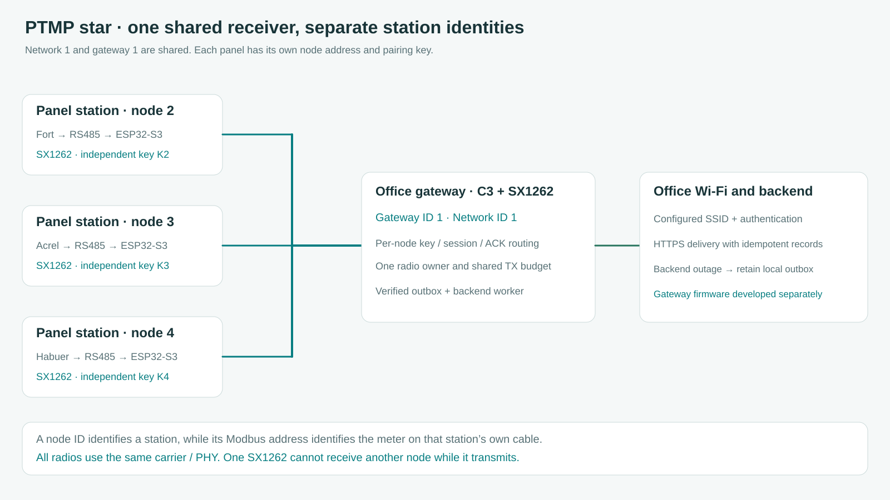

# One gateway and several meter stations

**English** · [Bahasa Indonesia](id/LORA_PTMP.md) · [Radio configuration](LORA.md) · [Gateway development prompt](GATEWAY_PROMPT.md)

The station is the node side of a point-to-multipoint star. Several ESP32-S3 stations can address one ESP32-C3 receiver, with one SX1262 at each end. The S3 firmware implements the node and the [Energy Station v1 binary contract](LORA_PROTOCOL.md). The [ESP32-C3 gateway repository](https://github.com/gedxxe/esp32-modbus-energy-gateway) contains a separate compatible receiver implementation. A successful RF exchange still requires physically matching both configurations and keys. Matching the frequency alone does not implement authentication, acknowledgements or checkpoint retrieval.

The gateway normally listens for the stations' periodic uplinks, authenticates each frame with that station's key and sends an addressed ACK. It can request a live value or a saved checkpoint day from one station. Its Wi-Fi connection uploads accepted data to the office backend independently of the radio worker. A panel-room station needs neither router coverage nor the gateway's Wi-Fi credentials to acquire and retain measurements.

## What the identifiers mean

| Setting | Meaning | Example |
| --- | --- | --- |
| Network ID | Application network carried in every radio header. Match it on the gateway and its stations. It does not select a frequency or prevent RF collisions. | `1` throughout this installation |
| Gateway ID | Radio destination address of the receiver. All its stations use this value. | `1` for the office gateway |
| Node ID | Radio source address of this station. It must be unique in that network and different from the gateway address. | `2`, `3`, `4` for three panels |
| Modbus slave ID | Address of the power meter on one station's local RS485 cable. Separate cables can each have slave `1`. | `1` on each independent panel bus |
| Saved meter ID | Inventory reference local to one station, retained in its checkpoint source. It is not a global radio address. | Store it together with Network ID and Node ID |
| Profile ID | Immutable decoding identity such as Fort or the verified ADL400 map. It describes the source, not a station address. | Current ADL400 total is profile `5` |
| Pairing key | Per-station 32-byte secret used for HMAC. The gateway stores the corresponding key under that station's ID. | A different generated key for each station |

Node `2` and gateway `1` are different endpoints in the same address space. Network `1` can also contain node `3` and node `4`. Do not enable several stations with the shared factory Node ID `2`. Neither an SSID nor an IP address substitutes for these radio identifiers. A matching sync word assists PHY reception but is not an authentication key.

## Configure a three-station installation

1. Build the separate [ESP32-C3 gateway](https://github.com/gedxxe/esp32-modbus-energy-gateway) from its `firmware/` PlatformIO workspace; use [the development prompt](GATEWAY_PROMPT.md) only as background. Give it Gateway ID `1`, Network ID `1` and the same PHY settings as the nodes. Default carrier is editable `915 MHz`, with `125 kHz`, `SF7`, `CR4/5`, preamble `8`, logical sync `0x12`, explicit header, normal IQ and LoRa CRC enabled. Follow the installation's spectrum requirements described in [LORA](LORA.md).
2. At the first S3, open its AP or client address and choose **Device & records → LoRa node / SX1262**. Set Node ID `2`, Gateway ID `1` and Network ID `1`. Generate a key and copy that new key into the gateway's inventory entry for node `2` before saving. Saved secrets are not returned by HTTP.
3. Use Node ID `3` at the second panel and `4` at the third, with the same gateway/network/PHY. Generate and register their own keys. Modbus settings stay specific to the meter connected to each panel.
4. Enable and test one station first. SX1262 initialization must succeed, then HELLO needs its matching authenticated ACK. Inspect RX/ACK counters and last RSSI/SNR. A configured gateway ID or a successful SPI initialization alone does not prove a radio exchange.
5. Add the other stations one at a time. The gateway should display a separate row for every `(network, node)` with its name, session, latest value, receive time, sample age and errors. Verify that a packet from node `3` never updates node `2`.
6. Request one saved day from one station. The gateway reassembles five acknowledged fragments into the frozen 446-byte record, checks CRC and semantics, then stores it idempotently. A missing day stays unavailable. Compare the result with that station's local checkpoint export.
7. Disconnect office Wi-Fi, restart the gateway and power-cycle a station in separate tests. Local acquisition must continue. Verify receiver backlog recovery and a new authenticated session after a node restart before treating the installation as accepted.

## Shared radio time and capacity

One SX1262 listens on one selected configuration and cannot receive another station while transmitting. The v1 link uses addressed packets, SX1262 nonblocking CAD before node uplinks in the companion branch, bounded random backoff and retries. It has no negotiated TDMA slots, collision-free reservation, mesh routing or multichannel concentrator. Gateway polling serializes requested work but cannot silence the nodes' autonomous periodic uplinks.

Since 3.4.1, initial HELLO contention has at least a five-second random window, increased for longer airtime up to 30 seconds. Other first transmissions use an airtime-dependent window with a 1.5-second minimum. A correctly addressed ACK for an already transmitted outstanding frame can arrive during retry backoff. It is rejected after that frame retires or its session changes. Retry bytes remain immutable and stale live values retain the existing expiry rule.

The 1% software pacing budget is local to each radio, so the gateway must budget its own ACKs and POLLs across all stations. As a calculation example, RadioLib 7.8.1's SX126x airtime equation gives about 133.4 ms for a 72-byte telemetry packet and 87.3 ms for a 41-byte ACK at the default PHY. Three telemetry ACKs per minute occupy about 0.44% gateway TX time before HELLOs, retries or archive work. Ten occupy about 1.46%, already beyond that software budget. These are calculated airtimes, not measured range or capacity results. Use the selected PHY's actual `getTimeOnAir()` result, leave headroom and increase station intervals as the installation grows. Slower spreading factors change these figures substantially.

The gateway scheduler needs one shared TX budget and radio owner. ACKs have priority, repeated pending ACKs for the same frame are coalesced, and only one archive transfer should run globally at a time. Keep normal telemetry reception active between archive fragments. A station can also interleave one due/requested live frame of its own between checkpoint fragments, so the receiver must keep its archive assembly while processing that telemetry. Do not poll every live value when periodic telemetry already supplies it. A busy gateway should defer work visibly instead of accumulating an unbounded queue. Poll deadlines must account for up to 30 seconds of node contention, duty waits and archive service, independently of a node's ACK timeout.

## Receiver implementation boundaries

The gateway inventory maps `(Network ID, Node ID)` to a name, key and expected receiver address. Treat a valid HELLO as a candidate session, then confirm current reachability with a fresh correlated live POLL before replacing an established session. This avoids promoting recorded old HELLO traffic to current online data. Preserve monotonic per-session POLL sequences across receiver restarts by reserving sequence blocks before transmitting. Never reset a sequence to `1` while the station still remembers a later sequence in that session.

ACK means radio packet acceptance. Database durability is a separate status. Retain validated records in a recoverable local gateway outbox before reporting durable collection, retry backend delivery idempotently and never delete a station's records because an ACK was sent. Record missing energy as missing, preserve UTC/sample age/source metadata and do not multiply already-scaled kWh by CT/PT again.

The ESP32-C3 gateway has a single RISC-V application core; do not copy the S3's core-1 ownership assignments into it. Use bounded worker queues and short tasks on its supported application core. Exact gateway GPIOs depend on its board/module and must be checked before wiring.

Software tests cover three addressed nodes, foreign-node/session rejection, delayed outstanding ACKs and bounded contention. Physical multi-node RF reception, collision behavior, gateway scheduling, power failure and backend delivery remain installation acceptance tests. The [gateway prompt](GATEWAY_PROMPT.md) specifies the required implementation and test evidence.

## ESP32-S3 channel sensing update (wire v1 unchanged)

The node's independent [PTMP medium-access PR #5](https://github.com/gedxxe/esp32-modbus-energy/pull/5) now checks for LoRa preamble/channel activity using RadioLib 7.8.1's interrupt-driven SX1262 CAD before each HELLO, TELEMETRY and CHECKPOINT uplink. Busy-channel observations defer the **same immutable authenticated frame** through bounded random backoff. The receiver gateway gives ACKs priority and performs its own CAD before lower-priority POLLs. Both ends keep their factory software default **915 MHz**, SX1262 PHY, 14 dBm configured TX and protocol v1 packet layout. This is a software collision-mitigation mechanism, not deterministic TDMA or proof of zero hidden-node collisions. Physical four-node RF acceptance remains outstanding.
