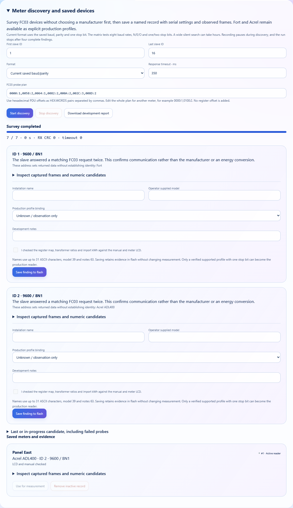

# Meter discovery, saved devices and development evidence

**English** · [Bahasa Indonesia](id/METER_DISCOVERY.md) · [Overview](../README.md)

The station has two related workflows. A production profile defines the documented meaning of a register and its conversion to kWh. Discovery searches for devices that answer read-only FC03 transactions, records what was observed and lets an operator retain a named investigation in flash. Finding a slave does not automatically select a manufacturer or authorize an energy conversion. The [Modbus application specification, section 6.3](https://modbus.org/docs/Modbus_Application_Protocol_V1_1b3.pdf), defines FC03 in terms of holding-register data and exceptions rather than a manufacturer identity.


## Run a survey from the ESP32 website

Open **Meter setup → Meter discovery and saved devices** on the local dashboard. The normal Fort/Acrel connection form remains the place to choose a documented production profile. Opening the discovery panel or downloading a report does not pause measurement. **Start discovery** is an active maintenance operation and interrupts interval continuity until the saved reader is restored.

1. Begin with the installed slave ID or a small range. **Current format** uses the saved baud, parity and one stop bit, so known communication settings avoid an expensive search. The direction circuit follows the saved manual/automatic choice, with the installed GPIO17/18/16 manual circuit remaining the default.
2. Review **FC03 probe plan**. It uses hexadecimal PDU offsets in `HEX:WORDS` pairs, separated by commas, with no 40001 adjustment. The generated default plan starts at `0000:1` and adds current, energy and ratio queries from the built-in profiles. Edit the whole plan for a different manual, for example `0000:1,0100:2,0102:2`. Up to eight unique queries of one to three registers fit the bounded capture buffers.
3. Set the response timeout between 150 and 3000 ms. The initial 350 ms is a survey setting, while normal production retains its established 2000 ms response timeout and 200 ms request spacing. Raise the survey timeout for a meter whose documented response is slower. A silent query does not stop the remaining queries for that candidate.
4. Choose **Start discovery**. The task tries each query, confirms a matching data or exception response with a second request and completes the candidate's plan before publishing a finding. It continues looking for other candidates instead of stopping at the first slave. Up to four complete findings are retained in RAM, after which the run stops and the previous production reader returns.
5. As soon as the desired finding appears, choose **Stop discovery** if the remaining range is unnecessary. Completed findings remain available, while the unfinished candidate is retained only as an investigation record in the report. There is no need to wait for the full range before saving a completed finding.
6. Inspect its captured frames and enter an **Installation name**, an **Operator supplied model** and optional **Development notes**. Keep **Unknown / observation only** when the model or register meaning is unresolved, then choose **Save finding to flash**. Saving evidence does not change the production connection.
7. To use a known meter, explicitly bind the finding to Fort or Acrel and confirm that the manual, transformer ratios and import-energy LCD have been checked. **Use for measurement** is available only when the supported profile's current, energy and ratio queries each returned two accepted data frames, the serial rate fits that profile and one stop bit is used. An exception-only discovery remains useful evidence but cannot satisfy those checks.
8. Download **Development report** before starting another survey. A new run replaces the previous unsaved findings, while named records stay in flash. The JSON export includes both saved records and the latest failed or incomplete candidate. Keep a copy outside the station when collecting evidence for a new driver.

The first four saved records fit the local registry. Remove an inactive record after exporting it when another slot is needed. The active reader cannot be removed. Selecting another saved reader, even with identical baud, ID and profile, interrupts continuity and stores that reader's distinct ID with subsequent checkpoints.



## Search bounds and interpretation

The broad matrix covers eight rates: 1200, 2400, 4800, 9600, 19200, 38400, 57600 and 115200 baud. It combines N/E/O parity with one and two stop bits and prioritizes the configured ID. The current-format path searches only the saved serial format. A large silent matrix can take hours because every query has a response deadline and bus-spacing cost. Progress counts completed query slots, while request-attempt counters include confirmation and locally rejected attempts. They are not wire-level packet counters.

Only FC03 is transmitted. This is a general scanner for FC03-compatible Modbus RTU devices, not a claim that every power-meter protocol can be discovered. A device that requires FC04, a vendor handshake, another baud outside the configured matrix or unsupported framing can remain silent. The tool does not read FC43 device identification, reset devices, alter addresses or write meter configuration. A valid exception is evidence that a slave answered, while a timeout alone cannot distinguish a disconnected module from a silent or differently configured meter.

The transport still requires the expected slave ID, function, byte count, frame length and CRC. It rejects request echoes, extra bytes and overflow without stripping a prefix to manufacture a plausible response. Discovery consumes that same validated result and does not introduce a second acceptance parser. Captured bytes may be truncated at 16 per reply when an invalid input exceeds the fixed buffer, in which case the report marks the capture as truncated.

Address-set hints mean that the current, energy and ratio addresses of a built-in profile returned data. They do not establish identity or units. The website can display U16 words, U32/I32 interpretations and both normal/swapped float candidates for the first two words. These are unscaled developer views and never enter the checkpoint tracker. Each probe retains the first reply and its confirmation so a changing value or a data/exception disagreement stays visible.

Attempt durations include request spacing, UART-driver waits and response processing. They are not exact RS485 propagation latency. The report records the boot identifier, run identifier, monotonic elapsed time and a whole-second RTC reference when available. That RTC reference is the task's time before its final probe, not an atomic timestamp for every returned register. No report claims to measure A/B voltage or prove the health of an external transceiver.

## Named records and flash recovery

Each saved entry retains a stable 16-bit ID, the operator's name/model/notes, explicit profile binding, verification flag, serial format, direction and complete probe evidence. Names allow 31 printable ASCII characters, model labels 39 and notes 63. Blank or control-character names are rejected. Names and models remain operator declarations, while raw observations stay separate. An identical save request for the same completed finding is idempotent and does not allocate another ID or write flash again.

The registry is explicitly serialized with a version and CRC16 into two alternating NVS banks, `meters_a` and `meters_b`. A new bank is read back and compared before it replaces the running registry. Boot selects the newest valid generation and retains the other bank for recovery. Both invalid banks are preserved for investigation and new writes are blocked rather than resetting the registry automatically. This storage is independent from the LittleFS checkpoint archive, and no automatic format or erase is introduced.

A separate CRC-protected `meter_seq` record reserves the next ID before a registry bank is written. Losing the newer bank therefore cannot cause its IDs to be reused after falling back to an older bank. Reservation can leave a gap after a failed write, which is intentional. IDs are never silently wrapped. The 16-bit namespace stops accepting new entries when exhausted, while existing saved records and exports remain readable.

Production settings use a separate explicit 16-byte record containing the selected saved ID and a CRC. The previous v1/v2/v2.5 records are decoded and migrated without changing their documented Fort/Acrel meaning. If a saved ID no longer resolves to a compatible verified entry after recovery, the station reports configuration attention and does not silently attribute measurements to a different named device.

Checkpoint schema 3 stores the saved meter ID in each 42-byte row, producing a 446-byte day record. Schema 1 and 2 remain readable at their original 426 bytes and receive saved ID zero because they predate named inventory. Completed rows are retained. Optional differences compare saved ID as well as profile, serial settings, ratios and continuity generation. The CSV adds `saved_meter_id`, and the table shows that ID beside the profile. Removing a registry entry does not delete historical checkpoint IDs, but its human label is no longer retained in the four-entry registry, so export the development report before removal.

## Standalone Arduino investigation

The [FortSerialDebug guide](../examples/FortSerialDebug/README.md) retains its path for compatibility. It uses the same discovery controller and transport as production, with no NVS or filesystem writes from the standalone sketch. In **Arduino IDE Serial Monitor**, select **115200 baud** and **Newline**. Type one command at a time into Serial Monitor **INPUT**, then press **Enter/Send** for that line:

```text
range 1 16
scanmode current
timeout 350
discoverplan 0000:1,0058:2,0064:1,0082:2,000A:2,002C:3,008D:2
discover
discoveryreport
```

Use `x` or `stop` in the same Serial Monitor INPUT to cancel, then run `discoveryreport` again for completed evidence. `scanmode matrix` enables the broad survey. `stops 1` or `stops 2` changes the diagnostic current format explicitly. Raw `reg HEX WORDS` investigations can be performed after selecting the desired baud, ID and parity. These remain trial settings and do not establish a production energy map.

The same lines can be entered one at a time in the website's **Diagnostic console → Command input → Run command**. Active console discovery interrupts recording, and **Resume measurement** restores the saved production configuration. The named flash registry belongs to the website discovery panel rather than the standalone INO. `status`, `report` and `discoveryreport` inspect existing state without starting maintenance. Copy resulting **OUTPUT** or the downloaded report to the support chat when requesting analysis. Do not paste output labels back into Command input.

## Modules and verification

[SerialSweep.h](../firmware/lib/FortMeter/src/SerialSweep.h) owns candidate enumeration and bounds. [MeterDiscovery.h](../firmware/lib/FortMeter/src/MeterDiscovery.h) owns the editable plan, confirmation policy, fixed-size evidence and lifecycle. The existing FortTransport/ModbusMaster stack owns transmission and response acceptance. [meter_registry.h](../firmware/include/meter_registry.h) owns record validation/encoding, while [meter_registry_store.h](../firmware/include/meter_registry_store.h) owns the two-bank Preferences adapter and ID reservation. [meter_lab_web.cpp](../firmware/src/meter_lab_web.cpp) owns HTTP parsing and report serialization through callbacks, with no direct UART or Preferences access. [meter_config.h](../firmware/include/meter_config.h) centralizes settings equality and migration.

Core 1 owns discovery, registry mutation and flash writes. Core 0 receives queue copies, serves the report and sends bounded requests to the owner. Stop uses a separate atomic run token checked by the cooperative transport service, so it does not wait behind an ordinary settings command. A stale run or queued mode revision cannot save a result from a newer survey. The ordinary profile scanner clears an old result when a new manual configuration is saved, and the Acrel ratio command uses the correct two-word boundary.

Native tests execute the real ModbusMaster implementation and actual standalone INO, including silent-first-probe continuation, exception-only findings, four-result capacity, stop handling, serial framing changes, record CRCs, old settings/checkpoints, bank failure/recovery and ID reservation across a lost newer bank. Browser tests use the actual embedded gzip arrays with simulated APIs for naming, save/reload, profile activation, active-delete protection, export, stale-view retention, priority Stop, languages and small-screen layout. Physical NVS power cuts, stack headroom, radio behavior and agreement with real meters still need field acceptance. No software-only test is presented as that hardware result.
