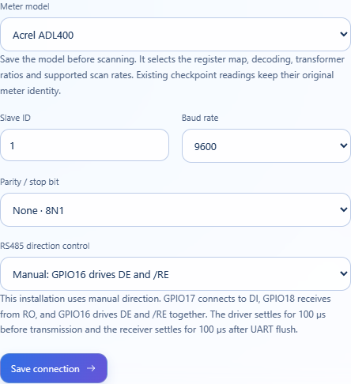
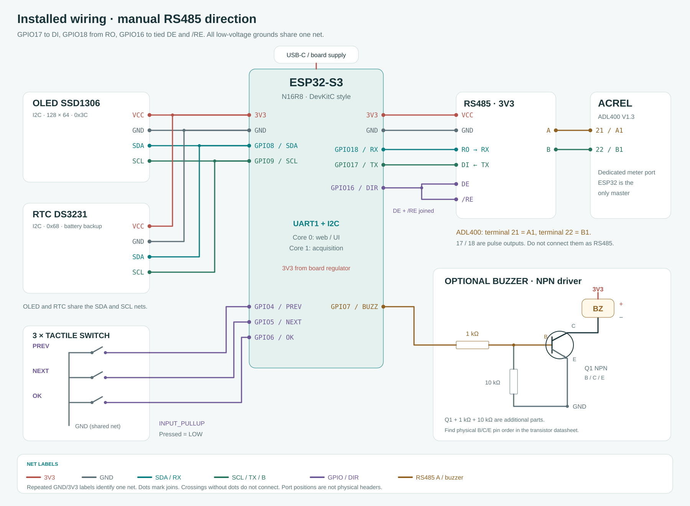

# Meter profiles and field acceptance

**English** · [Bahasa Indonesia](id/METER_PROFILES.md) · [Overview](../README.md)

One station reads one configured meter through the shared FC03 transport. Select the installed model in **Meter setup → Meter model**, match its slave ID, baud and parity, then choose **Save settings**. The selection controls acquisition, the scan probe, supported scan rates, raw-register labels and the diagnostic plan. A scan finds a responding slave at the selected settings. It cannot establish the manufacturer or prove that a plausible register value represents the intended physical quantity.



## Sources and supported revisions

The Fort profile preserves the validated map from the root [Fort manual](../Fort%20Power%20Meter_User%20Manual_compressed.pdf). The Acrel profile follows the supplied [ADL400 installation and operation instruction V1.3](../Acrel%20ADL400%20Manual.pdf), a 27-page document. PDF page numbers below count the cover as page 1. Its printed page numbers are four lower.

The Acrel table has ambiguous typography: the merged note on PDF page 16 labels active and reactive energy together as kVarh, while the quantity names distinguish active from reactive energy. A later [manufacturer ADL400 T1.4 manual](https://www.acrel.ng/uploads/file/20240819/adl400-installation-and-operation-instruction.pdf), table 8, explicitly identifies the low-address active-energy block as UINT32, 0.01 kWh, with PT×CT applied once. That later document corroborates the conversion but does not replace the supplied revision. In particular, later ADL400/MID documents give different power resolutions and floating-point maps. This implementation uses the supplied V1.3 extended power scale and does not claim compatibility with every ADL400 revision, MID variant, ADL400-D or ADL400W.

Production reads assume the high word comes first for the two-register integer values, with big-endian bytes inside each Modbus register. The supplied manual does not explicitly settle the two-word ordering. Diagnostics retain the raw words and an explicit `order normal` / `order swap` comparison. Do not select an order just because one candidate looks plausible. Compare the import-energy result with the meter LCD, and stop acceptance if the words or scaling disagree. Trial diagnostic overrides never silently change the production map.

## FC03 register map

Addresses are hexadecimal PDU offsets. No 40001 offset or automatic subtraction is applied. The Acrel length column counts bytes, so a length of 4 means two 16-bit registers.

| Reading | Fort | Acrel ADL400 V1.3 | Acrel PDF page |
| --- | --- | --- | --- |
| Phase-A current / default contact probe | `0x0058`, 2 words, UINT32 × 0.0001 A | `0x0064`, 1 word, UINT16 × 0.01 A | 17 |
| Phase-A voltage | `0x0042`, 2 words, UINT32 × 0.0001 V | `0x0061`, 1 word, UINT16 × 0.1 V | 17 |
| Total active power | `0x006A`, 2 words, INT32 × 0.0001 kW | `0x016A`, 2 words, INT32 × 0.0001 kW | 19 |
| Frequency | `0x0080`, 1 word, UINT16 × 0.01 Hz | `0x0077`, 1 word, UINT16 × 0.01 Hz | 17 |
| Forward/import active energy | `0x0082`, 2 words, UINT32 × 0.001 kWh | `0x000A`, 2 words, UINT32 × 0.01 kWh | 16 |
| Transformer settings | `0x002C`, 3 words: PT numerator, PT denominator, CT | `0x008D`, 2 words: PT, CT. Denominator is 1 | 18 |
| Optional primary float energy | `0x008A`, diagnostic candidates only | No primary float energy in this supplied map | 22–23 |

The energy formula is `raw × profile.energy.scale × PT numerator / PT denominator × CT`. It uses `double`, and no cumulative value is accepted until ratios are in 1–9999. For example, Acrel raw 123456, PT 2 and CT 40 produces `123456 × 0.01 × 2 × 40 = 98764.8 kWh`. The raw secondary register value remains available before ratio acceptance. Current, voltage and power in the register panel are decoded register values without an extra transformer multiplication.

The station deliberately reads the forward counter `0x000A`, rather than combined total `0x0000` or reverse `0x0014`. The meter's optional frozen-history registers are separate from the ESP32 checkpoint log and are not imported or reconfigured. Only FC03 requests are issued, even though the meter manual also describes write functions.

## Wiring



The local electronics stay unchanged: ESP32 GPIO17 goes to DI, GPIO18 receives RO and GPIO16 connects to tied DE and /RE. The direction callbacks allow 100 µs to settle before transmission and after switching to receive. The purchased transceiver is confirmed compatible with the ESP32's 3.3 V TTL signals.

For **Acrel ADL400 V1.3**, connect transceiver A to meter **21/A1** and B to **22/B1**, as drawn on PDF page 9, figure 7. Meter terminals 17/Ep+ and 18/Ep− are pulse outputs. The communication drawing does not provide an RS485 ground terminal. For **Fort**, use **58/A and 59/B**. Fort 70/COM belongs to the switch inputs. These are signal-terminal assignments, not instructions for the meter's mains or CT circuits. Refer to the [Acrel signal netlist](wiring-acrel-adl400.csv) or the [Fort wiring guide](WIRING.md) for the other ESP32 peripherals.

## Commission at the panel

1. Connect the actual meter and select its model in **Meter setup**. Match its installed ID, baud, parity and direction, then save. The model becomes the scanner default only after the save completes. Fort defaults remain available for installations upgraded from earlier releases.
2. Observe the register panel. A valid reply confirms a matching FC03 transaction, including CRC, ID, function, byte count and length. A valid exception confirms communication but does not accept that register map. RX noise, an echo or CRC errors do not confirm a meter connection.
3. If settings are unknown, start with a small ID range using **Saved format**. The full matrix covers six rates for Fort and five for the supplied ADL400 revision, each with N/E/O parity. ADL400 V1.3 lists 1200, 2400, 4800, 9600 and 19200 baud on PDF page 15. Its prose says None while its menu lists None/Odd/Even, so the selected menu setting determines the test. Use normal Modbus slave IDs 1–247 despite the menu table's inconsistent upper bound.
4. In the web **Command input**, enter `status` and choose **Run command**, then enter `intermediate` and choose **Run command**. Enter `deeper` separately for the profile's complete read-only plan. Inspect raw words, ratio values, decoded import kWh and any exceptions. Copy resulting **OUTPUT** to the support chat if analysis is needed. Log labels are not commands.
5. Compare the decoded import kWh with the meter's forward-energy LCD page at the same time. Confirm CT/PT against its menu and check representative current, voltage and frequency. The ESP32 cannot infer the meter revision from a successful CRC response. Keep the raw output when there is a factor-of-ten discrepancy or the counter does not track the LCD.
6. Choose **Resume measurement**. Check that production resumes with the saved model and wait for a scheduled checkpoint to become Recorded. The checkpoint table and CSV identify the model that produced each row.

## Standalone Arduino diagnostics

The existing [FortSerialDebug sketch](../examples/FortSerialDebug/README.md) retains its path for compatibility and supports both profiles through the same library. After uploading, open **Arduino IDE Serial Monitor**, choose **115200 baud** and **Newline**. Type each following line into Serial Monitor **INPUT**, then press **Enter/Send** after that line:

```text
profile acrel-adl400
id 1
baud 9600
parity N
status
intermediate
deeper
report
```

The ID and serial settings are examples and must match the installed meter. For Fort, use `profile fort`. The profile command resets its probe, energy address/scale, ratio layout, raw plan and matrix rates while retaining UART pins and link settings. It does not change saved production settings. `primary` reports unsupported for Acrel because this revision has no documented primary float energy register. Existing custom raw commands remain available for controlled comparisons, and all eight case recipes are Fort examples unless a recipe explicitly selects another profile.

## Architecture, persistence and extension

[MeterProfiles.h](../firmware/lib/FortMeter/src/MeterProfiles.h) is the allocation-free source of register descriptors, encoding, scale, ratio layout, scan baud limit and terminal labels. Acquisition and diagnostics consume these descriptors through the existing ModbusMaster transport. The status API publishes the same catalog to the browser, which uses it for selection and register labels. No second brand-specific CRC or frame parser is introduced.

The in-memory Settings layout remains 12 bytes, while the explicit 16-byte persisted configuration adds the selected saved-meter ID and CRC. CRC-valid v1/v2 configurations migrate to Fort, and v2.5 configurations retain their Fort/Acrel profile. Captures use schema 3 at 446 bytes with a saved-meter ID in every recorded row. The decoder still reads the old 426-byte schema 1/2 records, preserving their profile and assigning inventory ID zero. Model or saved-device changes interrupt continuity and clear live readings. Optional differences compare saved ID, profile, serial settings, ratios and generation. [Meter discovery](METER_DISCOVERY.md) explains named records and the separate raw-evidence workflow.

Add another meter by defining a new immutable profile ID with reviewed sources, descriptors and tests. Never repurpose an existing profile ID for a different scale or map because archived rows rely on its meaning. A new encoding, ratio layout or byte-order variant requires an explicit typed decoder and fixtures before it is enabled. Future revisions with different meanings need their own profile rather than a silent fallback after a failed probe.

Core ownership, bounded retries, active-maintenance arbitration, Wi-Fi modes, RTC handling and checkpoint admission windows remain shared across profiles. Native tests exercise both widths, signed power, CT/PT conversion, scan bounds, legacy settings and record migration through the real ModbusMaster library. Browser verification uses simulated APIs and the actual shipped gzip assets. Neither those checks nor PDF review substitutes for acceptance on the installed Acrel hardware.


## Habuer and profile capabilities

Habuer uses immutable ID 2 with a direct meter-total energy basis. Its required-reading mask, typed Float32 measurements and absent CT/PT registers are described in [Habuer integration](HABUER.md). The formula above applies to the Fort/Acrel secondary profiles. The runtime catalog marks unsupported registers as null, uses a dedicated contact probe and generates diagnostic/discovery plans from the same descriptors. Historical FortMeter API names and NVS keys remain for compatibility and do not restrict the selected manufacturer.
