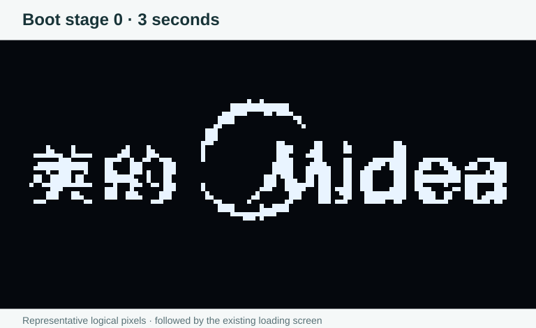
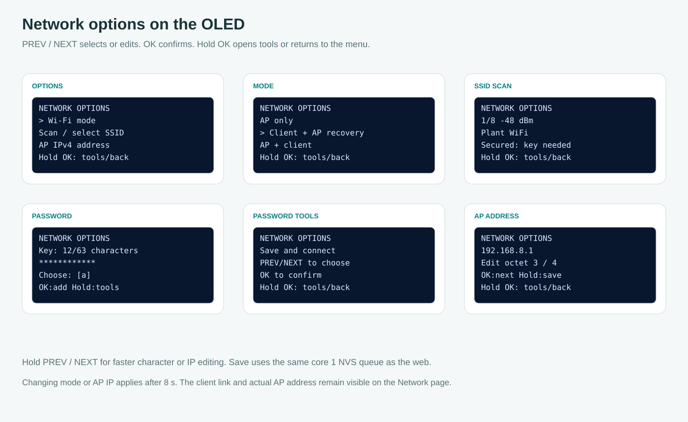
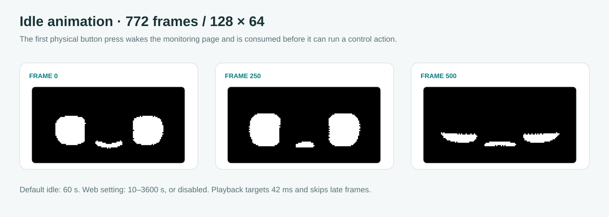

# OLED controls and network setup

**English** · [Bahasa Indonesia](id/OLED.md)

The installed SSD1306 is rotated 180° by the board setting before the first frame, including recovery screens. PREV is GPIO4, NEXT GPIO5 and OK GPIO6, each connected to GND when pressed with an internal pull-up. The existing 35 ms stable debounce and 900 ms long press remain in use.

## First boot frame

The supplied Midea logo is the first visible frame after OLED initialization. Its original 120×90 XBM is drawn at (4, -17), matching the supplied Lopaka layout, then clipped to the logical 128×64 panel. XBM uses least-significant-bit-first pixels, so the firmware calls Adafruit GFX `drawXBitmap()` rather than `drawBitmap()` and needs no U8g2 dependency. The master `OLED_ROTATE_180` setting is applied before drawing.

`OLED_BOOT_SPLASH_MS` in `firmware/include/board.h` defaults to 3000. The hold starts after the display transfer completes, while bounded RTOS/LED initialization can proceed behind the retained frame. The waiting loop yields every 5 ms and does not write the image repeatedly. The existing 1.5-second loading bar and buzzer pattern run afterward, before filesystem/network/acquisition startup. This is boot stage 0, not a FreeRTOS priority-0 task, and it adds approximately three seconds to startup only when the OLED is present. An absent OLED skips the logo hold and follows the existing startup path.

The canonical artwork is `firmware/assets/oled/boot-logo.xbm`. `tools/build-oled.py` verifies all 1350 bytes against the supplied bitmap SHA256 and emits its flash-resident data alongside the idle animation in `oled_frames.cpp`. The existing display buffer is reused and the boot logo allocates no separate frame buffer. The illustration above shows logical pixels and is not a hardware photograph.

## Open network options

Use PREV/NEXT to reach **NETWORK / WIFI**, then press OK to open **NETWORK OPTIONS**. PREV/NEXT moves through Wi-Fi mode, Scan/select SSID, AP IPv4 address, AP password and Back. Short OK enters the highlighted item. Holding OK normally returns to this options menu, while password/IP editing opens its respective tools.

Select **Wi-Fi mode** and choose AP only, Client + AP recovery, or AP + client with PREV/NEXT and OK. A client mode needs a selected or already saved SSID, so an empty configuration asks for a scan first. Network changes are rejected while Modbus scanning, maintenance, another save or a Wi-Fi scan owns the relevant operation. The browser and OLED submit the same versioned configuration through core 1, rather than writing Preferences from the button task.

## Scan and connect without a keyboard

Select **Scan / select SSID** and wait for the radio scan to finish. PREV/NEXT selects one of the retained visible networks, with its signal level and security shown, then OK chooses it. An open network can connect directly. A secured SSID that matches the saved connection reuses its existing key, while a new secured network opens the password editor. Enterprise networks display a concrete instruction to configure PEAP through the website, where the certificate and expected server name can be supplied. The buttons can still switch Wi-Fi mode or the AP address after that profile is saved. See [Enterprise Wi-Fi](ENTERPRISE_WIFI.md).

In the editor, PREV/NEXT cycles printable ASCII characters and short OK appends the selected character. Hold PREV or NEXT to repeat more quickly after 450 ms. The existing password remains masked, and input is limited to 63 characters. Hold OK to open password tools, then choose Save and connect, Delete last, Clear password or Cancel. Save requires a valid 8–63-character key. The web also accepts a 64-digit hexadecimal WPA key for installations that use one.

A successful save schedules application after eight seconds. A failed save or incompatible operation leaves a notice on the OLED, and the active connection remains available. The network page shows the preferred client/AP IP after application, with the recovery AP retained during failed client attempts. A missing OLED never blocks web startup.

## Set a custom AP address

Choose **AP IPv4 address**. PREV/NEXT adjusts the current octet, short OK moves to the next octet, and holding OK opens Save AP address, Reset 192.168.4.1 or Cancel. The same fast-repeat behavior applies to octets. Addresses must be private IPv4 hosts in 10.x.x.x, 172.16–31.x.x or 192.168.x.x with a final octet from 1 through 254. The AP subnet remains /24 and the gateway is the AP itself.

Saving uses the same eight-second transition as other network settings. Rejoin the hotspot so the phone receives a new DHCP lease, then open the new address. In AP + client mode, a LAN overlap may require a different runtime AP subnet, which is shown by the web/OLED while the preferred address remains saved.

## Other controls

Outside network options, PREV/NEXT still changes the five main pages. Short OK browses the five saved cumulative checkpoints on the morning/evening page, showing the record date and actual read time. Holding OK outside the Network page toggles alarm mute, while Network OK opens its options. The special five-second filesystem-format confirmation is still available only after a mount failure at boot and continues to erase archives only through that physical procedure.

The password editor does not print a client key into diagnostic output, export files or HTTP status. [WEB](WEB.md) covers the equivalent browser controls and [VALIDATION](VALIDATION.md) separates host menu tests from physical button, OLED, radio and DHCP acceptance.

## Idle animation and wake behavior

The original face sequence plays after 60 seconds without physical input by default. In **Device & records → OLED screensaver**, enable/disable it and choose 10–3600 idle seconds, then save. Settings use a separate eight-byte versioned CRC record written by core 1. An absent OLED still allows settings to be saved for a later boot.

Press and release any physical button to wake the OLED. The first press and its release are consumed, including a held button, so they cannot navigate, mute or save a menu option. The display returns to the monitoring dashboard with its IP visible, then subsequent presses work normally. Any unfinished password-editor buffer is cleared on wake. Network application/scanning temporarily keeps the monitoring view awake.

The 772 logical 128×64 frames use a 42 ms target, with late frames skipped rather than replayed in a blocking catch-up loop. A single 1 KiB working bitmap is decoded from flash and sent through the existing SSD1306 instance under its I2C mutex, honoring the master 180° setting. Modbus and recording continue on core 1. The compressed pack is 266,739 bytes instead of 790,528 raw bytes, and the build guard verifies the full decoded SHA256.

`firmware/assets/oled/idle.rle` and `idle.json` are the canonical asset and metadata. Run `python tools/build-oled.py` from the repository-root computer terminal after an intentional asset change, then rebuild firmware. The generated C++ frame pack replaces the scattered reference headers and has English source comments. The original reference is kept locally under ignored output/reference, outside the deployable project.

Representative browser controls with simulated device state: [desktop](assets/ui-display-desktop.png), [phone](assets/ui-display-mobile.png). To import another original header sequence, run `python tools/import-oled.py PATH_TO_REFERENCE` in the repository-root computer terminal before `python tools/build-oled.py`.
