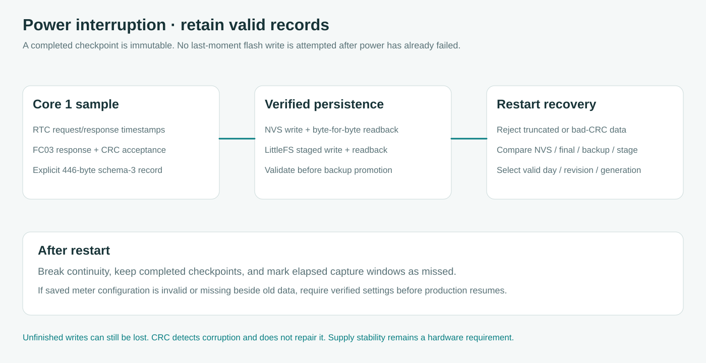

# Power interruption and storage audit

**English** · [Bahasa Indonesia](id/POWER_LOSS.md) · [Validation](VALIDATION.md) · [LoRa node](LORA.md)

The logger rejects damaged records and recovers a valid saved copy after restart. It cannot guarantee zero loss when power disappears during a flash operation. A reading still in RAM or a write that has not completed can be lost. NVS and LittleFS occupy the same flash chip, so they provide redundant software records rather than independent hardware storage. CRC detects damage but cannot reconstruct a measurement when every copy is invalid.

The essential data is the ten-point daily cumulative-kWh log. Each capture keeps its actual request/response timestamps, raw counter, engineering value and meter/ratio identity. Captures are not inferred from a browser's last displayed number. The earlier nine consumption intervals remain a separate legacy analysis.

## Configuration and archive hardening in 3.5.0

Meter and Wi-Fi configuration now use generation banks with readback and explicit degraded-copy status. Fresh units wait for a confirmed meter save, and stale staging cannot roll back a newer archive or replace conflicting immutable points. The inner payloads and capture schema stay compatible. See [fleet readiness](FLEET_READINESS.md) for migration, downgrade and first-installation limits.

## Findings corrected in 3.4.0

| Finding | Previous exposure | Corrected behavior |
| --- | --- | --- |
| NVS capture save checked only the returned byte count | An inconsistent write could be called durable without readback | Compare exact stored length and bytes before setting the verified marker |
| A valid staging file could be opened again with truncation | Another outage during rewriting could destroy the newest staging copy | Validate and promote recoverable staging before reusing its name |
| Backup promotion trusted an existing canonical file | A corrupt canonical file could replace a valid backup | Validate existing copies and quarantine rejected files under bounded `.bad` names |
| File recovery returned the first valid copy | A newer valid alternate could be overlooked | Compare valid day, revision and generation |
| Invalid meter settings could fall back to defaults | A valid response at a guessed address could be interpreted under the wrong profile | Pause production until verified settings are saved, retaining log, web and diagnostics |
| Legacy restore checked size, magic and CRC only | Non-finite values or inconsistent completion flags could pass structural checks | Validate day, numeric values, boolean representations and interval quality |
| Some setting writes lacked consistent readback | A RAM change could be mistaken for verified persistence | Apply bounded write/readback verification and report failures |

Meter registers, immutable profile IDs, schema-1/2/3 capture readers, CT/PT conversion and the capture schedule are unchanged. LoRa settings use a separate versioned two-bank record.

## Capture and persistence

Core 1 admits a capture only after the normal FC03 transport and selected profile validate the sample. Its request and response must fit the five-second scheduled admission window. A captured point is immutable for that day.

The owner serializes the explicit 446-byte schema-3 record with CRC16. It writes NVS and compares the readback. It also writes `/capture.pending`, flushes it, checks its exact bytes, validates existing alternatives and promotes the new file to `/c<day>.bin` using a backup. The promoted canonical record is validated again before its backup is removed. A failed final validation leaves the backup available. A valid pending record is rescued before its staging name is opened again. A previously quarantined invalid file can stop promotion rather than being overwritten. Invalid `/capture.pending` is now moved to the first free bounded `.bad` through `.bad9` name before any new truncating write; exhausted names or failed rename stop the write without erasing forensic evidence. Another verified copy can still preserve the capture, while storage remains degraded until recovery succeeds.

A capture is marked durable when at least one current saved copy passes this path. NVS/file status and the boot recovery source are exposed separately. A successful flash acknowledgement and readback cannot prove that the supply will remain within specification immediately afterward. This is a verified software state, not a hardware power-loss guarantee.

## Restart and a multi-day outage

Boot never formats a failed filesystem automatically. A failed mount now has Serial diagnostics and a standalone `/storage-recovery` browser page even without the OLED. Its safe retry probes the mount and requires a normal reboot before recovery or uploads. The physical GPIO6 hold-to-erase procedure remains deliberate and destructive. See [headless LittleFS recovery](IOT_HTTPS.md#headless-littlefs-recovery-without-an-oled).

Recovery examines NVS, canonical files, backups and flushed staging. The boot index now checks up to 4,096 directory entries and keeps the newest 64 unique archive days irrespective of listing order; **a 65th distinct day is always reported as incomplete, including when it sorts newer than all indexed days**; an incomplete scan, more than 64 distinct production days or unavailable filesystem lock fails closed and blocks capture-day advancement **and archive file writes**, preserving files and independently verified NVS captures rather than guessing which archive is newest. It rejects truncation, bad CRC, non-finite energy, invalid source/ratio metadata and out-of-window timestamps. The newest valid day/revision/generation is restored with sampling continuity broken. Completed captures stay completed, while elapsed uncaptured windows become missed. Late readings cannot backfill a scheduled value.

Before rollover, the current day must reach the archive or a protected previous-day NVS slot. One previous day can wait there during a filesystem failure. When both recovery slots are occupied, another rollover is blocked to protect earlier unarchived data. A prolonged storage failure can therefore stop new captures. Check backlog and recovery status before leaving the panel room.

A restored ACTIVE legacy interval becomes interrupted, not complete. Legacy interval NVS saves occur at quality transitions and the existing five-minute cadence; the five-minute pass now verifies existing NVS bytes and skips identical writes, repairing missing, damaged or changed records through the original readback-verified write. Legacy CSV similarly skips an identical verified canonical file, but short/corrupt files and leftover staging still use a bounded, readback-verified staging/promotion path. This reduces redundant flash writes without delaying changed interval persistence; the latest in-progress analysis can still lag RAM. Its CSV is a human-readable export with backup promotion rather than an independently CRC-protected primary record. CSVs remain available for inspection, but are not parsed to invent a trusted primary capture.

## Power dips and hardware limits

The pinned SDK enables brownout detection, and the main build rejects a configuration that disables it. Boot output and the dashboard expose Espressif's reset reason. A reported brownout is that reset classification, not a calibrated voltage trace or a history of every dip. A fast power cut may appear as POWERON on the next boot. The DS3231 battery maintains the clock and does not power the ESP32 or finish a flash write.

The confirmed board has no power-fail input or guaranteed hold-up energy. An interrupt cannot save data after usable energy has gone. Stronger protection requires a stable supply and a hardware supervisor/UPS with measured hold-up time at combined ESP32 Wi-Fi and radio load. A capacitor value alone does not prove sufficient hold-up. See [radio supply wiring](LORA.md#connect-the-ra-01sh) for SX1262 decoupling and current margin.

Espressif documents [NVS recovery after power loss](https://docs.espressif.com/projects/esp-idf/en/v5.5.5/esp32s3/api-reference/storage/nvs_flash.html), including possible loss of the key being written. This does not remove flash wear, electrical failures or voltage limits. Local exports and a gateway that durably stores validated records add recovery options. A radio ACK alone does not prove a database commit.

## Verification and bench acceptance

Native tests inject every truncation position in the 80-byte LoRa settings bank and 446-byte capture record. They exercise dishonest success returns, readback corruption, generation selection, rejected final readback with a preserved backup and failures between archive promotion operations with valid or corrupt canonical copies. Existing tests cover bytewise corruption, immutable points, RTC rejection, reboot continuity and protected rollover. These are fault models, not electrical simulations of the flash chip.

For bench acceptance, export existing data and use a reference meter/counter. Power-cycle outside and inside a capture window, then interrupt capture/settings saves at varied delays. After restart, compare recovery source, verified-copy flags, raw/source fields and CSV. Recovery must match a complete saved version or remain missing, without NaN, a manufactured zero or a false complete interval. Repeat with full/unmountable storage and verify that earlier days remain protected. Use controlled low-voltage supply tests to investigate dips, recording rail voltage and reset reason when adding the radio.

No physical power-cut, endurance, regulator-transient or RF test was performed by these software checks. [VALIDATION](VALIDATION.md) records actual automated outcomes and pending hardware work.
