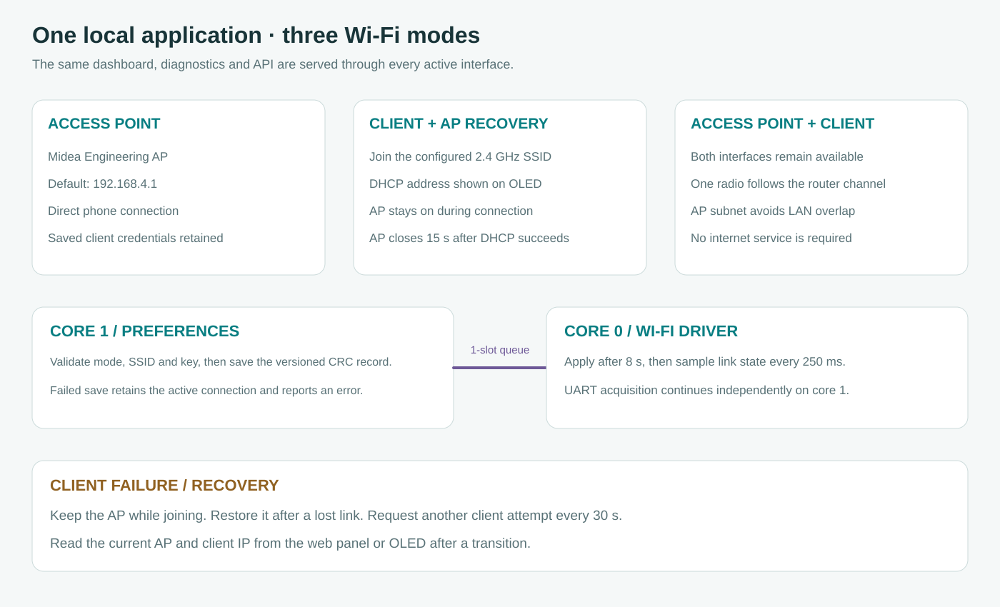
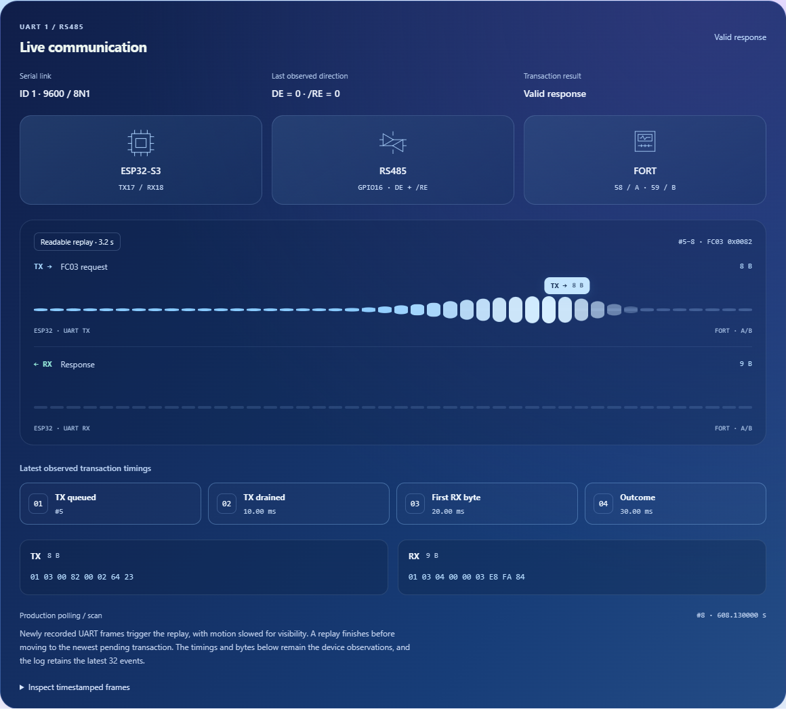

# Using the local dashboard

**English** · [Bahasa Indonesia](id/WEB.md)

Firmware 2.3.1 serves the complete application from the ESP32, including measurement, connection discovery, the shared ModbusMaster diagnostic console, raw traffic, process metrics and Wi-Fi settings. The standalone INO remains an optional USB-only diagnostic tool. It is not required to unlock features in the installed firmware, and changing Wi-Fi mode does not change meter settings or replace the firmware.

## Reach the application

On a fresh installation, connect the phone to **Midea Engineering AP** using **betahdijre12345** and open **http://192.168.4.1**. The AP password is the compile-time setting in [board.h](../firmware/include/board.h). English is selected initially, with Indonesian available from the language selector. Once joined as a client, open the IP assigned by the router instead. The OLED network page and the Wi-Fi panel show the current addresses.

Open **Device & records → Wi-Fi connection** to select a mode, choose an SSID from the automatic 2.4 GHz scan and enter its password, then choose **Save Wi-Fi settings**. The ESP32 uses DHCP for client addressing. A password must be 8–63 printable ASCII characters or a 64-digit hexadecimal WPA key. For an intentionally open network, select the explicit checkbox. Leaving the field blank retains a saved password only when the SSID is unchanged, and the saved password is never returned to the browser or put into browser storage. An enterprise identity/certificate workflow is not implemented by this form.

| Mode | What remains reachable |
| --- | --- |
| Access point only | Direct access through the Midea hotspot, with client credentials retained for a later mode change |
| Client with AP recovery | AP during connection attempts, then client IP after a successful DHCP connection and a 15-second AP grace period |
| Access point + client | Both interfaces, serving the same application and API |

Saving first goes through the core 1 command queue and CRC-protected NVS record. A failed save leaves the active connection intact. After a successful save, core 0 waits eight seconds before applying it, giving the browser time to receive the execution result. The client attempt never blocks the acquisition task. AP recovery remains available while disconnected, attempts repeat every 30 seconds, and a lost client link brings the AP back. The firmware does not format storage, erase intervals or reboot as part of this transition.

The AP and client share one radio, so the AP follows the router's channel in combined mode. If the LAN overlaps the AP subnet, the firmware chooses a non-overlapping AP address from the saved custom AP address first, then 192.168.4.1, 192.168.5.1, 10.42.0.1 and 172.23.42.1. Read the current address rather than assuming 192.168.4.1 after a network transition. A phone on the router must be allowed to reach other LAN clients. The same local HTTP interface becomes reachable on that LAN, with the existing per-boot mutation token and no separate account/TLS layer.

## Network selection, custom IP and OLED

The SSID picker starts a scan automatically when its cache is missing or older than 30 seconds. Scan again refreshes it explicitly. Firmware runs the radio scan asynchronously on core 0, retains up to 16 visible entries with signal/security information, releases the driver results and leaves Modbus acquisition on core 1. Open and supported personal-security networks can be selected, while enterprise/WEP/other unsupported security stays disabled. Hidden SSIDs are not listed by this visible-network picker.

The AP address field accepts a private IPv4 host and keeps the subnet fixed at /24. Save first persists the preferred address, then applies it after the eight-second transition. Rejoin the hotspot to renew DHCP and open the new IP. LAN overlap recovery may select a different runtime subnet, so the configured address and the actual AP address are shown separately. V1 Wi-Fi records remain readable with 192.168.4.1 as their default preference, and the next save writes the new record format.

The OLED Network page now opens an options menu with modes, a scan/picker, masked password entry and an IP-octet editor. It uses the same core 1 save queue as the browser. Follow [OLED](OLED.md) for the three-button workflow and its long-press tools.

## Clock presentation

The old clock label advanced only when the 2.5-second status request returned. It did not repeatedly set the RTC from the phone. The display now advances from a device UTC reference using monotonic browser time, refreshing that reference every five minutes or immediately after a clock revision, reconnect or RTC recovery. Status/measurement polling keeps its existing cadence, and the Set RTC from phone control remains an explicit operation. A brief lost status request does not reset the clock, but the display becomes unavailable after 15 seconds without a valid connection update.

The OLED similarly extrapolates its displayed seconds from the last validated RTC sample. These are presentation calculations, with all interval boundaries still taken from the acquisition owner's verified RTC reads. Neither display writes time automatically or substitutes its animated clock for the tracker clock.

## Follow the meter pipeline

Start in **Overview** to check current, voltage, frequency, the secondary counter and primary imported energy. Primary energy requires validated CT/PT applied once, whereas a valid secondary counter remains visible if ratio validation is pending. The sample age and recording quality identify stale or interrupted intervals, and the live communication view follows observed UART events rather than producing decorative traffic during silence.

In **Meter setup**, match CONi ID/baud/parity and Manual direction for the installed GPIO16 circuit. Scan a known ID with the saved format before expanding the range. The initial probe is FC03 at 0x0058 with two words, and a candidate must reply twice with valid data or a CRC-verified exception. Apply result saves the reader connection only. An exception establishes protocol contact but does not validate the energy register or scale.

Open **Diagnostic console** when a connection needs investigation. Session settings show the UART owner's actual configuration, while Observed UART results separates valid data, exceptions, CRC, incomplete input, echoes, timeouts and local failures. Read-only `status`, `report` and `help` inspection does not pause production. A raw read, trial-setting change or active test enters maintenance and interrupts the current interval, keeping trial values outside recording.

Use **Read a register directly** to enter a hexadecimal PDU address and one/two/three words, then choose **Read raw words**. Use **Adjust a trial setting** to select ID, format, direction, timing, probe, profile or scan-list parameters and apply one change at a time. The next read uses those settings and the console output records rejection of invalid arguments. **Primary float** prepares the `primary` command, which prints ABCD/CDAB candidates after **Run command** without choosing one automatically.

For any other supported command, type one line into **Command input** and choose **Run command**. **Stop test** remains available while a test is waiting, while **Resume measurement** cancels work and restores production pins, direction and saved serial settings. Download output to retain raw frames, decoded words and evidence before leaving the panel. [DIAGNOSTICS](DIAGNOSTICS.md) explains the detailed commands and the eight recipes, including the distinction between UART observations and physical connection claims.

## Integration map

| Web feature | HTTP path | Device owner and result |
| --- | --- | --- |
| Live measurements, quality, saved connection and Wi-Fi state | `/api/status` | Copied acquisition snapshot plus core 0 network state |
| Meter connection and confirmed scan result | `/api/config`, `/api/scan/start`, `/api/scan/cancel`, `/api/scan/apply` | Core 1 command execution, shared FC03 reader |
| Trial settings, raw reads, float comparison and diagnostic recipes | `/api/diagnostic` GET/POST | Core 1 FortDiagnostics, same FortTransport as acquisition and INO |
| UART direction and frame replay | `/api/uart` | Bounded software event ring, including sequence gaps |
| Passive raw transaction capture and export | `/api/trace`, `/api/trace/start`, `/api/trace/stop` | Bounded copied trace, without changing CRC acceptance |
| Core/task/heap/PSRAM observations | `/api/system` | Tick sampling and owned/idle task metrics |
| Network modes, custom AP IP and credentials | `/api/network` | Core 1 persistence, one-entry message to core 0 Wi-Fi state machine |
| Nearby SSID scan and picker | `/api/network/scan` GET/POST | Core 0 asynchronous radio scan and bounded visible-network cache |
| OLED idle animation settings | `/api/display` | Core 1 CRC-protected display preferences, core 0 playback/wake policy |
| LED, alarm mute and RTC synchronization | `/api/led`, `/api/mute`, `/api/time` | Queued controls with execution results |
| Completed records and CSV | `/api/history`, `/api/export` | Bounded filesystem access with existing recovery rules |

All these routes are registered by the production firmware. Ordinary controls use an execution ID rather than treating HTTP 202 as completion, and incompatible operations are checked again at the UART owner's transaction boundary. Wi-Fi changes are rejected during a scanner or maintenance session, while Stop/Resume has its own priority mailbox. The browser stops polling detailed logs, trace and process panels when they close, and malformed data cannot become accepted measurements.

## Verify the integrated installation

After uploading 2.3.1, check the footer version, perform the manual 0x0058 read from the web console and compare the displayed register values with the meter. Exercise Stop during a timeout, Resume back to production, a narrow scan, trace download, process metrics, CSV and a Wi-Fi mode change. For client mode, also disconnect the router deliberately and confirm that the AP returns without interrupting acquisition. These physical checks complement the compiled/native/browser checks recorded in [VALIDATION](VALIDATION.md), which use simulated APIs for browser tests.

The communication endpoint now sends at most eight events per page, with a backlog marker for catch-up. Browser polling targets 500 ms and retries failed requests after 1.2 seconds, retaining timestamped history and distinguishing timeout, invalid payload and endpoint failures. A failed HTTP event request does not establish whether a Modbus slave is present.

OLED screensaver controls in Device & records select a 10–3600-second idle delay or disable playback. The default is 60 seconds. Any first physical button press wakes the dashboard without executing its ordinary action. See [OLED](OLED.md#idle-animation-and-wake-behavior) for playback and wake details.

### Scan progress and recovery

A requested scan first enables the station interface and waits 300 ms before asking the driver to scan. If a client association is still pending, firmware pauses that association until discovery ends. An established client link is retained. The scanner allows three start/failure attempts, 750 ms between retries, 12 seconds for an accepted radio scan and 20 seconds for the whole operation. The radio spends 100–200 ms per scanned channel and returns to its home channel for 50 ms between channels. Acquisition remains on core 1 throughout.

The implementation initializes every field of `wifi_scan_config_t`, including the home-channel dwell, and uses the Arduino scan-done callback only after Arduino has collected its result list. This avoids the pinned Arduino wrapper's dwell × 20 timeout, which was only four seconds at a 200 ms dwell. The scan status includes a generation number, attempt count, failure reason and raw driver code. `radio_start` means the driver refused to begin, `radio_failed` means completion reported failure, `radio_timeout` means the deadline expired and `radio_enable` means STA could not be enabled. A completed scan with no SSIDs is a separate empty result.

An HTTP failure does not discard the selected network or start another radio scan. The page retries GET status for the current generation, while retaining the last network list. After an upload, reconnect to the ESP32's current IP and reload the page, then select Client or AP + client in Device & records. If scanning still fails, copy the visible scan reason and driver code from that web panel into the support chat. Alternatively, open **Arduino IDE Serial Monitor at 115200 baud** and copy the resulting **OUTPUT** line beginning `[WiFi scan]` into the support chat. That line is output to read, not a command to type.

### Reading the communication diagram

The MCU symbol represents UART1, the opposing driver symbols represent the transceiver and the display symbol represents the Fort meter. The blue lane carries the request toward the meter and the green lane carries observed RX toward the ESP32. Amber RX identifies a frame that did not pass normal validation. The pin labels include the direction pin carried by each recorded event, including trial diagnostic pins.

Four milestones retain the latest transaction's queued TX, drained UART, first observed RX byte and outcome. Times are measured from queued TX using device timestamps, with unsigned subtraction across the microsecond counter rollover. The DE and /RE values show the last recorded software direction state, and become unknown when the event endpoint is unavailable. They are not electrical feedback measurements. A timeout keeps RX empty and leaves the missing RX milestone unfilled.

The animated lanes use the supplied React Bits WakeSlider as a non-interactive visual. Each observed complete transaction travels outward for 1100 ms with quintic easing, so it accelerates gradually and slows to a stop at the endpoint. The packet and its wake then fade together for 360 ms without changing position. After a 140 ms pause, captured RX bytes follow the same movement and fade in the opposite direction, followed by a 160 ms rest. A complete request/response replay therefore takes about 3.2 seconds. The resting track remains visible as the active wave fades, and the badge is removed only after its opacity reaches zero. A timeout therefore plays an outbound request with no returning frame. These durations make the replay readable and are separate from the unscaled transaction timings below. No electrical travel time is inferred from the animation.

Only one replay and the newest pending transaction are retained. A burst replaces the pending visual rather than building a long queue, while recent raw events remain in the 32-entry log. Frame grouping requires a continuous sequence with matching ID, baud, parity, register, word count, pins and diagnostic context. Old initial history, reboot history, sequence gaps and orphan responses cannot create a new replay. A hidden page, unavailable endpoint or reduced-motion preference clears playback.

The clock uses the supplied Counter component for its hour/minute/second pairs, with a 300 ms roll, no intro spin, no bounce and no blur. Its source remains the device UTC/RTC reference and five-minute presentation re-anchor. The browser does not add NTP or repeatedly write the RTC. An accessible timer label exposes the complete time while the repeated visual numerals remain hidden from assistive reading.

Navigation uses the supplied StarBorder component around native buttons and an independent selection background that slides to the active page in about 320 ms. The old blue underline and the SVG transport taps are removed. Reduced motion disables packet replay and rolling digits, and renders static native navigation without the decorative canvas. The telemetry WakeSlider is inert and hidden from assistive control discovery, so it cannot be mistaken for a configurable meter value.

API fetches still share one socket slot through complete body reception with an eight-second active deadline. Queued waiting does not consume that deadline, and priority Stop/Resume can cancel an in-flight telemetry GET. Animation executes in the browser. The ESP32 serves the compiled offline bundle and does not execute React, Motion or canvas rendering.
