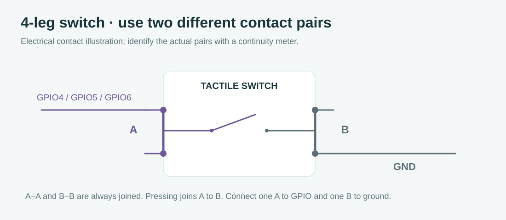

# Hardware wiring

**English** · [Bahasa Indonesia](id/WIRING.md)

Use the GPIO labels on the actual DevKitC-style N16R8 board. This drawing represents electrical connections; its port positions do not represent physical header positions.


The supplied module uses TXD → GPIO18 and RXD ← GPIO17; GPIO16 is unconnected.

**Manual-direction alternative:** the following complete schematic/netlist shows RO/DI/DE-/RE instead. Its OLED/RTC/buttons/buzzer nets also apply to the actual installation.


## Assemble in this order

1. With USB disconnected, connect ESP32 3V3 and GND to separate breadboard rails. Bridge a split rail if components use both halves.
2. Connect OLED VCC → 3V3, GND → GND, SDA → GPIO8, SCL → GPIO9. The firmware expects an I2C SSD1306 128×64 at 0x3C. Follow the module's printed labels, because header order varies.
3. Connect DS3231 VCC → 3V3, GND → GND, SDA → GPIO8, SCL → GPIO9. These are branches on the same I2C nets as the OLED. SQW and 32K stay unconnected. Its address is 0x68.
4. Connect the confirmed 3.3 V-compatible RS485 module: VCC → 3V3, GND → GND, module TXD → GPIO18 (RX), module RXD ← GPIO17 (TX). The supplied four-pin module handles direction automatically: GPIO16 unconnected. Only the manual-direction alternative uses RO/DI and tied DE-/RE on GPIO16.
5. Connect RS485 A → Fort 58/A and B → Fort 59/B. The manual's PDF page 7/table 3 and page 9/figure 5 identify those terminals. Terminal 70/COM is for switch inputs; it is not RS485 ground.
6. If buttons are installed, connect one contact of PREV/NEXT/OK to GPIO4/5/6 respectively and the opposite contact to GND. Internal pull-ups keep an unpressed button HIGH.
7. The buzzer can be omitted while testing. If fitted, connect its driver to GPIO7 using the circuit below.
8. Check the [point-to-point netlist](wiring-netlist.csv), then power the board from USB. Confirm the AP works before moving to a panel installation.

The user's Fort RS485 port is dedicated to this reader; no other master is present. The purchased “MAX485 TTL RS485 3.3V/5V flexible” module is confirmed suitable for ESP32 3.3 V TTL. Those facts are part of this project's configuration, not open assumptions.

## RS485 direction

For a **manual-direction alternative**, RO is the transceiver's receive **output**, so it connects to the ESP32 RX **input**. DI is the transceiver's driver **input**, so it connects to ESP32 TX. With DE and /RE tied, GPIO16 HIGH transmits and LOW receives. A module exposing only TX/RX may handle direction automatically; determine connections by signal direction and check turnaround/local echo before acceptance.

Use the panel's intended isolation/reference/shielding arrangement. A basic TTL module does not add galvanic isolation. Twisted pair, termination and bias depend on the cable and installed transceiver network; check existing resistors before adding more. About 120 Ω termination belongs at bus ends where required, not at every node. Do not modify the meter's voltage/current/CT measurement wiring to attach this reader.

## Four-leg tactile contacts



A four-leg switch contains two internally joined pairs. Use a continuity meter to identify them: A–A is always joined, B–B is always joined, A–B joins only when pressed. Use one A and one B. The GPIO and ground must not land on an already joined pair. No button VCC connection is needed.

## Optional two-leg buzzer

```text
GPIO7 -- 1 kΩ -- NPN base
                 emitter -- GND
                 collector -- buzzer (-)
3V3 ---------------------- buzzer (+), for a compatible 3 V unit
base -- 10 kΩ -- GND
```

The transistor and two resistors are additional parts. A 2N2222/BC337 example identifies a transistor type, not a physical pin order; use its package datasheet for B/C/E. Add a flyback diode if the buzzer is electromagnetic and its datasheet calls for it. A three-pin buzzer module with its own 3.3 V-compatible driver can instead use GPIO7 → signal, VCC → rated supply, GND → GND. Firmware uses active HIGH; an active-low module needs a polarity change. Do not assume a bare buzzer's current is within GPIO drive capability.

## RTC battery and display checks

Some DS3231 breakouts charge LIR2032 cells. Use a battery appropriate to the module; do not connect a non-rechargeable CR2032 to an active charging circuit. I2C pull-ups must end at 3.3 V. Check the combined OLED/RTC pull-ups and the module supply labels.

For a blank OLED, check 3V3/GND, GPIO8/9, address 0x3C/0x3D and the controller type. Change `OLED_ADDRESS` in [board.h](../firmware/include/board.h) for 0x3D. A 128×32 screen or SH1106 is a different layout/driver target. Firmware continues starting the AP and reader if the OLED is absent.
