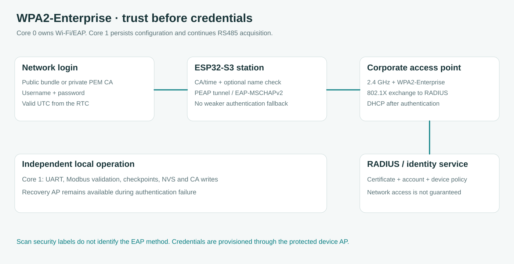

# Koneksi WPA2-Enterprise dan pengisian sertifikat

## Hasil koneksi pada 3.4.3

Form mengenali antarmuka yang dipakai sebelum menerima login baru. Bila halaman dibuka melalui IP client perangkat, hubungkan HP atau komputer ke hotspot pemulihan yang ditampilkan perangkat lalu buka IP AP, biasanya `http://192.168.4.1`. Isi username dan password baru di sana, pilih SSID hasil scan lalu simpan. IP client dapat mencoba ulang profil Enterprise tersimpan yang tidak berubah tanpa mengirim ulang kredensial. Penggantian login, server tepercaya atau CA tetap melalui AP terlindungi. Nama AP pemulihan terpisah dari SSID tujuan, yang tidak dibatasi pada nama perusahaan tertentu.

SSID dapat diketik manual ketika scan tidak menemukan jaringan, termasuk SSID tersembunyi. Memilih kembali SSID Enterprise yang sama mempertahankan pemakaian ulang login dan referensi CA tersimpan; mengganti SSID memutus pemakaian ulang tersebut. Username/password baru tetap hanya diisi lewat AP pemulihan. Jaringan juga harus menerima **PEAP dengan MSCHAPv2**, rantai CA tepercaya, dan kebijakan RADIUS yang sesuai.

Simpan berhasil berarti penyimpanan selesai, belum berarti autentikasi berhasil. Panel **Hasil koneksi** di dekat Simpan menunjukkan jeda pergantian delapan detik, pelepasan koneksi lama, autentikasi, DHCP dan hasil akhirnya. Mengisi username atau password otomatis mematikan pemakaian ulang login tersimpan agar isian pengganti tidak diabaikan. Kegagalan menampilkan reason dan kode API. Jika konfigurasi EAP gagal, nama operasi SDK juga ditampilkan. Kegagalan terakhir tetap tersedia ketika percobaan berikutnya dimulai atau berhasil, dan hanya disimpan di RAM sampai reboot agar tidak menambah penulisan flash berulang.

Lifecycle core 0 pada `network_attempt.h` menunggu pelepasan station secara asinkron dengan batas persiapan lima detik berdasarkan status asosiasi langsung dari ESP-IDF. Batas koneksi Personal adalah 30 detik dan Enterprise 60 detik. Event station-associated memulai batas DHCP 15 detik, tetap tunduk pada batas keseluruhan koneksi. Hanya station aktif yang cocok dan event GOT_IP baru yang menandai koneksi online. IP lama atau konfigurasi yang berhasil tidak cukup. Percobaan gagal memiliki jeda retry minimal 30 detik, sedangkan reason 23/202 menjeda retry Enterprise sampai profil disimpan kembali. Antrean event yang penuh menghentikan percobaan dengan pesan khusus agar hasilnya tidak hilang tanpa penjelasan.

Adapter SDK produksi berada di `enterprise_station.cpp` dan memeriksa hasil boolean konfigurasi station Arduino sebelum memakai fungsi EAP resmi Espressif. Parser sertifikat, penyimpanan CA immutable, pengaturan jam sistem dan compile guard keamanan SDK tetap pada `enterprise_wifi.cpp`. Test native mengompilasi adapter produksi ini dengan pengganti batas API SDK, lalu menginjeksi kegagalan tiap operasi EAP. Test juga mencakup nama server opsional kosong, CA publik maupun privat, jam tidak valid, pembersihan kredensial serta Personal setelah Enterprise. Hasil tersebut membuktikan urutan pemanggilan dan penanganan error, belum autentikasi RADIUS fisik.

Bila batas waktu tercapai tanpa alasan driver yang lebih spesifik, panel menjelaskannya. Timeout tidak membuktikan password salah, dan penolakan autentikasi umum belum membedakan masalah kredensial, CA atau kebijakan jaringan. Untuk bantuan, salin teks **Hasil koneksi** dan **OUTPUT Serial Monitor** ke chat dukungan. Prosedur ini tidak memerlukan perintah INPUT Serial Monitor.


[English](../ENTERPRISE_WIFI.md) · **Bahasa Indonesia** · [Panduan dashboard](WEB.md)

Pilih SSID 2,4 GHz dari hasil scan, pilih autentikasi PEAP bila belum terpilih otomatis, lalu isi username dan password. Identitas luar mengikuti username dan nama DNS server boleh dikosongkan. Mulai firmware 3.3.1, profil Enterprise baru memakai kumpulan CA publik bawaan SDK, sehingga form tidak lagi mewajibkan unggahan sertifikat sebelum pengaturan dapat disimpan.

Saat memasukkan kredensial Enterprise baru, buka dashboard melalui IP AP pemulihan ESP32. Mulai 3.4.1, pilihan SSID selalu memulai identity otomatis meskipun profil lama memakai custom identity. Perubahan ini memperbaiki tombol Save aktif yang sebelumnya tertahan kolom wajib kosong di dalam Advanced settings tertutup. Jika operator sengaja mengedit kolom yang belum lengkap, Save membuka dan memfokuskan kolom tersebut serta menampilkan pesan di dekat tombol. Area yang sama menunjukkan proses simpan, hasil terkonfirmasi atau alasan permintaan belum dapat dijalankan. Pengaturan berhasil tersimpan belum membuktikan akses jaringan, sehingga periksa status asosiasi dan autentikasi Wi-Fi sesudahnya.

Tidak ada nama SSID perusahaan, username, domain maupun hostname RADIUS yang ditanam dalam client. Nama hotspot pemulihan perangkat tetap mengikuti konfigurasi AP tersendiri. Scan hanya mengenali keamanan WPA2-Enterprise yang diumumkan jaringan dan tidak dapat mengetahui metode EAP yang diterima. Keberhasilan koneksi tetap bergantung pada dukungan PEAP / EAP-MSCHAPv2, kepercayaan sertifikat serta kebijakan akun dan perangkat jaringan tersebut.



## Runtime dan API

Build memakai pioarduino 55.03.311, Arduino-ESP32 3.3.11 dan ESP-IDF 5.5.5. Adapter menggunakan [API EAP resmi Espressif](https://docs.espressif.com/projects/esp-idf/en/v5.5.5/esp32s3/api-reference/network/esp_wifi.html), membatasi metode ke `ESP_EAP_TYPE_PEAP` dan mengaktifkan `esp_eap_client_use_default_cert_bundle(true)` untuk trust publik. SDK yang dipin memakai `auth=MSCHAPV2` untuk fase kedua PEAP. Selector TTLS tidak dipakai sebagai pengaturan PEAP, dan contoh lama `esp_wpa2_config_t` tidak dicampurkan ke build IDF 5 ini.

Bootstrap SDK dan compile guard memeriksa keberadaan bundle publik lengkap serta validasi tanggal dan key usage. Pemeriksaan sertifikat tidak dimatikan. Profil CA privat menonaktifkan bundle publik secara eksplisit dan hanya memakai CA yang direferensikan hash tersimpan. Berkas yang hilang membuat koneksi gagal, tanpa mengganti trust secara diam-diam. Saat berpindah ke Personal, konfigurasi EAP sebelumnya dibersihkan terlebih dahulu.

SDK dikompilasi sekali pada cache bersama tanpa spasi untuk menghindari keterbatasan tooling ESP-IDF. Konfigurasi dan hash library diverifikasi sebelum dipakai ulang, sedangkan aplikasi tetap dikompilasi dari direktori sumber aslinya. Bila build melaporkan versi Core berbeda, jalankan `python tools/setup-core.py` di **terminal komputer pada root repository** untuk memasang pioarduino Core 6.1.19 yang dipin.

## Asal sertifikat

Bundle CA publik sudah masuk firmware dan tidak perlu diunggah. Bundle ini dapat memvalidasi server RADIUS yang rantai sertifikatnya berujung pada salah satu root publik tersebut. Sebagian perusahaan memakai CA privat sendiri, sehingga tidak semua jaringan akan langsung menerima koneksi dengan bundle publik. Untuk jaringan seperti itu, sertifikat CA publik milik jaringan perlu ditambahkan melalui pengaturan lanjutan. Username dan password tidak dapat menggantikan kepercayaan terhadap server yang belum dikenal.

Sertifikat CA adalah materi trust publik, bukan password atau private key. Windows yang sudah mempercayai jaringan mungkin menyimpannya. Di **PowerShell pada root repository**, gunakan nama profil dari `netsh wlan show profiles`:

```powershell
./tools/export-wifi-trust.ps1 -ProfileName 'Nama profil Wi-Fi Anda'
```

Helper hanya mengekspor CA publik yang sesuai referensi SHA1 profil dan menulis `output/wifi-trust/report.json`, tanpa mengambil password/private key atau mengubah koneksi. Exit code 2 berarti sertifikat yang cocok tidak tersedia pada store yang dapat diakses. Fingerprint saja tidak bisa diubah menjadi sertifikat, sehingga berkas CA harus diperoleh dari pengelola jaringan bila tidak ada di store tersebut.

Nama DNS sertifikat RADIUS bersifat opsional. Bila diisi, nama tersebut diperiksa selain rantai CA dan tanggal. Bila kosong, koneksi dibatasi oleh root CA yang dipilih tetapi tidak terikat ke satu nama server RADIUS tertentu. Firmware tidak menebak hostname dari SSID atau alamat email. Instalasi yang membutuhkan pembatasan identitas server harus memasukkan nama sertifikat yang sebenarnya.

## Mengatur melalui website lokal

1. Hubungkan HP atau komputer ke AP pemulihan perangkat lalu buka IP AP yang ditampilkan. Bila mode client telah mematikan AP, pilih **Access point saja** lalu simpan dan hubungkan ke hotspot sebelum mengisi kredensial Enterprise. AP default **Midea Engineering-XXXXXXXXXXXX** merupakan hotspot perangkat, bukan SSID perusahaan yang dipaksakan untuk client. Kredensial Enterprise melalui HTTP hanya diterima pada antarmuka AP. Bila halaman dibuka lewat IP client, nama AP dan tautan alamatnya muncul di dekat Simpan. Tombol tetap dapat ditekan untuk menampilkan petunjuk, tanpa mengirim kredensial melalui antarmuka client.
2. Buka **Perangkat & arsip → Koneksi Wi-Fi**, pilih **AP + client**, lalu pilih SSID tujuan dari scan. Pilih autentikasi PEAP jika sesuai metode jaringan tersebut.
3. Isi username dan password lalu pilih **Simpan pengaturan Wi-Fi**. Untuk profil baru, form tidak mewajibkan berkas sertifikat, identitas luar terpisah atau nama DNS RADIUS. Username/password menerima maksimal 127 byte UTF-8 per kolom tanpa karakter kontrol. Identitas luar khusus tersedia dalam pengaturan lanjutan bila dibutuhkan jaringan.
4. Pertahankan pilihan CA privat yang sudah tersimpan saat mengedit jaringan tersebut. Untuk memasang CA privat, unggah atau tempel sertifikat/rantai Base-64 PEM, maksimal 4096 byte dan empat CA. Sertifikat leaf server serta private key ditolak. Melepas pilihan CA tersimpan secara eksplisit mengembalikan profil ke bundle publik dan meminta pengisian ulang kredensial. Tidak ada fallback otomatis.
5. Pastikan waktu RTC valid. DS3231 menyimpan UTC dan dashboard menampilkan WIB. RTC yang tidak tersedia atau invalid ditampilkan sebagai kebutuhan waktu, tanpa melewati pemeriksaan tanggal sertifikat. Gunakan aksi pengaturan waktu yang tersedia bila diperlukan. Core 0 memperbarui waktu sistem dari snapshot RTC valid setiap lima menit atau saat revisi waktu berubah, tanpa menulis RTC melalui polling browser.
6. Tunggu hasil eksekusi dan jeda perpindahan delapan detik, kemudian periksa IP client serta RSSI. Pengaturan berhasil disimpan berarti percobaan koneksi diminta, bukan bukti bahwa autentikasi dan DHCP sudah berhasil.

Status tidak mengembalikan username/password tersimpan. Browser tidak memasukkannya ke penyimpanan lokal dan log tidak mencetaknya. Kredensial dapat digunakan ulang untuk SSID yang sama. Perubahan SSID, nama server atau CA meminta kredensial baru agar login tersimpan tidak dialihkan ke target trust lain. Profil baru memakai bundle publik, sedangkan profil CA privat tetap mempertahankan CA sampai diubah secara eksplisit.

[Contoh desktop](../assets/ui-enterprise-desktop.png) dan [contoh HP](../assets/ui-enterprise-mobile.png) memakai respons API simulasi dan kredensial pengujian. Gambar tersebut bukan bukti koneksi pada jaringan fisik.

## Penyimpanan, kepemilikan dan reconnect

Record Wi-Fi versi 3 tetap berukuran 779 byte dengan CRC16, kolom EAP terbatas, alamat AP dan referensi SHA256 CA. Pada 3.3.1, hash CA seluruhnya nol memilih bundle publik. Hash selain nol memilih berkas LittleFS immutable `/wifi-ca-<sha256>.pem`. Record CA privat sebelumnya dan record Personal/open 104/108 byte tetap dapat dibaca. Profil bundle publik tidak memerlukan filesystem dan filesystem gagal tidak diformat otomatis.

Mulai 3.5.0, payload tersebut dibungkus dalam bank generation `wifi_a`/`wifi_b` berukuran 793 byte dengan readback terverifikasi. Impor legacy, penanganan kegagalan dan batas downgrade dijelaskan pada [kesiapan fleet](FLEET_READINESS.md).

Core 1 memiliki penulisan Preferences dan penyimpanan CA privat. Berkas CA baru melewati antrean terbatas satu item dan harus diverifikasi sebelum record kredensial diganti. Core 0 memiliki driver Wi-Fi/EAP dan membaca CA privat di bawah mutex filesystem. Kepemilikan UART, register meter, jadwal checkpoint dan logging tidak diubah. Build pengembangan menyimpan kredensial pada NVS tanpa enkripsi kecuali ada provisi build terenkripsi tersendiri. Indikator enkripsi flash saja tidak membuktikan enkripsi NVS.

Asosiasi berjalan asinkron, dengan jarak retry Personal 30 detik dan Enterprise 60 detik. Retry menunggu scan selesai. AP pemulihan tetap tersedia saat koneksi gagal, dan mode client mempertahankan AP selama 15 detik setelah memperoleh IP. Alasan penolakan Enterprise 23/202 menjeda retry agar password yang ditolak tidak terus diajukan. Menyimpan ulang profil meminta percobaan berikutnya tanpa menghentikan akuisisi meter atau pencatatan lokal.

## Memahami hasil

| Hasil | Makna dan tindakan |
| --- | --- |
| Tombol sebelumnya terkunci saat memakai IP client | Versi 3.3.1 menampilkan petunjuk dan tautan AP di dekat Simpan. Hubungkan ke hotspot yang ditampilkan lalu buka alamat AP tersebut. |
| Form sebelumnya menuntut unggahan CA | Profil baru sekarang memakai bundle publik bawaan. CA privat hanya diperlukan jika jaringan menggunakannya. |
| `enterprise_clock_required` | Tidak ada referensi RTC valid yang cukup baru. Periksa RTC dan atur waktu perangkat. |
| `enterprise_ca_missing` | CA privat yang memang dikonfigurasi tidak tersedia atau gagal verifikasi. Bundle publik tidak dipakai sebagai pengganti otomatis. |
| `enterprise_api_failed` | API EAP gagal. Catat kode API dan versi firmware. Metode autentikasi tidak diturunkan. |
| Penolakan autentikasi, alasan 23/202 | Kredensial, trust/nama/waktu sertifikat, kompatibilitas EAP atau kebijakan jaringan dapat menjadi penyebab. Kode ini belum menentukan kolom mana yang salah. |
| SSID tidak ditemukan, alasan 201 | SSID tidak ditemukan pada 2,4 GHz di lokasi receiver. |
| Handshake timeout atau koneksi putus berulang | Simpan RSSI, jumlah percobaan dan kode alasan untuk dibandingkan dengan log AP/RADIUS. |

Dashboard memperlihatkan fase, status asosiasi dibanding penerimaan IP, RSSI, jumlah percobaan, alasan disconnect dan kode API. Untuk bantuan, salin **OUTPUT Serial Monitor** ke chat dukungan. Alur pengisian melalui website tidak memerlukan perintah diketik ke Serial Monitor.

## Pengujian perangkat dengan akun uji

Pengujian browser memakai byte gzip yang benar-benar disajikan firmware. Cakupannya termasuk pengiriman username/password tanpa unggahan CA, reload tanpa fingerprint CA palsu, CA privat dan DNS eksplisit, penolakan lewat antarmuka client dengan tautan AP yang benar, kedua bahasa serta layout HP. Pengujian native memeriksa record CRC dan perubahan target trust. Build target fisik mengompilasi API Espressif sebenarnya, tetapi hasil software tersebut belum membuktikan koneksi ke jaringan perusahaan tertentu.

Pada perangkat, uji profil rantai publik dan CA privat secara terpisah, CA salah/hilang, DNS tidak cocok, sertifikat kedaluwarsa/belum berlaku dan RTC tidak tersedia. Periksa DHCP, pulih setelah kehilangan sinyal, jeda retry penolakan, perpindahan ke Personal dan operasi Modbus/checkpoint bersamaan. Server RADIUS berizin dan board fisik tidak tersedia bagi pengujian otomatis ini, sehingga hasil tersebut masih memerlukan pengujian perangkat.

## Receiver kantor yang direncanakan

Node SX1262 opsional di panel dan gateway C3 kantor yang terpisah mengikuti [Energy Station v1](LORA_PROTOCOL.md). Gateway mengelola koneksi Wi-Fi perusahaan sendiri. Framing radio dan acknowledgement node sudah tersedia, sedangkan firmware gateway dan client database merupakan proyek terpisah.
