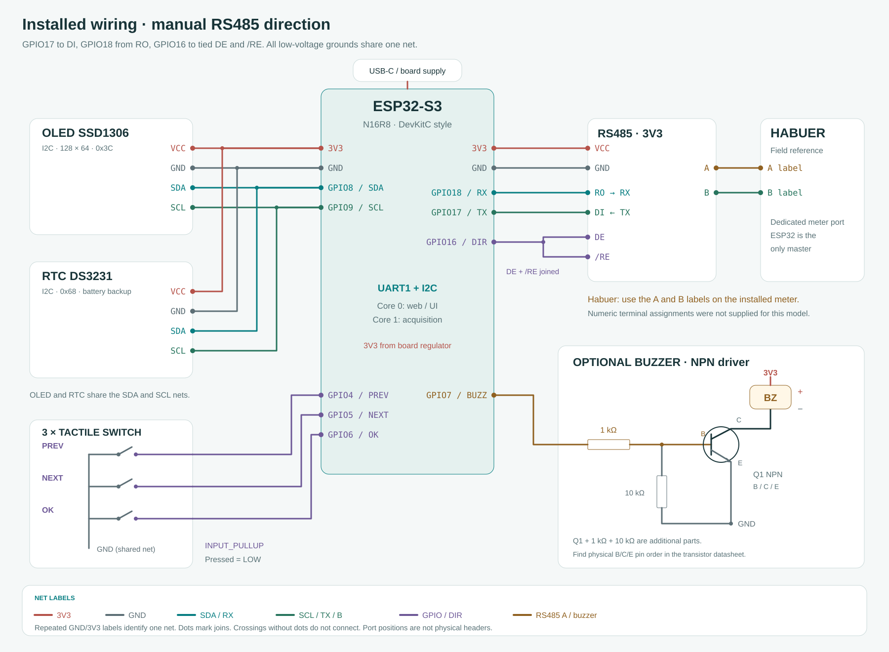
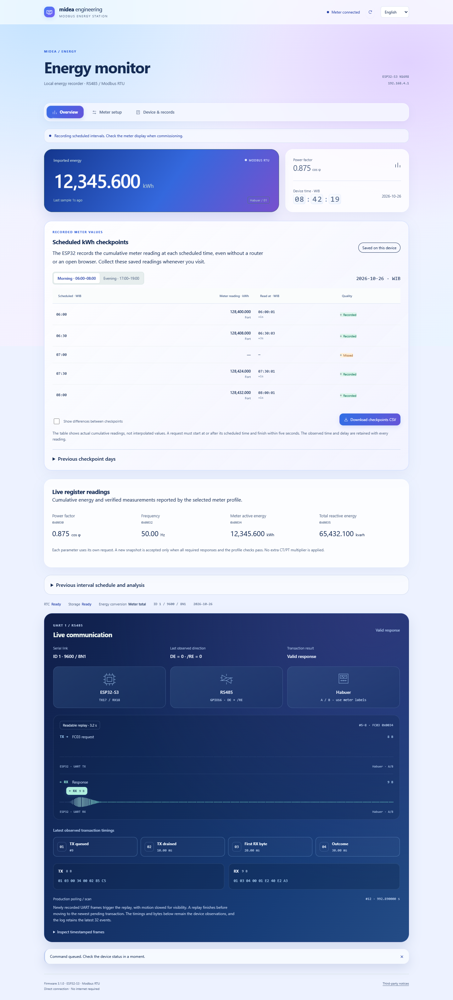

# Profil Habuer berdasarkan referensi lapangan

[English](../HABUER.md) · **Bahasa Indonesia** · [Seluruh profil meter](METER_PROFILES.md)

Opsi Habuer mengikuti sketch ESP32-S3 yang dilaporkan berhasil oleh pemilik proyek. Empat request FC03 dikirim secara terpisah melalui transport ModbusMaster yang juga dipakai Fort dan Acrel. [Sketch aslinya](../references/habuer-field-reference.ino.txt) dipertahankan di luar firmware deployable, dengan SHA256 `6ad372465827f8636a0dd2644bd205f86be4e954c68fb18da6454d642ee1447b`. Materi yang diberikan belum menyebut model Habuer persis atau manual vendor, sehingga profil ini tidak dinyatakan cocok untuk seluruh model Habuer.

## Urutan pembacaan dan konversi

| Urutan | Parameter | Alamat awal FC03 | Word | Decoder | Unit |
| --- | --- | --- | --- | --- | --- |
| 1 | Faktor daya | `0x0030` | 2 | IEEE754 Float32 ABCD | cos φ |
| 2 | Frekuensi | `0x0032` | 2 | IEEE754 Float32 ABCD | Hz |
| 3 | Energi aktif total | `0x0034` | 2 | UInt32 × 0,1 | kWh |
| 4 | Energi reaktif total | `0x0035` | 2 | UInt32 × 0,1 | kvarh |

Word pertama berisi 16 bit paling tinggi. Contohnya `0001 E240` berarti raw 123456 atau 12345,6 kWh. Angka ini merupakan total kumulatif yang dilaporkan meter, sehingga firmware tidak menambahkan pengali CT/PT. Rasio identitas pada metadata checkpoint menjelaskan konversi firmware, bukan menyatakan bahwa trafo fisiknya memiliki rasio 1:1.

Alamat awal `0x0034` dan `0x0035` yang terlihat bertumpang tindih dipertahankan sesuai transaksi referensi. Pembaca tidak menggabungkannya menjadi satu blok register dan tidak menebak alamat berikutnya dari lebar parameter sebelumnya. Belum ada alamat terverifikasi untuk arus, tegangan atau daya aktif sesaat, sehingga firmware tidak membaca register tersebut dan UI tidak menyajikannya sebagai hasil pengukuran.

Snapshot baru memerlukan empat respons dengan ID, fungsi, jumlah word, panjang dan CRC yang sah. PF harus finite dalam −1,05 sampai 1,05, sedangkan frekuensi harus finite dalam 40–70 Hz, sama dengan sketch referensi. Jika satu parameter gagal, seluruh kandidat ditolak. Nilai yang hilang tidak diganti nol dan nilai baru tidak dicampur dengan PF/frekuensi lama. Snapshot terakhir yang diterima tetap dapat dikenali dari umurnya.

Descriptor profil menentukan parameter wajib melalui bit mask. Status `readingQuality` menyediakan `required`, `transportFailed`, `invalid` dan `complete`, dengan bit PF=1, frekuensi=2, energi aktif=4 serta reaktif=8. Transaksi UART terakhir yang berhasil belum berarti seluruh snapshot lengkap jika parameter sebelumnya gagal.

## Pemakaian melalui website

1. Buka **Pengaturan meter → Model meter**, pilih **Habuer**, sesuaikan setting serial yang terpasang dan pilih **Manual direction**, lalu simpan. Referensi memakai ID 1, baud 9600 dan 8N1. Pergantian model mempertahankan pilihan serial operator dan tidak mengubah setting meter secara otomatis.
2. Pada **Ringkasan**, counter utama menampilkan kWh aktif yang diterima. Parameter tambahan menampilkan PF, frekuensi dan energi reaktif. Status konversi menunjukkan **Total dari meter**. Jadwal akuisisi langsung tetap sekitar dua detik, bukan loop cetak 15 detik dari referensi.
3. Scanner produksi memakai `0x0030` dengan dua word sebagai probe awal. Respons terkonfirmasi menunjukkan komunikasi protokol, sedangkan akuisisi normal tetap harus meluluskan seluruh snapshot. Matriks pencarian dibatasi sampai 38400 sebagai kebijakan pencarian. Hanya 9600/8N1 yang dibuktikan oleh referensi, dan kandidat lain tidak dianggap spesifikasi vendor.
4. **Pencarian meter dan perangkat tersimpan** mencakup probe serta energi Habuer pada rencana default yang dihasilkan dari katalog. Temuan dapat diberi nama dan diikat ke Habuer setelah unitnya diperiksa. Bukti alamat register tidak otomatis mengidentifikasi merek, dan setelah aktivasi firmware tetap menjalankan validasi empat pembacaan.

## Perintah diagnostik

Masuk diagnostik pada **Pengaturan meter → Diagnostik UART**, lalu ketik setiap baris berikut di **Command input web dan tekan Run command**. Jika memakai sketch mandiri, ketik pada **INPUT Arduino IDE Serial Monitor, baud 115200, line ending Newline**, lalu tekan **Enter/Send** setelah setiap baris. Ini bukan perintah terminal komputer atau pesan yang langsung dikirim ke chat bantuan.

```text
profile habuer
id 1
baud 9600
parity N
direction manual
read
report
```

`read` memeriksa snapshot lengkap. `deeper` menampilkan empat query raw terpisah dan hasil konversinya. Gunakan `reg 0030 2`, `reg 0032 2`, `reg 0034 2` atau `reg 0035 2` pada input yang sama untuk memeriksa satu parameter. Setting percobaan hanya berada di RAM. Pilih **Lanjutkan pengukuran** atau ketik `resume` untuk memulihkan konfigurasi produksi tersimpan. Salin **OUTPUT** hasilnya ke chat bantuan hanya saat membagikan bukti.

## Checkpoint dan wiring

Sepuluh checkpoint kWh aktif tetap mengikuti jadwal WIB dengan DS3231 yang menyimpan UTC. Timestamp mengapit request dan respons energi yang sebenarnya, walaupun PF serta frekuensi dibaca lebih dahulu. Jendela penerimaan lima detik dan batas durasi siklus tetap berlaku. Snapshot yang ditolak tidak membentuk checkpoint atau menggeser baseline kontinuitas energi. ID dan konversi historis Fort/Acrel dipertahankan, sedangkan Habuer mendapat ID profil tetap 2. Energi reaktif masih berupa telemetri langsung dan belum menjadi seri checkpoint tersimpan tersendiri.



Koneksi tetap GPIO17 ke DI, GPIO18 dari RO dan GPIO16 ke DE serta /RE yang disatukan. Adapter arah bersama memberi settling 100 µs sebelum TX dan setelah kembali ke RX. Gunakan label A/B pada meter yang terpasang. Nomor terminal Habuer tidak diberikan, sehingga diagram tidak meminjam nomor terminal Fort atau Acrel. Posisi port pada gambar bersifat logis, bukan foto posisi pin fisik.

Tes native mengeksekusi ModbusMaster asli untuk urutan empat request, respons hilang, float invalid, penolakan kandidat parsial, konversi langsung serta round trip checkpoint dan registry. Tes browser memakai byte gzip yang dikirim firmware. Sketch yang dilaporkan berhasil menjadi bukti peta referensi, sementara firmware terpadu ini tetap memerlukan perbandingan LCD serta pemeriksaan timing pada perangkat sebenarnya.

API langsung menyediakan `meterEnergy` serta `meterAge` sebagai field nilai register yang umum. Nama `secondaryEnergy` dan `secondaryAge` lama dipertahankan sebagai alias kompatibilitas. Gunakan `meter.energyBasis` untuk membedakan total langsung meter dari counter sekunder yang memerlukan konversi trafo.


