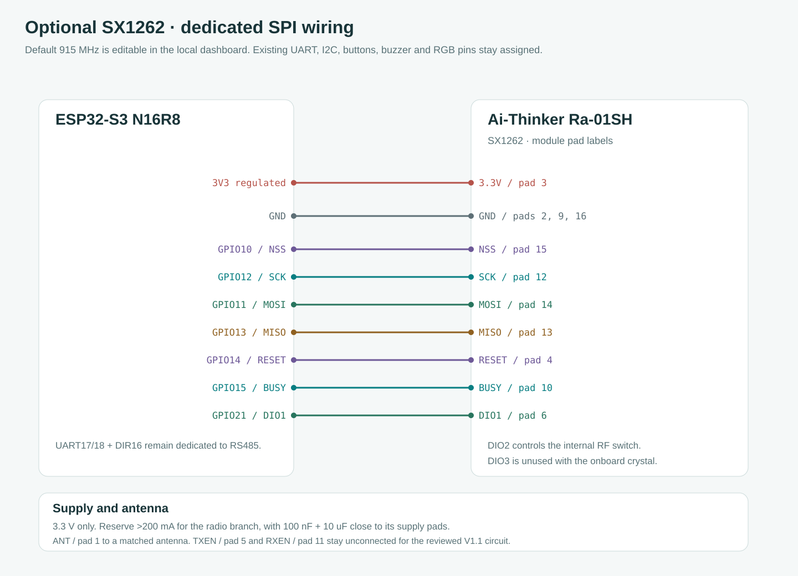
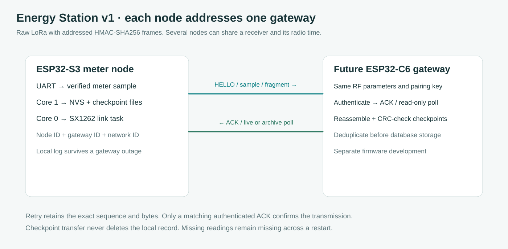

# Node SX1262 dan pengaturan radio lokal

[English](../LORA.md) · **Bahasa Indonesia** · [Protokol radio](LORA_PROTOCOL.md) · [Audit listrik terputus](POWER_LOSS.md)

Untuk beberapa station menuju satu receiver kantor, ikuti [setup PTMP dan contoh ID](LORA_PTMP.md). [Prompt pengembangan gateway](GATEWAY_PROMPT.md) siap disalin ke chat terpisah pada project gateway.

Firmware 3.4.0 menambahkan raw LoRa opsional dari station ESP32-S3 ini ke satu gateway yang ditentukan. Gateway penerima memakai ESP32-C3 dan SX1262 dalam [repository terpisah](https://github.com/gedxxe/esp32-modbus-energy-gateway). Rilis ini mengimplementasikan node S3 dan spesifikasi protokol gateway, tanpa menyertakan image gateway atau mengklaim pairing RF fisik sudah diuji.

Sesuai permintaan pemilik, default carrier adalah **915.000 MHz** dan radio tetap nonaktif sampai dikonfigurasi. Frekuensi dapat diubah melalui web dari 803 sampai 930 MHz mengikuti rentang model Ra-01SH. ID node, gateway dan jaringan terpisah dari slave ID Modbus. Setiap node pada jaringan yang sama harus memiliki ID unik.

## Wiring Ra-01SH ke ESP32-S3

Gunakan angka GPIO pada silkscreen board, bukan urutan lubang header. Penetapan berikut tidak berbenturan dengan UART 17/18 dan DIR16, I2C 8/9, tombol 4/5/6, buzzer 7, RGB 48, USB 19/20 atau pin memori N16R8. Nomor pad berasal dari halaman PDF 11 Ai-Thinker Ra-01SH V1.1 yang telah diperiksa gambarnya. [Catatan sumber](../references/ra-01sh-reference.json) memuat URL, SHA256 dan halaman yang ditinjau.

| ESP32-S3 atau suplai | Pad Ra-01SH | Sinyal |
| --- | --- | --- |
| 3,3 V teratur | 3 | 3.3V |
| GND bersama | 2, 9 dan 16 | Hubungkan ketiga GND |
| GPIO10 | 15 | NSS |
| GPIO12 | 12 | SCK |
| GPIO11 | 14 | MOSI, keluaran ESP32 |
| GPIO13 | 13 | MISO, masukan ESP32 |
| GPIO14 | 4 | RESET |
| GPIO15 | 10 | BUSY |
| GPIO21 | 6 | DIO1, interrupt |
| Antena dengan impedansi 50 ohm yang sesuai | 1 atau konektor antena terpasang | ANT |

Skema halaman 12 yang ditinjau memakai kristal dan RF switch internal dengan kendali DIO2 melalui R8. Driver menetapkan `radio.tcxoVoltage=0` serta mengaktifkan RF switch DIO2. Pada rangkaian tersebut, biarkan pad TXEN/RXEN dan DIO2/DIO3 tidak terhubung ke ESP32. Label TXEN/RXEN dan tabel DIO pada manual tidak seluruhnya konsisten, sehingga skema sebenarnya dan API SX1262 menjadi dasar konfigurasi. Varian board dengan populasi RF switch berbeda perlu diperiksa rangkaiannya sebelum pad kontrol eksternal diberi keluaran GPIO.

Radio memakai 3,3 V dan tidak boleh diberi daya dari GPIO atau rail 5 V. Pabrikan meminta kemampuan suplai lebih dari 200 mA untuk cabang radio. Pasang 100 nF dan 10 uF dekat pad suplai, dengan margin regulator untuk arus Wi-Fi ESP32 yang berjalan bersamaan. Regulator 3,3 V terpisah dapat digunakan dengan ground bersama bila regulator board tidak menjaga rail tetap stabil. Pasang antena yang sesuai sebelum mengaktifkan TX. Label GND berulang berarti net yang sama. Diagram merupakan koneksi logis, bukan foto letak header. [Netlist](../wiring-lora.csv) dibuat dari sumber yang sama dengan SVG.

## Pengaturan melalui website ESP32

1. Buka **Perangkat & arsip → Node LoRa / SX1262**. Gunakan IP AP ESP32 atau IP client yang sedang terhubung. Pengaturan radio dan key baru memakai otorisasi perintah dashboard yang sama pada kedua antarmuka, terpisah dari provisi kredensial Enterprise. Isi key melalui koneksi lokal tepercaya karena dashboard memakai HTTP. Key tersimpan tidak dikembalikan melalui status.
2. Isi **ID node** yang unik, **ID gateway** tujuan dan **ID jaringan** bersama. ID node dan gateway harus berbeda. Pengaturan ini tidak mengganti alamat Modbus meter.
3. Pertahankan 915 MHz atau pilih carrier instalasi. Buka **Parameter radio dan waktu retry** untuk menyamakan bandwidth, spreading factor, coding denominator, preamble dan sync word dengan gateway. Daya, interval sampel, timeout ACK dan jumlah retry juga dapat diubah.
4. Buat atau isi pairing key heksadesimal 64 digit yang tidak seluruhnya nol. Salin key baru ke konfigurasi gateway sebelum menyimpan. Setelah simpan, kolom dibersihkan dan secret tidak dapat diambil kembali lewat HTTP. Simpan key pada catatan kredensial instalasi bila diperlukan kemudian. Provisi ini tidak mengenkripsi NVS pengembangan ataupun payload pengukuran.
5. Aktifkan radio lalu pilih **Simpan pengaturan radio**. Core 1 menulis bank CRC yang tidak aktif dan memverifikasi baca ulang sebelum generasi konfigurasi dikirim ke task radio. Browser dengan data lama tidak dapat menimpa key baru secara diam-diam. Kegagalan simpan mempertahankan konfigurasi aktif.
6. Setelah firmware gateway yang cocok berjalan, pilih **Pairing ulang**. Inisialisasi SX1262 saja belum membuktikan pairing. Status sesi dipasangkan muncul setelah ACK HELLO dengan alamat, session dan autentikasi yang benar. **Kirim sampel saat ini** meminta TX pada slot radio berikutnya yang tersedia.

Simpan perubahan sebelum memilih Pairing ulang atau Kirim sampel saat ini. Kedua aksi memakai konfigurasi aktif yang tersimpan, sehingga dashboard menonaktifkannya saat form masih berisi draft. Bila kolom dalam Parameter radio yang tertutup belum lengkap, Simpan membuka bagian itu, memfokuskan kolom dan menampilkan namanya di dekat tombol. Pengaturan, kontrol key dan aksi radio memiliki baris tersendiri yang menyesuaikan layar sempit.

[Gambar desktop dengan Advanced terbuka](../assets/ui-lora-advanced-desktop.png) dan [gambar HP](../assets/ui-lora-advanced-mobile.png) memakai nilai simulasi. Gambar tersebut bukan bukti pengujian RF perangkat.

Default lengkap adalah 915 MHz, bandwidth 125 kHz, SF7, CR4/5, preamble 8, sync word 18 desimal, daya 14 dBm, interval 60 detik, timeout ACK 10 detik dan dua retry setelah percobaan pertama. ID default node 2, gateway 1 dan jaringan 1 merupakan nilai awal pengaturan, bukan alamat yang otomatis unik.

Rentang hardware dan default 915 MHz tidak menyatakan izin penggunaan spektrum. Untuk LPWAN Indonesia, [Permenkomdigi 2/2025 Lampiran II](https://www.postel.go.id/downloads/40/20250208094700-permen_2025-02_perubahan_PM_Izin_Kelas_BN.pdf) mencantumkan 920–923 MHz, bandwidth maksimum 250 kHz, daya end node 20 dBm dan duty limit uplink/downlink 1%. Sesuaikan frekuensi, bandwidth, daya dan gain antena pada kedua sisi dengan instalasi. Batas hardware yang dapat diedit juga mencakup wilayah lain, sedangkan pacing airtime per boot bukan sertifikasi regulasi.

## Half duplex dan checkpoint ketika gateway offline

Task prioritas 1 pada core 0 memiliki FSPI, objek SX1262 dan penanganan DIO1. ISR hanya mengubah flag. SPI, parsing paket dan HMAC dijalankan pada task dengan batas BUSY 100 ms dan startup yang menghindari probe reset 1 detik berulang dari RadioLib. Modul yang tidak tersedia menampilkan kode inisialisasi dan dicoba ulang setiap 30 detik selama radio aktif. Radio tidak disentuh saat nonaktif. UART, Preferences dan tracker tetap dimiliki core 1, serta tidak ada perintah radio yang menulis register meter atau mengubah RTC.

Setelah TX selesai, radio kembali RX sebelum menunggu ACK. Retry mempertahankan byte, session nonce dan sequence yang sama. Backoff acak mengurangi benturan berulang, sedangkan anggaran airtime 1% dipakai bersama oleh telemetry, retry dan fragmen checkpoint pada boot saat ini. Anggaran tetap di RAM saat konfigurasi radio berubah tetapi hilang saat ESP32 reset. Pada SF12, waktu tunggu dapat lebih lama daripada interval sampel. Mekanisme ini tidak berarti TX/RX simultan, kapasitas node tak terbatas atau penghitungan duty yang bertahan melintasi mati listrik.

Telemetry live mengambil nilai meter valid terbaru dan tidak membuat antrean tanpa batas. Energi hilang atau kedaluwarsa ditandai tidak tersedia. Checkpoint tetap berada pada log lokal. Gateway dapat meminta satu tanggal WIB untuk memperoleh record CRC 446 byte melalui fragmen ber-ACK. Core 1 melayani satu permintaan arsip terbatas dan menundanya di dekat jadwal checkpoint. Gateway perlu merakit, memvalidasi dan menghapus duplikasi sebelum menyimpan. ACK tidak menghapus record lokal dan belum membuktikan commit database. Setelah gangguan, gateway dapat meminta hari tersebut lagi selama retensi lokal masih tersedia.

Gunakan pairing key berbeda untuk setiap node, dengan inventori ID-ke-key pada gateway. Frame memakai HMAC-SHA256 terpotong untuk autentikasi, tanpa enkripsi payload kWh. Alamat, session, sequence ACK dan replay poll diperiksa. Tidak ada pairing tanpa key melalui udara atau konfigurasi meter jarak jauh. [Energy Station v1](LORA_PROTOCOL.md) menjelaskan offset, flag, ACK dan test vector publik untuk implementasi C3.

## Pemeriksaan lapangan

Panel menampilkan counter TX, RX terautentikasi, ACK, timeout, frame ditolak dan CRC fisik, RSSI/SNR, airtime terakhir, tunggu TX dan kode driver. Counter direset saat ESP32 restart dan tidak ditulis ke flash setiap paket. Process monitor menampilkan task `sx1262-link / SPI` beserta stack watermark. Timeout ACK saja tidak dapat membedakan modul tidak terpasang, antena tidak cocok, interferensi atau gateway yang berbeda protokol.

[Gambar desktop](../assets/ui-lora-desktop.png) dan [gambar HP](../assets/ui-lora-mobile.png) memakai API simulasi. Pengujian native mencakup codec, recovery, alamat, kecocokan ACK/session dan pacing. Sinyal SPI, RF switch DIO2 pada modul yang dibeli, daya TX, penerimaan, jangkauan, coexistence, beban Wi-Fi dan interoperabilitas gateway tetap memerlukan pengujian perangkat. Status paired simulasi bukan bukti penerimaan hardware.

## Mitigasi collision uplink melalui CAD

Worker radio node memeriksa kanal SX1262 dengan CAD nonblocking sebelum HELLO, TELEMETRY dan CHECKPOINT. Kanal yang sedang sibuk membuat frame yang sama ditunda menggunakan randomized backoff terbatas. Session dan sequence paket tidak berubah sehingga retry tetap bisa dideduplikasi di gateway. Penerima ESP32-C3 memprioritaskan ACK dan memeriksa kanal sebelum mengirim POLL. **Default 915 MHz dan TX power 14 dBm tidak berubah.** CAD bukan TDMA dan tidak menghilangkan collision hidden node; uji lapangan tetap dibutuhkan. Baca [topologi PTMP](LORA_PTMP.md) dan [desain gateway](https://github.com/gedxxe/esp32-modbus-energy-gateway/blob/main/docs/COLLISION_CONTROL.md).
