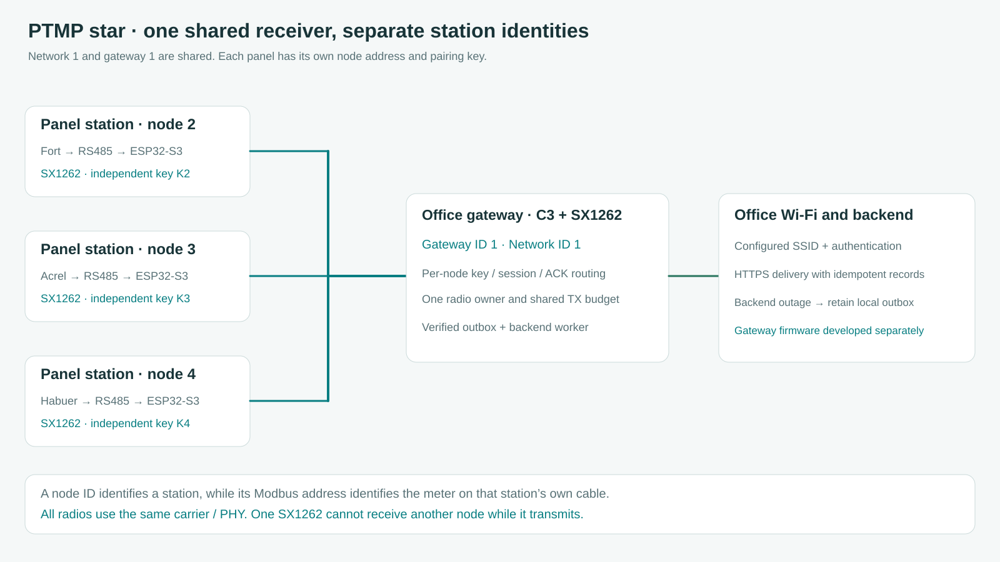

# Satu gateway untuk beberapa station meter

[English](../LORA_PTMP.md) · **Bahasa Indonesia** · [Konfigurasi radio](LORA.md) · [Prompt pengembangan gateway](GATEWAY_PROMPT.md)

Station ini merupakan sisi node dari jaringan PTMP bertopologi bintang. Beberapa ESP32-S3 mengirim ke satu receiver ESP32-C6, dengan SX1262 pada setiap perangkat. Firmware S3 menyediakan node beserta [kontrak biner Energy Station v1](LORA_PROTOCOL.md). Receiver C6 tetap memerlukan firmware gateway yang cocok. Menyamakan frekuensi saja belum menyediakan autentikasi, ACK maupun pengambilan checkpoint.

Gateway umumnya mendengarkan kiriman periodik station, memeriksa frame dengan key milik station tersebut lalu membalas ACK beralamat. Gateway juga dapat meminta nilai live atau hari checkpoint dari satu station. Wi-Fi kantor dipakai gateway untuk meneruskan data ke backend melalui worker tersendiri. Station di ruang panel tetap membaca dan menyimpan meter tanpa jangkauan router atau kredensial Wi-Fi milik gateway.

## Arti setiap ID

| Pengaturan | Arti | Contoh |
| --- | --- | --- |
| ID jaringan | Identitas aplikasi dalam header radio. Samakan pada gateway dan semua station. Angka ini tidak memilih frekuensi dan tidak mencegah tabrakan RF. | `1` untuk instalasi ini |
| ID gateway | Alamat radio receiver tujuan. Semua station yang menuju receiver ini memakai angka yang sama. | `1` untuk receiver kantor |
| ID node | Alamat radio station ini, wajib unik dalam jaringan dan berbeda dari alamat gateway. | `2`, `3`, `4` untuk tiga panel |
| Slave ID Modbus | Alamat meter pada kabel RS485 lokal. Kabel yang terpisah boleh sama-sama menggunakan slave `1`. | `1` pada setiap bus panel terpisah |
| Saved meter ID | ID inventori lokal dalam checkpoint satu station, bukan alamat radio global. | Simpan bersama ID jaringan dan node |
| Profile ID | Identitas dekode immutable, misalnya Fort atau map total ADL400 yang terverifikasi. | Total ADL400 saat ini memakai profil `5` |
| Pairing key | Secret 32 byte untuk HMAC satu station. Gateway menyimpan key yang sesuai pada entri node tersebut. | Key hasil generate berbeda pada setiap station |

Node `2` dan gateway `1` merupakan dua endpoint dalam ruang alamat yang sama. Jaringan `1` juga dapat berisi node `3` dan `4`. Jangan menyalakan beberapa station dengan ID node bawaan `2` yang sama. SSID dan IP tidak menggantikan ID radio ini. Sync word membantu penerimaan PHY, tetapi bukan key autentikasi.

## Contoh pengaturan tiga station

1. Buat dan flash firmware C6 terpisah menggunakan [prompt gateway](GATEWAY_PROMPT.md). Tentukan ID gateway `1`, ID jaringan `1` dan PHY yang sama dengan node. Default carrier dapat diubah dari `915 MHz`, dengan bandwidth `125 kHz`, `SF7`, `CR4/5`, preamble `8`, sync logis `0x12`, explicit header, IQ normal dan CRC LoRa aktif. Sesuaikan instalasi dengan ketentuan spektrum pada [panduan radio](LORA.md).
2. Di S3 pertama, hubungkan HP atau laptop ke AP pemulihan lalu buka **Perangkat & arsip → Node LoRa / SX1262**. Isi ID node `2`, ID gateway `1` dan ID jaringan `1`. Generate key baru, lalu salin ke entri node `2` pada inventori gateway sebelum menyimpan. Key tersimpan tidak dapat diambil kembali melalui HTTP.
3. Gunakan ID node `3` untuk panel kedua dan `4` untuk panel ketiga. Gateway, jaringan dan PHY tetap sama, sedangkan setiap station memakai key sendiri. Pengaturan Modbus mengikuti meter yang terpasang pada masing-masing panel.
4. Uji satu station dahulu. Setelah inisialisasi SX1262 berhasil, HELLO harus mendapat ACK yang alamat, session dan autentikasinya cocok. Periksa counter RX/ACK serta RSSI/SNR terakhir. ID gateway tersimpan atau SPI berhasil belum membuktikan pertukaran RF.
5. Tambahkan station lain satu per satu. Gateway perlu memiliki baris tersendiri untuk setiap `(jaringan, node)`, lengkap dengan nama, session, nilai terakhir, waktu terima, usia sampel dan error. Pastikan paket node `3` tidak mengubah nilai node `2`.
6. Minta satu hari tersimpan dari satu station. Gateway merakit lima fragmen ber-ACK menjadi record beku 446 byte, memeriksa CRC/semantik lalu menyimpannya tanpa duplikasi. Hari yang tidak tersedia tetap unavailable. Cocokkan dengan ekspor checkpoint lokal station tersebut.
7. Uji Wi-Fi kantor terputus, gateway restart dan satu station dimatikan secara terpisah. Pembacaan lokal harus tetap berjalan. Periksa pemulihan backlog receiver dan session baru setelah restart node sebelum menerima instalasi sebagai selesai diuji.

## Pembagian waktu radio

Satu SX1262 memakai satu konfigurasi penerimaan dan tidak dapat menerima station lain saat sedang TX. Link v1 memakai alamat tujuan, random contention terbatas dan retry. Belum ada negosiasi slot TDMA, reservasi bebas tabrakan, mesh atau concentrator multichannel. Polling gateway mengurutkan pekerjaan yang diminta tetapi tidak membungkam uplink periodik node.

Mulai 3.4.1, HELLO pertama memakai jendela acak minimal lima detik, meningkat mengikuti airtime sampai 30 detik. TX pertama lainnya memiliki jendela mengikuti airtime dengan minimum 1,5 detik. ACK yang cocok untuk frame yang sudah pernah dikirim masih diterima saat menunggu retry. ACK ditolak setelah frame dihentikan atau session berubah. Byte retry tetap sama dan nilai live kedaluwarsa tetap mengikuti batas freshness.

Anggaran software 1% berlaku pada masing-masing radio, sehingga gateway harus menghitung semua ACK dan POLL yang dikirimnya. Pada PHY bawaan, persamaan airtime RadioLib 7.8.1 menghasilkan sekitar 133,4 ms untuk telemetry 72 byte dan 87,3 ms untuk ACK 41 byte. Tiga ACK telemetry per menit memakai sekitar 0,44% waktu TX gateway sebelum HELLO, retry dan arsip. Sepuluh ACK memakai sekitar 1,46%, sudah melebihi anggaran software tersebut. Ini hasil perhitungan, bukan hasil pengukuran kapasitas atau jangkauan. Gunakan `getTimeOnAir()` pada PHY sebenarnya, sisakan margin dan naikkan interval station seiring penambahan node. SF lebih lambat mengubah angka itu secara besar.

Scheduler gateway harus memiliki satu pemilik radio dan satu anggaran TX bersama. Dahulukan ACK, gabungkan ACK tertunda yang identik dan jalankan paling banyak satu pengambilan arsip secara global. Terima telemetry biasa di antara fragmen arsip. Station juga dapat menyisipkan satu frame live miliknya yang jatuh tempo atau diminta, sehingga receiver perlu mempertahankan assembly arsip ketika memproses telemetry tersebut. Tidak perlu terus melakukan POLL live bila uplink periodik sudah tersedia. Tampilkan status antrean saat sibuk dan batasi ukurannya. Deadline POLL perlu memperhitungkan contention node sampai 30 detik, duty wait dan layanan arsip, terpisah dari timeout ACK node.

## Kontrak receiver

Inventori gateway memetakan `(ID jaringan, ID node)` ke nama, key dan alamat receiver yang dituju. HELLO valid menjadi kandidat session, kemudian gateway menguji keterjangkauan saat ini dengan POLL live baru yang responsnya berkorelasi sebelum mengganti session aktif. Langkah ini mencegah rekaman HELLO lama langsung dianggap sebagai data online terkini. Sequence POLL per-session harus meningkat dan bertahan ketika gateway restart, misalnya dengan reservasi blok sequence sebelum TX. Jangan mengulang dari `1` ketika node masih mengingat sequence lebih besar pada session yang sama.

ACK berarti frame diterima melalui radio. Status database durable harus dipisah. Gateway perlu outbox lokal yang dapat pulih dari restart, pengiriman backend tanpa duplikasi dan tidak menghapus log station setelah ACK. Energi yang tidak tersedia tidak boleh diubah menjadi nol. Pertahankan UTC, usia sampel dan identitas sumber, serta jangan mengalikan CT/PT kembali pada kWh yang sudah dikonversi node.

CPU aplikasi C6 memakai satu core RISC-V performa tinggi dengan CPU low-power terpisah, sesuai [datasheet Espressif](https://documentation.espressif.com/esp32-c6_datasheet_en.html). Penetapan core 1 pada firmware S3 tidak boleh disalin ke C6. Gunakan worker dan antrean terbatas pada core aplikasi yang didukung. GPIO gateway perlu disesuaikan dengan board serta modul C6 sebenarnya.

Tes software memeriksa tiga node beralamat, penolakan node/session lain, ACK terlambat untuk frame aktif dan batas contention. RF banyak node, tabrakan, scheduler gateway, pemutusan daya dan pengiriman backend tetap perlu diuji pada perangkat. [Prompt gateway](GATEWAY_PROMPT.md) memuat implementasi dan bukti pengujian yang diperlukan.
