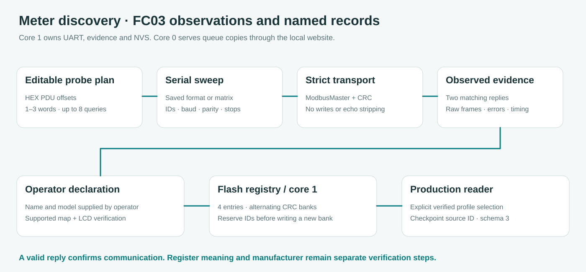
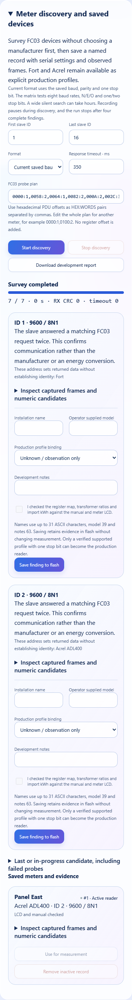

# Pencarian meter, perangkat tersimpan dan bukti pengembangan

[English](../METER_DISCOVERY.md) · **Bahasa Indonesia** · [Ringkasan](../../README.id.md)

Profil produksi menentukan arti register yang didokumentasikan serta konversinya menjadi kWh. Discovery mencari perangkat yang membalas transaksi FC03 read-only, mencatat hasil pengamatan dan memungkinkan operator menyimpan investigasi bernama ke flash. Slave yang ditemukan tidak otomatis dianggap sebagai merek tertentu atau diterima sebagai sumber energi. [Spesifikasi Modbus bagian 6.3](https://modbus.org/docs/Modbus_Application_Protocol_V1_1b3.pdf) menjelaskan FC03 sebagai pembacaan holding register beserta exception, bukan identifikasi produsen.



## Langkah melalui website ESP32

Buka **Meter setup → Pencarian meter dan perangkat tersimpan**. Form koneksi Fort/Acrel tetap digunakan untuk profil produksi yang diketahui. Membuka panel atau mengunduh laporan tidak menjeda pembacaan. **Mulai pencarian** adalah maintenance aktif yang memutus kontinuitas interval sampai pembaca tersimpan dipulihkan.

1. Mulai dengan ID meter yang diketahui atau rentang kecil. **Format tersimpan** memakai baud, parity dan satu stop bit dari konfigurasi produksi. Kontrol arah mengikuti pilihan manual/otomatis yang tersimpan, dengan rangkaian manual GPIO17/18/16 tetap sebagai default instalasi.
2. Periksa **Plan probe FC03**. Formatnya `HEX:WORDS` yang dipisahkan koma, memakai offset PDU heksadesimal tanpa penambahan 40001. Plan awal dibentuk dari `0000:1` beserta query arus, energi dan rasio profil bawaan. Seluruh plan dapat diganti mengikuti manual lain, misalnya `0000:1,0100:2,0102:2`. Maksimal delapan query unik dengan satu sampai tiga register ditampung oleh buffer tetap.
3. Pilih batas respons 150–3000 ms. Nilai awal 350 ms hanya untuk survey, sedangkan produksi mempertahankan timeout 2000 ms dan jarak request 200 ms. Naikkan timeout bila manual menyebut respons lebih lambat. Probe pertama yang diam tidak menghentikan probe berikutnya.
4. Pilih **Mulai pencarian**. Respons data atau exception yang sah dikonfirmasi dengan request kedua. Seluruh plan kandidat diselesaikan sebelum temuan ditampilkan, lalu pencarian berlanjut ke kandidat lain. Empat temuan lengkap dapat ditampung di RAM sebelum scan berhenti dan pembaca produksi kembali.
5. Jika temuan yang dibutuhkan sudah muncul, pilih **Hentikan pencarian** tanpa menunggu seluruh rentang. Temuan lengkap tetap tersedia. Kandidat yang belum selesai hanya dipertahankan sebagai catatan investigasi pada laporan dan belum dapat disimpan sebagai meter terkonfirmasi.
6. Periksa frame lalu isi **Nama instalasi**, **Model menurut operator** dan **Catatan pengembangan**. Gunakan **Belum diketahui / observasi saja** ketika identitas atau arti register belum jelas, lalu pilih **Simpan temuan ke flash**. Penyimpanan bukti tidak mengganti koneksi produksi.
7. Untuk memakai meter yang didukung, kaitkan dengan profil Fort atau Acrel dan konfirmasikan pemeriksaan manual, rasio trafo serta LCD energi impor. **Gunakan untuk pengukuran** hanya aktif ketika query arus, energi dan rasio profil masing-masing mendapat dua respons data sah, baud sesuai batas profil dan format memakai satu stop bit. Temuan yang hanya berupa exception belum memenuhi pemeriksaan tersebut.
8. Pilih **Unduh laporan pengembangan** sebelum memulai survey baru. Run baru mengganti temuan RAM yang belum disimpan, sedangkan record bernama tetap berada di flash. Laporan JSON mencakup record tersimpan serta kandidat terakhir yang gagal atau belum selesai. Simpan salinan di komputer untuk pengembangan driver.

Registry menyediakan empat record. Ekspor record tidak aktif sebelum menghapusnya untuk memberi ruang. Record aktif tidak boleh dihapus. Memilih instalasi lain tetap memutus kontinuitas meskipun baud, ID dan profilnya sama, lalu checkpoint berikutnya menyimpan ID instalasi yang berbeda.



## Batas pencarian dan interpretasi

Matrix mencakup 1200, 2400, 4800, 9600, 19200, 38400, 57600 dan 115200 baud, dikombinasikan dengan N/E/O serta satu/dua stop bit. ID tersimpan diprioritaskan. Format tersimpan hanya mencoba konfigurasi serial produksi. Pencarian matrix yang luas tanpa respons dapat memerlukan beberapa jam karena setiap query memiliki deadline serta jeda bus. Progress menghitung slot query yang selesai, sedangkan counter request mencakup konfirmasi serta percobaan yang ditolak secara lokal. Angka tersebut bukan hitungan paket yang diukur langsung pada kabel.

Seluruh transaksi tetap FC03. Ini adalah scanner generik untuk perangkat Modbus RTU yang kompatibel dengan FC03, bukan klaim dapat mengenali setiap protokol power meter. Perangkat yang membutuhkan FC04, handshake vendor, baud lain atau framing yang belum didukung dapat tetap diam. Sistem tidak memakai FC43 device identification, tidak mereset perangkat dan tidak menulis konfigurasi meter. Exception sah mengonfirmasi adanya balasan, sedangkan timeout saja tidak membedakan modul terlepas dari meter yang diam atau setting serial yang berbeda.

Transport memeriksa ID, fungsi, byte count, panjang dan CRC. Echo request, byte tambahan serta overflow ditolak tanpa menghapus prefix agar terlihat sebagai respons. Discovery memakai hasil validasi yang sama, bukan parser penerimaan baru. Input invalid yang terlalu panjang ditampung maksimal 16 byte per balasan dan diberi penanda terpotong pada laporan.

Petunjuk kecocokan alamat berarti query arus, energi dan rasio suatu profil mendapat data. Petunjuk itu belum membuktikan identitas atau satuan. Website menampilkan word U16, interpretasi U32/I32 serta kandidat float normal/swapped untuk dua word pertama. Semua merupakan interpretasi tanpa skala untuk developer dan tidak masuk ke tracker checkpoint. Respons pertama serta konfirmasi disimpan agar perubahan nilai atau perbedaan data/exception tetap terlihat.

Durasi percobaan mencakup jeda request, waktu driver dan pemrosesan respons, sehingga bukan latensi propagasi RS485 yang presisi. Laporan menyimpan identitas boot/run, elapsed time monotonik serta referensi RTC satu detik jika tersedia. Referensi RTC diambil oleh task sebelum probe terakhir, bukan timestamp atomik setiap register. Laporan tidak mengukur tegangan A/B atau memastikan kesehatan transceiver eksternal.

## Record bernama dan pemulihan flash

Setiap record berisi ID 16-bit yang tetap, nama/model/catatan operator, kaitan profil, flag verifikasi, format serial, arah serta bukti probe. Nama maksimal 31 karakter ASCII yang dapat dicetak, model 39 dan catatan 63. Nama kosong atau berisi karakter kontrol ditolak. Identitas model merupakan pernyataan operator yang terpisah dari pengamatan mentah. Penyimpanan ulang temuan yang sama dengan isian identik tidak mengalokasikan ID atau menulis flash lagi.

Registry dikodekan secara eksplisit dengan versi serta CRC16 ke dua bank NVS bergantian, `meters_a` dan `meters_b`. Bank baru dibaca kembali dan dibandingkan sebelum mengganti registry yang sedang digunakan. Saat boot, generasi sah terbaru dipilih dan bank lain tetap menjadi cadangan. Jika keduanya invalid, data dipertahankan untuk investigasi dan penulisan baru diblokir. Tidak ada reset registry, format atau erase otomatis. Penyimpanan ini terpisah dari arsip checkpoint LittleFS.

Record `meter_seq` dengan CRC mencadangkan ID berikutnya sebelum bank registry ditulis. Pemulihan ke bank lama tidak dapat memakai ulang ID dari bank baru yang hilang. Kegagalan write dapat meninggalkan nomor yang terlewat dan hal tersebut disengaja. ID tidak diputar kembali secara diam-diam. Ketika ruang ID 16-bit habis, pembuatan record baru berhenti sementara record serta ekspor yang ada tetap dapat dibaca.

Konfigurasi produksi memakai record eksplisit 16 byte yang mencakup ID tersimpan serta CRC. Format v1/v2/v2.5 dibaca dan dimigrasikan tanpa mengubah arti profil Fort/Acrel. Jika ID aktif tidak lagi merujuk ke record yang kompatibel setelah pemulihan, sistem melaporkan kebutuhan pemeriksaan konfigurasi dan tidak mengaitkan pengukuran ke instalasi lain secara diam-diam.

Schema checkpoint 3 memakai 42 byte per baris dan 446 byte per hari. Schema 1/2 tetap dibaca pada ukuran 426 byte dengan ID meter nol karena dibuat sebelum inventory bernama. Baris yang sudah selesai dipertahankan. Selisih membandingkan ID meter, profil, setting serial, rasio serta generasi kontinuitas. CSV menambahkan `saved_meter_id` dan tabel menampilkan ID di samping profil. Penghapusan registry tidak menghapus ID historis checkpoint, tetapi label manusianya tidak lagi tersedia dalam registry empat record, sehingga unduh laporan sebelum menghapus record.

## Diagnostik Arduino mandiri

Lokasi [FortSerialDebug](../../examples/FortSerialDebug/README.id.md) dipertahankan agar kompatibel. Controller discovery serta transport sama dengan firmware utama, tetapi sketch mandiri tidak menulis NVS atau filesystem. Buka **Arduino IDE Serial Monitor**, pilih **115200 baud** dan **Newline**. Ketik satu baris berikut pada Serial Monitor **INPUT**, lalu tekan **Enter/Send** untuk baris itu:

```text
range 1 16
scanmode current
timeout 350
discoverplan 0000:1,0058:2,0064:1,0082:2,000A:2,002C:3,008D:2
discover
discoveryreport
```

Gunakan `x` atau `stop` pada Serial Monitor INPUT untuk membatalkan, lalu jalankan `discoveryreport` lagi. `scanmode matrix` mengaktifkan matrix lengkap. `stops 1` atau `stops 2` mengubah format trial saat ini. Pemeriksaan `reg HEX WORDS` dapat dilakukan setelah baud, ID dan parity yang diinginkan dipilih. Semua masih merupakan trial dan belum menentukan konversi energi produksi.

Perintah yang sama dapat diketik satu per satu pada website **Diagnostic console → Command input → Run command**. Discovery aktif dari konsol memutus kontinuitas, sedangkan **Resume measurement** memulihkan konfigurasi produksi. Penyimpanan inventory bernama dilakukan pada panel discovery website, bukan INO mandiri. `status`, `report` dan `discoveryreport` membaca keadaan yang ada tanpa memulai maintenance. Salin hasil **OUTPUT** atau laporan unduhan ke chat dukungan jika membutuhkan analisis. Label output tidak diketik kembali sebagai perintah.

## Modul dan verifikasi

[SerialSweep.h](../../firmware/lib/FortMeter/src/SerialSweep.h) mengatur kandidat serta batas serial. [MeterDiscovery.h](../../firmware/lib/FortMeter/src/MeterDiscovery.h) mengatur plan, konfirmasi, bukti tetap serta lifecycle. FortTransport/ModbusMaster tetap menangani transaksi dan validasi. [meter_registry.h](../../firmware/include/meter_registry.h) mengatur codec, sedangkan [meter_registry_store.h](../../firmware/include/meter_registry_store.h) menangani dua bank serta pencadangan ID. [meter_lab_web.cpp](../../firmware/src/meter_lab_web.cpp) menangani parsing HTTP dan serialisasi laporan melalui callback tanpa akses UART atau Preferences langsung. [meter_config.h](../../firmware/include/meter_config.h) memusatkan kesetaraan serta migrasi setting.

Core 1 memiliki discovery, mutasi registry serta penulisan flash. Core 0 menerima salinan queue, melayani laporan dan mengirim request terbatas. Stop memakai token run atomik terpisah yang diperiksa oleh service transport, sehingga tidak menunggu di belakang antrean setting. Run atau revisi mode yang sudah berubah tidak dapat menyimpan temuan dari survey baru. Scanner profil biasa menghapus hasil lama setelah konfigurasi manual diganti dan perintah rasio Acrel memakai batas dua word yang benar.

Tes native memakai ModbusMaster serta INO aktual untuk probe awal diam, exception, batas empat temuan, Stop, framing, CRC record, migrasi, kegagalan/pemulihan bank serta pencadangan ID saat bank baru hilang. Browser memakai gzip aktual dengan API simulasi untuk nama, save/reload, aktivasi, larangan hapus record aktif, ekspor, pelestarian tampilan ketika payload rusak, Stop prioritas, bahasa dan layout HP. Pemutusan daya NVS fisik, sisa stack, radio serta kesesuaian dengan meter aktual tetap memerlukan penerimaan lapangan. Tes software tidak dinyatakan sebagai hasil hardware.
