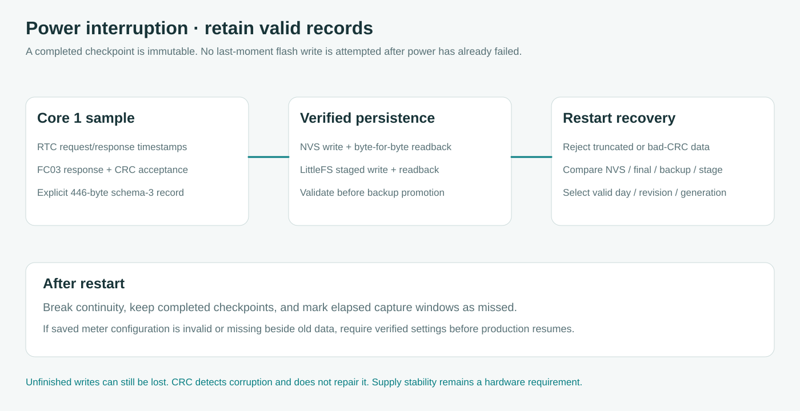

# Audit listrik terputus dan penyimpanan

[English](../POWER_LOSS.md) · **Bahasa Indonesia** · [Validasi](VALIDATION.md) · [Node LoRa](LORA.md)

Logger menolak record rusak dan memulihkan salinan tersimpan yang valid setelah restart. Tidak ada jaminan kehilangan data nol ketika listrik terputus saat operasi flash. Pembacaan yang masih di RAM atau penulisan belum selesai dapat hilang. NVS dan LittleFS berada pada chip flash yang sama, sehingga merupakan redundansi software dan bukan dua media hardware independen. CRC mendeteksi kerusakan tetapi tidak membangun ulang angka bila semua salinan rusak.

Data utama adalah sepuluh checkpoint kWh kumulatif harian dengan timestamp request/response, counter mentah, nilai engineering dan identitas meter/rasio. Capture tidak disimpulkan dari angka terakhir browser. Sembilan interval konsumsi lama tetap menjadi analisis terpisah.

## Penguatan konfigurasi dan arsip pada 3.5.0

Konfigurasi meter/Wi-Fi memakai bank generation dengan readback dan status salinan bermasalah. Unit baru menunggu save meter terkonfirmasi. Staging lama tidak boleh menurunkan versi arsip atau mengganti checkpoint immutable yang bertentangan. Payload dalam dan schema capture tetap mengikuti kontrak existing. Lihat [kesiapan fleet](FLEET_READINESS.md) untuk migrasi, downgrade dan batas instalasi pertama.

## Temuan yang diperbaiki pada 3.4.0

| Temuan | Risiko sebelumnya | Perbaikan |
| --- | --- | --- |
| Simpan NVS hanya memeriksa jumlah byte hasil tulis | Record disebut durable sebelum isinya diperiksa | Baca ulang panjang dan seluruh byte sebelum menandai terverifikasi |
| Staging valid dapat dibuka lagi dengan truncation | Gangguan berikutnya dapat merusak staging terbaru | Validasi dan promosikan staging sebelum namanya dipakai ulang |
| Promosi backup mempercayai berkas utama | Berkas utama rusak dapat menggantikan backup valid | Validasi salinan dan karantina record ditolak dalam nama `.bad` terbatas |
| Recovery memilih salinan valid pertama | Alternatif lebih baru dapat terlewat | Bandingkan tanggal, revision dan generation |
| Konfigurasi meter rusak dapat memakai default | Respons valid dari alamat yang ditebak dapat ditafsirkan dengan profil salah | Hentikan produksi sampai konfigurasi terverifikasi disimpan, dengan log/web/diagnostik tetap tersedia |
| Interval lama hanya diperiksa ukuran, magic dan CRC | NaN atau flag complete tidak konsisten belum ditolak | Validasi tanggal, angka, representasi boolean dan kualitas |
| Beberapa setting belum memakai baca ulang konsisten | Perubahan RAM dianggap tersimpan | Gunakan verifikasi tulis/baca ulang dan laporkan kegagalan |

Register, ID profil immutable, pembaca schema capture 1/2/3, CT/PT dan jadwal tidak diubah. Pengaturan LoRa memakai record dua bank tersendiri.

## Saat checkpoint disimpan

Core 1 menerima sampel setelah FC03 dan profil meter memvalidasinya. Request/response harus memenuhi jendela lima detik. Titik yang sudah ditangkap tidak ditimpa lagi pada hari tersebut.

Owner menyusun record schema 3 berukuran 446 byte beserta CRC16. Blob NVS ditulis lalu hasil baca ulang dibandingkan. Record juga ditulis ke `/capture.pending`, di-flush, diperiksa byte-nya, lalu dipromosikan ke `/c<day>.bin` menggunakan salinan yang telah divalidasi. Berkas utama hasil promosi divalidasi lagi sebelum backup dihapus. Bila validasi akhir gagal, backup tetap tersedia. Staging valid diselamatkan sebelum namanya dibuka ulang. Staging **rusak** di `/capture.pending` kini dipindahkan ke nama karantina `.bad` sampai `.bad9` yang masih tersedia sebelum percobaan tulis dengan truncation; ketika rename gagal atau semua nama penuh, penulisan gagal secara aman tanpa menghapus buktinya. Karantina yang sudah terisi dapat membuat promosi berhenti agar bukti tidak ditimpa. Salinan lain yang terverifikasi tetap dapat melindungi capture, sedangkan status storage terganggu sampai pemulihan berhasil.

Penyimpanan NVS interval lima menit kini memverifikasi isi record terlebih dahulu dan tidak menulis ulang byte yang identik; record berubah, rusak, tidak ada, atau gagal dibaca tetap menggunakan jalur tulis dan readback tervalidasi. CSV legacy juga membandingkan seluruh isi file dengan batas buffer, sedangkan file staging tersisa atau file yang korup tetap melewati proses promosi setelah verifikasi ulang. Kebijakan ini mengurangi penulisan flash yang tidak perlu tanpa mengubah jadwal capture utama.

Capture disebut durable ketika sedikitnya satu salinan saat ini lolos jalur penyimpanan. Status NVS, berkas dan sumber recovery boot ditampilkan terpisah. Hasil tulis/baca ulang tidak membuktikan suplai akan tetap sesuai spesifikasi setelahnya. Status ini merupakan verifikasi software, bukan jaminan hardware terhadap mati listrik.

## Restart dan gangguan beberapa hari

Firmware tidak memformat filesystem gagal secara otomatis. Prosedur fisik menahan tombol untuk menghapus arsip tetap merupakan tindakan recovery yang disengaja.

Recovery memeriksa NVS, berkas utama, backup dan staging yang selesai di-flush. Penemuan tanggal arsip berbeda ke-65, termasuk tanggal yang lebih baru daripada seluruh indeks, selalu menandai recovery tidak lengkap (tidak boleh diam-diam menggeser tanggal tertua). Pemindaian direktori dapat meninjau sampai 4.096 entri dan mengurutkan 64 hari arsip terbaru tanpa bergantung pada urutan direktori; jika batas terlampaui, terdapat lebih dari 64 hari produksi berbeda atau mutex/root gagal, status recovery tidak lengkap dan pergantian hari capture **serta penulisan arsip filesystem** diblokir tanpa menghapus salinan NVS. Record terpotong, CRC salah, energi non-finite, metadata invalid atau timestamp di luar jendela ditolak. Record valid terbaru dipulihkan dan kontinuitas diputus. Capture lengkap tetap disimpan, sedangkan jadwal terlewat tanpa capture menjadi missed. Angka terlambat tidak digunakan untuk mengisi pengukuran masa lalu.

Sebelum pergantian hari, hari saat ini harus masuk arsip atau slot NVS hari sebelumnya yang dilindungi. Saat filesystem gagal, satu hari sebelumnya dapat menunggu di sana. Jika kedua slot recovery terisi, rollover berikutnya diblokir agar hari lama tidak tertimpa. Gangguan penyimpanan berkepanjangan dapat menghentikan capture baru. Periksa backlog dan recovery sebelum meninggalkan ruang panel.

Interval lama yang pulih dalam status ACTIVE diinterupsi dan tidak dinyatakan lengkap. NVS interval disimpan saat perubahan kualitas dan periodik lima menit, sehingga analisis berjalan dapat tertinggal dari RAM. CSV merupakan ekspor dengan promosi backup, bukan record primer dengan CRC sendiri. CSV tetap dapat diperiksa tetapi tidak dipakai mengarang capture primer tepercaya.

## Power dip dan batas hardware

SDK yang dipin mengaktifkan brownout detector dan build utama menolak konfigurasi yang mematikannya. Log boot dan dashboard menampilkan alasan reset Espressif. Brownout merupakan klasifikasi reset, bukan rekaman tegangan terkalibrasi atau daftar semua gangguan suplai. Padam cepat dapat terlihat sebagai POWERON pada boot berikutnya. Baterai DS3231 menjaga jam, bukan menyalakan ESP32 atau menyelesaikan penulisan flash.

Board ini belum memiliki masukan power-fail atau energi cadangan dengan hold-up terjamin. Interrupt tidak dapat menyimpan setelah energi yang dibutuhkan habis. Perlindungan lebih kuat memerlukan suplai stabil dan supervisor/UPS hardware dengan hold-up yang diukur pada beban gabungan Wi-Fi/radio. Nilai kapasitor saja belum membuktikan hold-up cukup. Cabang SX1262 membutuhkan margin dan decoupling pada [panduan wiring](LORA.md#wiring-ra-01sh-ke-esp32-s3).

Espressif mendokumentasikan [pemulihan NVS setelah kehilangan daya](https://docs.espressif.com/projects/esp-idf/en/v5.5.5/esp32s3/api-reference/storage/nvs_flash.html), termasuk kemungkinan hilangnya key yang sedang ditulis. Hal ini tidak menghapus keausan flash, kerusakan elektris atau batas tegangan. Ekspor dan gateway yang benar-benar menyimpan record tervalidasi menambah pilihan recovery. ACK radio saja belum membuktikan commit database.

## Validasi dan uji perangkat

Suite native menguji semua posisi truncation pada bank LoRa 80 byte dan record primer 446 byte. Cakupannya termasuk hasil tulis yang mengaku sukses tetapi salah, korupsi baca ulang, generation, kegagalan validasi akhir yang tetap mempertahankan backup serta kegagalan antaroperasi promosi dengan salinan utama valid/rusak. Suite sebelumnya memeriksa korupsi byte, titik immutable, RTC invalid, reboot dan rollover terlindungi. Ini model fault-injection, bukan simulasi elektris flash fisik.

Untuk bench, ekspor data lama dan gunakan meter/counter referensi. Lakukan power cycle di luar/dalam jadwal, lalu putuskan suplai pada variasi jeda ketika menyimpan capture/setting. Bandingkan sumber recovery, flag terverifikasi, raw/source dan CSV. Hasil harus sama dengan salah satu versi lengkap atau tetap missing, tanpa NaN, nol buatan atau interval complete palsu. Ulangi dengan storage penuh/tidak dapat di-mount dan pastikan hari sebelumnya terlindungi. Untuk power dip, catat tegangan rail dan alasan reset pada pengujian suplai rendah yang terkendali.

Pengujian software tidak melakukan pemutusan daya fisik, endurance, transien regulator atau TX RF. [VALIDATION](VALIDATION.md) memuat hasil aktual dan pekerjaan hardware yang tersisa.
