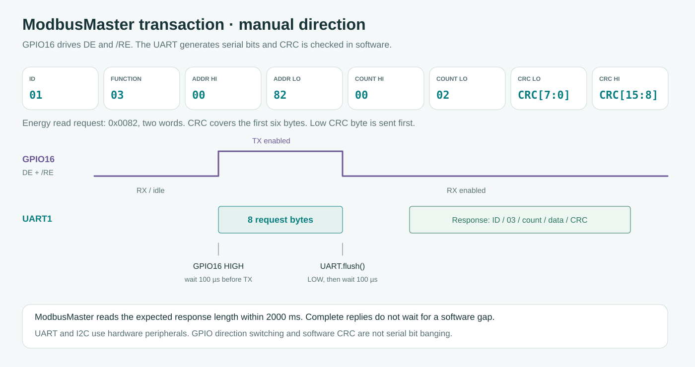

# FortSerialDebug 3.0.0 / panduan diagnosis lapangan

Sketch mendukung `discover`, `discoverplan`, `discoveryreport` dan `stops` melalui controller yang sama dengan website. [Panduan discovery](../../docs/id/METER_DISCOVERY.md#diagnostik-arduino-mandiri) menjelaskan tujuan pengetikan perintah serta pengambilan output. Record flash bernama disimpan melalui website utama dan tidak ditulis oleh INO ini.

Sketch ini juga mendukung Acrel ADL400 melalui `profile acrel-adl400`. Baca [Profil meter](../../docs/id/METER_PROFILES.md) untuk pemilihan model, register serta langkah Serial Monitor. Resep kasus yang sudah ada memakai Fort kecuali profil lain dipilih secara eksplisit.

[English](README.md) · **Bahasa Indonesia**

Sketch ini menjalankan source FortMeter/ModbusMaster yang sama dengan firmware 3.0.0 melalui USB Serial. Default mengikuti transceiver manual terkonfirmasi: TX17→DI, RX18←RO, DIR16→DE+/RE, settling 100 µs, jeda request 200 ms dan timeout dua detik. Seluruh request merupakan FC03 read dan konfigurasi uji hanya disimpan di RAM.

## 1. Upload satu kali

Pada Arduino IDE, pasang **FortMeter-library-v3.0.0.zip** melalui **Sketch → Include Library → Add .ZIP Library**, kemudian buka `FortSerialDebug.ino`. ZIP menyertakan ModbusMaster 2.0.1+fort.1 dengan hook layanan runtime. Memasang ModbusMaster stok saja belum menyediakan hook tersebut. Dari checkout source, salin seluruh [folder FortMeter](../../firmware/lib/FortMeter) ke folder `libraries` pada Sketchbook yang dipilih di Preferences.

Pilih board ESP32-S3 dengan flash 16 MB, OPI PSRAM serta USB CDC aktif dan gunakan Arduino ESP32 3.3.11. Alternatif PlatformIO dijalankan dari **terminal komputer pada root repository** dengan `pio run -d examples/FortSerialDebug`, atau tambahkan `-t upload`. Library lokal ditemukan otomatis. Build React tidak diperlukan untuk menjalankan sketch ini.

## 2. Pertahankan wiring instalasi

TX17 menuju DI, RX18 menerima dari RO, dan GPIO16 terhubung ke DE serta /RE yang disatukan. Catu/GND modul kompatibel berbagi rangkaian tegangan rendah dengan ESP32. A menuju Fort 58/A dan B menuju 59/B, sedangkan 70/COM bukan ground RS485. `direction auto` hanya dipakai untuk modul yang memang mengendalikan arah otomatis dan tidak memakai kabel GPIO16.

## 3. Ketik perintah di INPUT Serial Monitor

Buka **Serial Monitor Arduino IDE pada 115200 baud, Newline**. Ketik `status` di **INPUT Serial Monitor**, tekan Enter/Send, lalu baca **OUTPUT** yang muncul. Setelah itu ketik `intermediate` dan Enter/Send untuk mencoba contoh arus pada manual, 0x0058/dua word. Perintah tersebut diketik pada konsol perangkat, bukan dikirim ke chat dukungan.

Untuk tes lebih luas, masukkan `diagnose` sebagai baris berikutnya dan tunggu `[REPORT_END]`. Jika meminta analisis, salin OUTPUT dari `[REPORT_BEGIN]` beserta setting/TX/RX sebelumnya ke chat. Jangan mengetik label OUTPUT kembali sebagai perintah. Pada firmware utama, tujuan yang sesuai adalah **Command input web + Run command**, satu baris setiap klik setelah membuka Diagnostic console.

## Pilih pengujian berdasarkan hasil

| Tujuan atau observasi | Resep |
| --- | --- |
| Aktivitas RX tanpa request | [01 RX pasif](cases/01-passive-rx.txt) |
| Echo persis atau tidak ada respons sah | [02 echo/respons](cases/02-echo-or-no-reply.txt) |
| Rentang ID/format terbatas | [03 matriks serial](cases/03-serial-matrix.txt) |
| Bedakan exception sah dari data terbaca | [04 exception register](cases/04-register-exception.txt) |
| Audit panjang register tanpa menganggapnya energi | [05 map mentah](cases/05-raw-map-audit.txt) |
| Decode counter sekunder dengan CT/PT eksplisit | [06 kWh terkonfigurasi](cases/06-configured-kwh.txt) |
| Bandingkan budget timeout | [07 perbandingan timeout](cases/07-timeout-comparison.txt) |
| Bandingkan urutan word integer | [08 urutan word](cases/08-word-order-comparison.txt) |

Komentar resep membedakan tujuan INPUT dan OUTPUT. Pada Serial Monitor, ketik/tempel baris non-komentar lalu biarkan tes selesai. Antrean dapat menahan enam belas baris dan `x` memutus penantian sekaligus membatalkan antrean lama. Pada web, masukkan satu baris non-komentar setiap Run command karena paste multi-baris ditolak agar eksekusi tidak ambigu.

Pada sketch mandiri, x menghentikan pekerjaan sambil mempertahankan setting uji dan resume memulihkan default startup. Pada firmware utama, Resume measurement mengembalikan koneksi produksi tersimpan.

## Referensi konfigurasi runtime

| Parameter atau aksi | Contoh dan arti |
| --- | --- |
| Link | `id 1`, `baud 9600`, `parity N`, `pins 18 17` (RX lalu TX) |
| Arah dan settling | `direction manual`, `settle 100`, `gap 200`, satuan µs lalu ms |
| Timing | `timeout 2000`, `interval 2000`, milidetik |
| Probe kontak | `probe 0058 2`, lalu `intermediate` |
| Word mentah | `reg 0082 2`, alamat berupa PDU heksadesimal |
| Float primer | `primary`, mencetak kandidat ABCD/CDAB tanpa memilih |
| Plan mentah | `plan clear`, `plan add 0080 1`, `plan show`, maksimal delapan query |
| Profil energi | `energy 0082`, `ratios 002C`, `scale 0.001`, `order normal/swap`, `decode on/off` |
| Discovery | `range 1 16`, `scanmode current/matrix`, `bauds 9600 19200`, `parities NE`, `scan` |
| Bukti pasif | `listen 5`, `rxcheck`, `report`, `stats clear` |
| Capture berlabel operator | `check connected`, ubah A/B fisik, `check isolated`, `compare` |
| Baca berulang dan stop | `read`, `poll`, `x`, `resume` |

Input invalid tidak mengganti konfigurasi yang sedang berlaku, dan pin arah tidak boleh dipakai sebagai pin UART pada mode manual. Matriks 4.446 kandidat bertimeout dua detik dapat mencapai tiga jam, sedangkan resep 03 sengaja memakai timeout/rentang lebih kecil. Mulai dari setting meter yang diketahui sebelum memperluas pencarian.

## Arti log dan langkah lanjut

`0x00` memerlukan ID/fungsi/count/panjang/CRC sesuai. Exception diverifikasi CRC secara terpisah dan tidak menghasilkan kWh. `0xE0–0xE3` mengikuti arti ModbusMaster untuk ID salah, fungsi salah, timeout dan CRC. Integrasi menambah abort, I/O lokal, bentuk dan overflow pada 0xE4–0xE7. Rincian tindak lanjut ada di [panduan utama](../../docs/id/DIAGNOSTICS.md#arti-hasil-transaksi).

UART diam tidak menentukan modul hilang, tanpa daya atau rusak. Saat A/B dilepas, RX lokal bukan respons Fort meskipun request berulang menghasilkan pola berulang. `rxcheck` hanya mengamati pull lemah, sedangkan capture berpasangan membutuhkan perubahan fisik nyata serta setting/completion yang cocok. Hasil transport sah tetap perlu dibandingkan dengan halaman Fort yang tepat sebelum menerima skala atau word order.

## Batas dan verifikasi

Suite host mengompilasi INO ini dengan source ModbusMaster yang disertakan serta menjalankan semua resep. PlatformIO juga mengompilasi library yang sama untuk N16R8. Tes tersebut memeriksa perilaku software, bukan level sinyal, waveform DE-/RE ataupun kesesuaian display meter. Catat penerimaan fisiknya melalui [COMMISSIONING](../../docs/id/COMMISSIONING.md).
