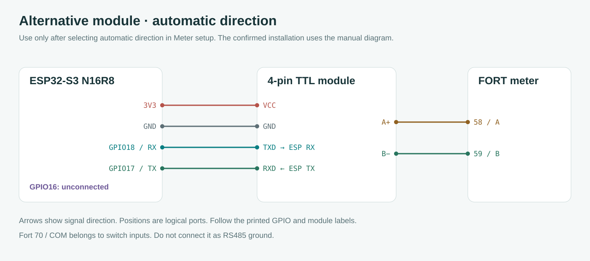

# FortSerialDebug 1.3.1 — field diagnostic guide

**English** · [Bahasa Indonesia](README.id.md) · [Main firmware](../../README.md)

Independent Arduino sketch, Espressif core only, **no external libraries**. Installing it replaces the dashboard temporarily: AP/OLED/RTC/interval recording do not run. Reader settings and captures live in RAM only. All meter requests use read-only function 03.

## 1. Upload once

1. Download/extract the repository ZIP or update your checkout. Open local [FortSerialDebug.ino](FortSerialDebug.ino) in Arduino IDE; keep [partitions.csv](partitions.csv) beside it. The GitHub source page is not a console.
2. Select **ESP32S3 Dev Module**, the board's COM port, **16 MB flash**, **OPI PSRAM**, **Erase All Flash: Disabled**. Native USB: **Hardware CDC and JTAG**, **USB CDC On Boot: Enabled**.
3. Click Upload. Afterwards open **Tools → Serial Monitor** on the same COM port. Select **115200 baud**, **Newline**. `Both NL & CR` also works; do not use `No line ending`.
4. Banner must show **FortSerialDebug 1.3.1**. If missing, type `help` in Serial Monitor input and press Enter. Boot does not wait for USB.

Locally compiled with Arduino ESP32 **2.0.17** through PlatformIO; IDE GUI, other core versions and installed Fort untested. Optional `pio run -d examples/FortSerialDebug` goes in a **computer terminal** from the repository root, not Serial Monitor.

## 2. Keep confirmed wiring

| Module pin | Connection |
| --- | --- |
| VCC / TTL GND | ESP32 3V3 / GND |
| TXD module | GPIO18, ESP32 UART RX |
| RXD module | GPIO17, ESP32 UART TX |
| A+ / B− | Fort 58/A / Fort 59/B |

Supplied module: **four TTL pins, automatic direction**. GPIO16 unconnected. RO/DI/DE-/RE drawings are a manual-direction alternative. Fort 70/COM is switch-input common, not RS485 ground. Preserve confirmed wiring while collecting evidence.



## 3. Type commands into Serial Monitor INPUT

**Commands go into the ESP32 through Serial Monitor, not into the support chat.** Type one line into the Serial Monitor input, press **Enter / Send**, then wait for OUTPUT before the next. Do not type Markdown backticks, `text`, prompts or log labels.

| Step | Type in Serial Monitor INPUT, then Enter | Wait for OUTPUT |
| --- | --- | --- |
| 1 | `x` | `Stopped; queued commands cancelled.` |
| 2 | `status` | `[SETTINGS]`, `[PROFILE]`, plan and UART counters |
| 3 | `diagnose` | `[REPORT_END]`; usually about 10 seconds with silent defaults |

Defaults ID1/9600/8N1 do not prove meter settings. To change settings type e.g. `id 7` or `baud 19200` in the same input, Enter, check the output. No source edit/re-upload needed.

`diagnose` listens for 3 seconds without TX, probes the selected register, runs the configured raw plan, then attempts configured kWh/ratios if enabled. **A silent first address no longer stops the plan.** It uses the current ID/format, not an automatic full scan. Maximum requests: `1 + plan size + 2` with decoding enabled; default silence sends 8 because failed energy skips its ratio read. Transmission/gaps/printing add time. Type `x` to cancel.

### Copy OUTPUT to the support chat afterwards

**Copy the scrolling Serial Monitor OUTPUT and paste it into the support chat for analysis.** Include version, `status` settings, `[SERIAL_INPUT] diagnose`, every following TX/RX/CRC line, and `[REPORT_BEGIN]` through `[REPORT_END]`. Keep HEX intact. Do not paste output back into Serial Monitor.

Illustrative output only, not hardware evidence:

```text
[SERIAL_INPUT] diagnose
[DIAGNOSE_BEGIN] ...
TX [8]: ...
RX [7]: ...
[REPORT_BEGIN] ...
[EVIDENCE] requests=... valid_data=... valid_exception=...
[NO_RX_UNRESOLVED] ...
[REPORT_END] ...
```

## 4. Evidence and physical limits

The four-pin module has no presence/power-good/fault telemetry. Missing/unpowered/failed module, open RX, silent meter, wrong ID/format and a silently unsupported query can all produce identical UART silence. No-byte software observations cannot uniquely identify these causes.

| Summary | Established evidence | Next action |
| --- | --- | --- |
| `LOCAL_UART_ERROR` | Local UART initialization/write failed | Resolve local driver/resources before assessing the module |
| `NO_RX_UNRESOLVED` | Requests attempted, no bytes | Optional rxcheck/paired comparison; independent supply/settings checks |
| `RX_UNVALIDATED` | Bytes without accepted reply | Inspect HEX/UART errors; bounded serial matrix |
| `ECHO_WITHOUT_REPLY` | Complete RX equals request | Paired comparison; not a Fort reply or proof of echo location |
| `TRANSPORT_EXCEPTION_ONLY` | Matching ID/FC83/CRC | Peer replied, register not read;01function,02address/count,03request constraints,04device failure |
| `TRANSPORT_DATA_CONFIRMED` | Matching ID/FC03/count/length/CRC | Raw-map/display comparison; model identity not authenticated |
| `ENERGY_NOT_VERIFIED` | No accepted conversion this run | Missing energy remains unknown, never zero |
| `PROFILE_DECODED_UNVERIFIED` | Configured UInt32/scale/CTPT decoded | Compare the corresponding primary-import energy display |
| `INCOMPLETE_TEST` | Aborted | Repeat before comparing captures |

Type `report` to print last active-test/scan/poll evidence without TX. `stats clear` resets evidence and cumulative UART counters. `status` shows current settings, which may have changed since a test. UART callbacks may arrive later; counters do not measure differential A/B voltage.

RX bytes discarded before TX are counted separately as `pre_tx_bytes` and logged with a bounded prefix; they are not replies to the new request. Paired comparison also stops at `COMPARE_LOCAL_UART_ERROR` if a capture had local UART failures.

### Optional TTL RX check

Type **`rxcheck` in Serial Monitor**, Enter. It stops polling/UART briefly, samples RX 32 times with weak pull-up and 32 times with weak pull-down, restores plain input and reopens UART. No Modbus TX or output HIGH/LOW drive on RX. `x` cancels and still restores UART.

| Log | Meaning and limit |
| --- | --- |
| `RX_WEAK_BIAS_FOLLOWING` | Consistent with high impedance/open lead/unpowered or disabled output; cannot choose a cause |
| `RX_HIGH_HELD` | HIGH resists weak pulldown: driven idle or external bias possible, not proof of module health |
| `RX_LOW_HELD` | LOW resists weak pullup: held-low/break/short/driver-state investigation, not proof of damage |
| `RX_VARIABLE` | Changing levels or competing bias; inspect logs/instruments |

Optional TTL sampling is not an A/B analyzer, voltage or continuity test. It cannot verify VCC; brief pulses can escape sampling.

### Optional paired test: physically change A/B between commands

Do not paste both test commands together. Keep TTL/power unchanged.

1. A/B connected normally: type **`check connected` in Serial Monitor**, Enter, wait for `[REPORT_END]`. First `COMPARE_NEEDS_TWO` is expected.
2. Detach **only A/B at the low-voltage module end**, keeping VCC/GND/TXD/RXD. Do not touch meter measurement/CT wiring.
3. Type **`check isolated` in Serial Monitor**, Enter, wait for `[REPORT_END]` and `[COMPARE]`.
4. Reconnect A/B. Type `compare` to reprint without TX. Copy both runs' complete OUTPUT for support.

States are **operator labels**, not detected facts. RAM captures must share ID/format/pins/probe/plan/profile/timeout; changes/abort block comparison.

- `LOCAL_ACTIVITY_REPRODUCED`: bytes also isolated; those isolated bytes are not Fort-response evidence. Localize module/TTL/ESP activity or noise independently.
- `REPLY_REQUIRES_CONNECTED_PATH`: validated reply only connected in these tests; energy map still separate.
- `CONNECTED_ACTIVITY_ONLY`: bytes only connected, none accepted; signaling/settings unresolved.
- `BOTH_SILENT_UNRESOLVED`: both silent. Measure supply/TTL TX/RX or compare a known-good link; UART software cannot isolate absent/failed hardware. Multimeter checks supply/static levels, not bit timing/CRC.
- `ISOLATION_CONTRADICTED`: validated replies in the user-labeled isolated test; verify physical state or another signal path.

## Choose the test by the observation

| Observation | Use | What to decide next |
| --- | --- | --- |
| No RX bytes | [01 passive RX](cases/01-passive-rx.txt), then [02 single request](cases/02-echo-or-no-reply.txt) | Separate silence without TX from silence after a request. Neither alone proves a wiring fault. |
| Exact request returns to RX | [02 echo/no reply](cases/02-echo-or-no-reply.txt) | TX=RX is echo evidence, not a meter response. Compare context and UART errors; do not assume its physical source. |
| CRC/parity/framing errors | [03 serial matrix](cases/03-serial-matrix.txt) | Compare the same ID across configured baud/parity modes; inspect driver counters and raw bytes. A wrong register by itself does not validate corrupted data. |
| CRC-valid exception | [04 exception/register](cases/04-register-exception.txt) | Communication replied; inspect exception code and the queried address/count independently. |
| Communication works, energy profile does not | [05 raw map audit](cases/05-raw-map-audit.txt) | Disable conversion, compare raw words/register support and1/2/3-word reads at the ambiguous energy entry; no fabricated kWh. |
| Raw energy and ratios look plausible | [06 configured kWh](cases/06-configured-kwh.txt) | Decode with explicitly logged addresses/scale/order and compare the corresponding meter energy page. |
| Response may be late | [07 timeout comparison](cases/07-timeout-comparison.txt) | Hold ID/baud/parity/register constant and change timeout. A longer timeout does not bypass CRC. |
| Word order is uncertain | [08 word-order comparison](cases/08-word-order-comparison.txt) | Compare labeled normal/swapped interpretations. The sketch does not automatically choose whichever number looks plausible. |

Each TXT contains **Serial Monitor INPUT commands**. Open one TXT, type each non-comment line into Serial Monitor INPUT, Enter, wait for completion, then the next. Do not type its path. Copy resulting OUTPUT to the support chat. `#` lines are comments. Multi-line paste is optional only if the terminal preserves newlines. The console queues up to **16 complete commands**, including while a UART wait/listen is active; each line is at most **95 characters**. Queue/line overflow is reported explicitly. **x** immediately aborts and cancels queued commands. Commands following an ongoing scan are deferred until scan finishes. Upload once, select different tests through Serial.

## Runtime reference

| Command | Meaning and accepted values |
| --- | --- |
| `help`, `status` | Help or full settings, scan lists, audit plan and UART counters |
| `basic`, `listen 10` | Passive RX for 5 seconds or specified 1–30 seconds; no Modbus request |
| `intermediate`, `diagnose`, `deeper` | Probe only; staged diagnosis; raw plan plus optional configured energy decode |
| `id 7` | Reader target 1–247; broadcast ID0 is never used |
| `baud 19200`, `parity E` | Reader baud 1200–1000000; parity N/E/O, 8 data bits, 1 stop bit. Fort manual lists 1200–38400; wider diagnostic rates are experiments, not claims of device support. |
| `pins 18 17` | RX GPIO then TX GPIO, distinct. Guarded choices: 10–18,21,39–42,47. USB, flash/PSRAM, boot/console and the known I2C/button/buzzer/RGB pins are excluded. Default wiring remains18/17. |
| `timeout 1200` | Response budget 50–5000 ms, starts after TX flush |
| `interval 3000` | Repeated-read target 100–60000 ms; actual reads/printing can take longer |
| `probe 0080 1` | Set scan/intermediate probe: HEX PDU address, 1–3 words |
| `reg 0082 2` | One bounded raw read; HEX address (optional0x), 1–3 words; no40001 translation |
| `range 1 16` | Inclusive scan ID range |
| `scanmode current` | Scan selected IDs with current baud/parity only |
| `scanmode matrix` | Scan selected IDs across configured baud/parity lists |
| `bauds 9600 19200` | Replace list with 1–6 unique decimal rates; validated atomically |
| `parities NE` | Replace list with 1–3 unique N/E/O modes |
| `scan` | Probe configured combinations. Stop on matching valid data or exception, separately from energy profile. No settings are written to the meter. |
| `plan clear`, `plan add 0080 1`, `plan show` | Configure up to8 raw read queries for deeper; HEX addresses/count1–3 |
| `energy 0082`, `ratios 002C` | Set 2-word UInt32 energy and 3-word PT numerator/PT denominator/CT locations |
| `scale 0.001`, `order normal`, `order swap` | Positive finite scale1e-12–1e6 and UInt32 high/low word ordering; interpretation is printed explicitly |
| `decode off`, `decode on` | Disable/enable kWh interpretation, including read/poll; raw reg/plan remains available |
| `read`, `poll` | One configured kWh/CTPT reading or toggle repeated reads |
| `report`, `rxcheck` | Last-test evidence without TX; optional weak-bias TTL input test |
| `check connected`, `check isolated`, `compare` | User-labeled paired tests; compare RAM snapshots without TX |
| `stats clear`, `x` | Clear local UART error counters; abort/cancel queued work |

Successful configuration changes print settings. Invalid values leave the old setting intact. Changes are not persisted; restart restores defaults. Changing UART/profile settings stops polling, so a partially applied multi-line configuration does not generate automatic reads. Function03, frame integrity and storage protections are fixed safety boundaries, not arbitrary runtime overrides.

## Scan size and elapsed time

A slave silently rejecting the selected probe can still be missed. Change `probe` based on the manual or run the multi-address diagnosis; no register is universal.

Default matrix: IDs1–247 × six documented baud rates × N/E/O = **4,446 candidates**. For an initial test use one ID and the configured format. **Type each following line into Serial Monitor INPUT, then Enter**, waiting for completion:

```text
x
range 1 1
scanmode current
probe 0034 1
scan
```

For a limited matrix, use case03 or set smaller lists. Current mode has `ID count` candidates; matrix has `ID count × baud count × parity count`. No-reply time is roughly candidates × timeout plus transmission/silent-gap/printing costs. At the default800ms, a full silent scan is about an hour or longer. `status` prints the actual candidate count; `x` cancels immediately during waits.

## Read the result, then choose an action

| Log | Meaning | Next action |
| --- | --- | --- |
| `COMM_FOUND` / `VALID_RESPONSE` | Matching ID/function/count/length/CRC response | Continue the raw map, then compare configured decoding with the meter |
| `COMM_VALID_EXCEPTION` | Matching ID, FC83 and valid CRC | Code01: check documented function/model;02: address/count/map;03: quantity/value constraints;04: device-side failure. The sketch does not clear/reset the meter. |
| `EXACT_TX_ECHO` | Complete RX frame equals the8-byte request | Remains rejected; receiver waits for a separate valid response within the same budget |
| `MISMATCH`, `SHORT_FRAME`, `WRONG_FRAME` | Corrupt/incomplete or incompatible response shape | Preserve hex and UART counters; compare formats/timing before inferring an address-map fault |
| `TIMEOUT` | No RX bytes during the request budget | Compare passive/single/matrix tests; no automatic wiring verdict |
| `NO_VALID_RESPONSE` | Some RX, no accepted data/exception | Distinguish echo, corruption and shape mismatch using accompanying logs |
| `RX_OVERFLOW` | Only the first64 bytes of an oversized frame retained | Result rejected; inspect traffic volume and driver FIFO/buffer counters |
| `DECODE_DISABLED` / `PROFILE_NOT_CONFIRMED` | Conversion disabled or energy/CTPT rejected | Use raw plan; a prior valid protocol reply is still valid evidence |
| `UART_EVENTS` | Cumulative parity/framing/FIFO/buffer/break events and RX logic state | `stats clear` starts a comparison. Zero counters do not prove clean differential A/B signaling. |

Addresses are literal HEX PDU values: `0080` is 128 decimal, without40001/minus-one translation. One word is2bytes: `reg 0082 2` sends address `00 82` and requests 4 data bytes. Typical manual length 2/4 fields are bytes. Case05 compares 1/2/3-word reads; 3 words includes the next address and is not decoded as 2-word energy. Primary float bits are not UInt32 and must not receive CT/PT again if already primary.

The default map follows the visually checked manual pages: energy 0x0082–83, PT/CT 0x002C–2E, scale 0.001, high word/byte first. The manual visibly prints energy length 3 despite two addresses and ulong type; retain that ambiguity. Configuring another address/scale/order is an explicitly labeled experiment, not independent verification of that map. Primary float words are raw-audited, not guessed into a kWh value. [Manual audit](../../docs/DESIGN.md#manual-visual-audit-and-diagnostic-follow-up--26-october-2026).

## Boundaries and verification

No register writes, broadcast, meter resets, NVS writes or filesystem operations. No DE pin used for the supplied automatic module. RX 64 bytes/frame; detailed logging capped at 4 frames/request, passive logging 8 chunks; remaining traffic is still counted/validated. Callback error counts are atomic and console output stays in loop context. UART buffer timing is not a logic-analyzer measurement; no RX does not prove no signal on A/B. Serial output itself affects timing.

Tests execute the actual INO with deterministic host UART/console mocks, including runtime settings, invalid values, multiple result classes, queuing, stop and conversion. PlatformIO compiles this sketch independently (`pio run -d examples/FortSerialDebug`). Hardware timing/mapping and the Arduino IDE GUI remain untested. Restore the main firmware after diagnostics; keep partition CSV and flash-erase selection consistent with its guide.

### Transport corrections in 1.3.1

The pre-TX guard observes a continuous quiet interval and discards bytes arriving during that wait. `[BUS_NOT_QUIET]` means no request was sent within the guard budget; inspect the logged pre-TX activity without concluding that the module is absent or damaged. Short-frame polling is finer around the expected frame gap to avoid merging an echo and a legal fast reply. UART initialization failures are retried. These are software-buffer observations; a delayed task can still miss a physical gap, and RTU has no transaction ID for conclusive attribution of every delayed response.
